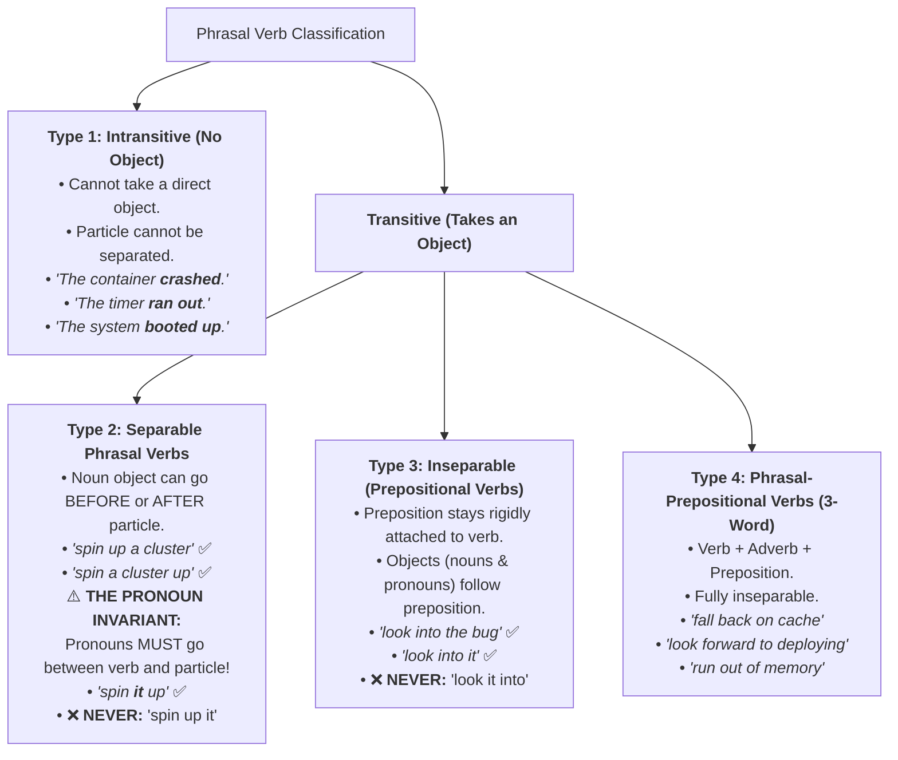

# Phrasal Verbs High-Frequency Guide: Syntax, Separability & Technical Operations ⚙️🚀

> **Level:** CEFR B1–C1 (Phrasal Verb Mechanics & Particle Semantics)  
> **Primary References:** Raymond Murphy (*English Grammar in Use*, Units 137–145); Michael Swan (*Practical English Usage*, §19); *Collins COBUILD Phrasal Verbs Dictionary*  
> **Core Premise:** A **phrasal verb** is a multi-word predicate formed by a lexical verb combined with an adverbial particle, a preposition, or both. Their meaning is overwhelmingly **idiomatic and non-compositional** (*“roll back”* does not mean physical rolling). In software engineering and cloud operations, phrasal verbs dominate daily conversation and runbooks (*“spin up a pod”*, *“tear down a cluster”*, *“fall back on cache”*). Mastering their **transitivity** and the non-negotiable **pronoun separability invariant** is mandatory for professional fluency.

---

## 1. The Phrasal Verb Taxonomy & Separability Architecture



---

## 2. The Non-Negotiable Pronoun Invariant ("The Sandwich Rule")

This is one of the most frequently violated rules by non-native software engineers:

$$\mathbf{\text{Verb}} + \mathbf{\text{PRONOUN (it / them / him / her / us)}} + \mathbf{\text{Particle}} \quad \text{--- NEVER: Verb + Particle + Pronoun}$$

When the direct object of a **separable phrasal verb** is a personal pronoun (*it, them*), the pronoun **must be sandwiched** between the verb and the particle:

| Separable Phrasal Verb | With a Full Noun Phrase Object | With a Personal Pronoun (*it / them*) | ❌ Fatal Bug Pattern |
| :--- | :--- | :--- | :--- |
| **`Spin up`** | *“Spin up the cluster.”* ✅<br>*“Spin the cluster up.”* ✅ | *“Spin **it** up.”* ✅ | ❌ *Spin up it.* |
| **`Roll back`** | *“Roll back the deployment.”* ✅<br>*“Roll the deployment back.”* ✅ | *“Roll **it** back.”* ✅ | ❌ *Roll back it.* |
| **`Back up`** | *“Back up the database.”* ✅<br>*“Back the database up.”* ✅ | *“Back **it** up.”* ✅ | ❌ *Back up it.* |
| **`Tear down`** | *“Tear down the test nodes.”* ✅<br>*“Tear the test nodes down.”* ✅ | *“Tear **them** down.”* ✅ | ❌ *Tear down them.* |
| **`Shut down`** | *“Shut down the worker.”* ✅<br>*“Shut the worker down.”* ✅ | *“Shut **it** down.”* ✅ | ❌ *Shut down it.* |
| **`Figure out`** | *“Figure out the root cause.”* ✅<br>*“Figure the root cause out.”* ✅ | *“Figure **it** out.”* ✅ | ❌ *Figure out it.* |

---

## 3. High-Frequency Technical & DevOps Phrasal Verbs Catalog

Grouped by operational engineering lifecycle:

### 1. Infrastructure & Lifecycle Operations
- **`spin up`** (separable): Initialize or provision virtual machines or containers (*“Spin up three worker pods”*).
- **`tear down`** (separable): Destroy, delete, or deprovision temporary testing infrastructure (*“Tear down the test sandbox”*).
- **`boot up`** (intransitive / separable): Power on an operating system or hardware node (*“The server boots up in 4 seconds”*).
- **`scale out / scale in`** (intransitive): Add or remove horizontal nodes to balance elastic traffic (*“Scale out during peak hours”*).
- **`scale up / scale down`** (intransitive): Increase or decrease vertical CPU/RAM resources on a single node.

### 2. Version Control & Release Engineering
- **`roll out`** (separable): Gradually deploy a new release to production users (*“Roll out the new checkout UI to 10% of users”*).
- **`roll back`** (separable / intransitive): Revert to a previous stable software release after an incident (*“Roll it back immediately”*).
- **`branch off`** (inseparable): Create a child git branch from a parent branch (*“Branch off from `main`”*).
- **`pull down`** (separable): Fetch and download code or images locally (*“Pull down the latest Docker image”*).
- **`push up`** (separable): Upload local commits to a remote repository (*“Push up your feature branch”*).

### 3. Resilience, Fault Tolerance & Diagnostics
- **`fall back on`** (3-word inseparable): Revert to an emergency secondary mechanism when the primary fails (*“Fall back on the local cache”*).
- **`look into`** (inseparable): Investigate a problem or defect (*“The SRE team is looking into the latency spike”*).
- **`drill down into`** (3-word inseparable): Examine fine-grained, granular telemetry metrics (*“Drill down into trace spans”*).
- **`track down`** (separable): Locate a subtle bug through systematic debugging (*“We tracked down the memory leak to a circular pointer”*).
- **`bail out`** (intransitive): Abort execution early when validation fails (*“If the token is missing, bail out with a 401”*).
- **`weed out`** (separable): Remove unwanted, malformed, or malicious elements (*“Weed out fraudulent requests”*).

---

## 4. Practical Dual-Domain Examples

### Everyday Conversation & General Situations

1. *Separable Noun:* *Please **turn off the lights** before you go to sleep.*
2. *Separable Pronoun:* *The radio is too loud; please **turn it down**.*
3. *Intransitive:* *We had to wake up at dawn because our flight was **taking off** at 07:00.*
4. *Inseparable:* *I **ran into an old friend** at the supermarket yesterday.*
5. *3-word Inseparable:* *We have **run out of coffee beans**; can you buy some on your way home?*
6. *Separable Pronoun:* *If you don't know what that word means, **look it up** in the dictionary.*
7. *Inseparable:* *The police are **looking into the circumstances** surrounding the accident.*
8. *Separable:* *She **gave up smoking** three years ago and feels much healthier.*

### Software Engineering & Technical Runbooks

9. *Separable Pronoun:* *The container configuration is corrupted; delete it and **spin it up** again.*
10. *Separable Noun:* *The automated CI pipeline will **tear down the staging environment** after the test suite finishes.*
11. *Inseparable:* *Our security engineers are **looking into an unauthorized API access attempt** from an unknown IP range.*
12. *3-word Inseparable:* *If the external payment gateway experiences downtime, the system **falls back on queued transactions**.*
13. *Intransitive:* *Under extreme write concurrency, the worker thread pool **timed out** after 30 seconds.*
14. *Separable Pronoun:* *A regression was discovered in v2.4.0, so the on-call engineer **rolled it back** to v2.3.9.*
15. *Separable Noun:* *Use Prometheus histograms to **track down latency bottlenecks** in downstream microservices.*
16. *Intransitive:* *The autoscaler automatically **scales out** the worker fleet whenever CPU utilization surpasses 75%.*

---

## 5. Common Antipattern Diagnostic Bug-and-Patch Table

| ❌ Broken Anti-Pattern (Bug) | Corrected Idiomatic English (Patch) | Diagnostic Grammar Explanation |
| :--- | :--- | :--- |
| ❌ *The node crashed; let’s **spin up it**.* | ✅ *The node crashed; let’s **spin it up**.* | Personal pronoun objects (*it*) must be sandwiched between the verb and particle in separable phrasal verbs. |
| ❌ *The release failed; we must **roll back it**.* | ✅ *The release failed; we must **roll it back**.* | Pronoun invariant: *roll it back*, never *roll back it*. |
| ❌ *The SRE team is **looking the bug into**.* | ✅ *The SRE team is **looking into the bug**.* | *Look into* is an inseparable prepositional verb; the particle cannot be separated from the verb. |
| ❌ *We **ran out of the memory**.* | ✅ *We **ran out of memory**.* | Non-count abstract resources like system memory omit the definite article in general capacity statements. |
| ❌ *Can you **figure out it**?* | ✅ *Can you **figure it out**?* | Separable phrasal verbs mandate the pronoun sandwich (*figure it out*). |
| ❌ *The pod was unhealthy, so we **tore down it**.* | ✅ *The pod was unhealthy, so we **tore it down**.* | Past tense separable verb: *tore it down*. |
| ❌ *We must **fall back the cache**.* | ✅ *We must **fall back on / upon the cache**.* | The phrasal-prepositional verb requires the complete prepositional sequence: *fall back on*. |

---

## 6. Self-Assessment Practice Exercises

### Exercise 1: The Pronoun Sandwich Test
Rewrite each sentence by replacing the bracketed noun phrase with the appropriate pronoun (*it* or *them*):
1. *The developer rolled back [the breaking migration].*
2. *Before merging, make sure you back up [the production database].*
3. *The automated script spun up [the four container instances].*
4. *We need to tear down [the staging clusters] tonight.*
5. *The support engineer tracked down [the intermittent race condition].*

### Exercise 2: Separability & Preposition Selection
Choose the grammatically correct option:
6. If the Redis server is unresponsive, we must (fall back on / fall back / fall on) PostgreSQL.
7. The lead architect promised to (look the memory leak into / look into the memory leak).
8. The server reached 100% CPU and (shut down / shut it down) automatically.
9. When the load test completes, please (tear down it / tear it down / tear down them).
10. Can you (pull down the latest image / pull the latest image down / both are correct)?

---

## 7. Answer Key with Diagnostic Explanations

1. **The developer rolled it back.** — Separable phrasal verb requires pronoun sandwich (*rolled it back*).
2. **Before merging, make sure you back it up.** — Pronoun *it* must precede the particle *up*.
3. **The automated script spun them up.** — Plural pronoun *them* sandwiched between *spun* and *up*.
4. **We need to tear them down tonight.** — Separable verb *tear down* takes pronoun *them* internally.
5. **The support engineer tracked it down.** — Pronoun *it* placed between *tracked* and *down*.
6. **fall back on** — The three-word phrasal-prepositional verb requires both *back* and *on*.
7. **look into the memory leak** — *Look into* is an inseparable prepositional verb; particle cannot be split.
8. **shut down** — Intransitive usage describing an automatic state transition without an external agent.
9. **tear it down** — Singular container/environment represented by sandwiched pronoun *it*.
10. **both are correct** — With a full noun phrase (*the latest image*), separable phrasal verbs allow the noun before or after the particle.

---

## 8. High-Density Revision Flashcards

```
Q: What is the 'Pronoun Sandwich Rule' for separable phrasal verbs?
A: When the object is a pronoun (it, them, him, her), it MUST go BETWEEN the verb and particle.
   Example: 'Spin it up' ✅ (NEVER: 'Spin up it' ❌).
```

```
Q: What is the difference between separable and inseparable phrasal verbs?
A: • Separable (Verb + Adverb): Noun can go before or after particle; pronouns MUST go between.
   • Inseparable (Verb + Preposition): Nouns and pronouns MUST ALWAYS follow the preposition ('look into it').
```

```
Q: Give three high-frequency computing phrasal verbs for cluster lifecycles:
A: 1. 'Spin up' = Provision / start up nodes.
   2. 'Tear down' = Destroy / deprovision test infrastructure.
   3. 'Scale out' = Add horizontal nodes to handle traffic surges.
```
