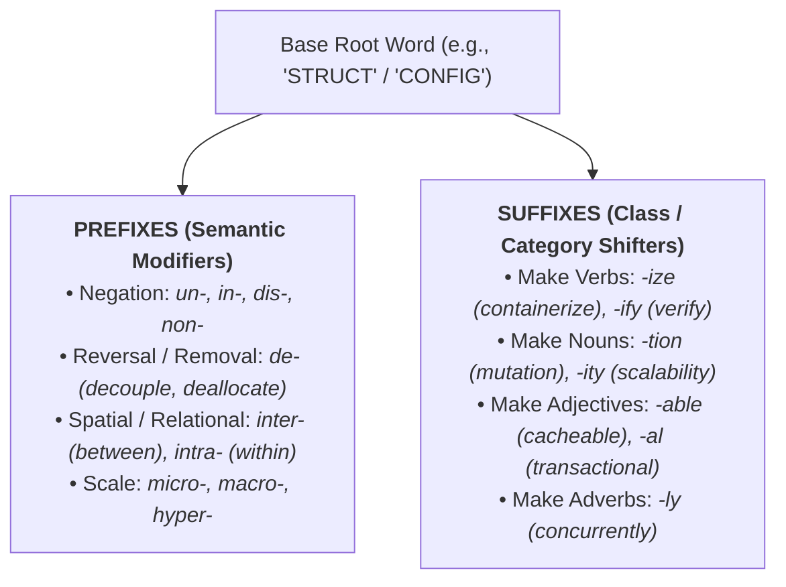
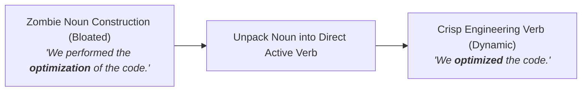

# Prefixes, Suffixes & Word Formation: Morphology & Technical Compounding 🧬🔤

> **Level:** CEFR B2–C1 (Morphology, Derivational Affixation & Nominalization Control)  
> **Primary References:** Michael Swan (*Practical English Usage*, §28, 30); Laurie Bauer (*English Word-Formation*); Google Technical Writing Style Guide  
> **Core Premise:** The English language expands its lexicon through **derivational morphology**: attaching **prefixes** (which alter semantic meaning) and **suffixes** (which shift syntactic parts of speech) to base root words. In software engineering, morphology powers technical neologisms (*“containerize”*, *“decouple”*, *“idempotency”*). However, misuse of affixation—particularly excessive **nominalization** (turning active verbs into suffocating “zombie nouns”)—destroys readability.

---

## 1. The Morphological Architecture of English



---

## 2. Productive Technical Prefixes

Prefixes attach to the front of a base morpheme to alter its polarity, spatial relationship, or operational direction:

| Prefix Family | Semantic Function | Computing / Engineering Examples | Critical Nuance |
| :--- | :--- | :--- | :--- |
| **`de-`** | **Reversal, removal, undoing** | *decouple, deallocate, decrypt, deserialize, deactivate* | Reversing an active technical action (*deallocate memory*). |
| **`un-`** | **Reversal of state or negation** | *unmount, unwrap, unbuffered, unsubscribe, unhandled* | Often used for OS operations (*unmount disk*). |
| **`dis-`** | **Severance, disconnection, negation** | *disconnect, disable, dispatch, disassemble, disallowed* | Breaking an active link (*disable port, disconnect socket*). |
| **`non-`** | **Objective absence / neutrality** | *non-blocking, non-volatile, non-relational, non-deterministic* | Neutral fact; lacks emotional/moral judgment. |
| **`inter-`** | **Between or among distinct entities** | *inter-service, inter-process communication (IPC), internet* | Spans across boundaries between distinct modules. |
| **`intra-`** | **Within a single entity / internal** | *intra-node, intranet, intra-cluster, intra-datacenter* | Confined strictly inside one single system or machine. |
| **`re-`** | **Repetition or restoration** | *reindex, refactor, retry, reboot, replicate, regenerate* | Executing an operation again. |
| **`mis-`** | **Erroneously, incorrectly, defectively** | *misconfiguration, misallocated, mismatch, misinterpretation* | Error in execution (*a YAML misconfiguration*). |

> [!IMPORTANT]
> **The Inter- vs. Intra- Trap in Cloud Networking:**
> - **`Inter-service traffic`**: Network packets moving **between** Service A and Service B across network interfaces.
> - **`Intra-node traffic`**: Memory or loopback communications occurring **inside a single** host server.

---

## 3. Productive Suffixes by Part-of-Speech Category

Suffixes change the grammatical function of a base word, transforming verbs into nouns, adjectives into verbs, or nouns into adjectives:

### 1. Noun-Forming Suffixes (`→ Noun`)
- **`-tion / -sion`** (State / Action): *optimize $\rightarrow$ optimization; migrate $\rightarrow$ migration; collide $\rightarrow$ collision*.
- **`-ity`** (Quality / Condition): *scalable $\rightarrow$ scalability; reliable $\rightarrow$ reliability; idempotent $\rightarrow$ idempotency*.
- **`-ment`** (Concrete result / action): *deploy $\rightarrow$ deployment; manage $\rightarrow$ management; govern $\rightarrow$ government*.
- **`-ance / -ence`** (Operational state): *persist $\rightarrow$ persistence; maintain $\rightarrow$ maintenance; resilient $\rightarrow$ resilience*.
- **`-er / -or`** (Agent / Subsystem): *consume $\rightarrow$ consumer; produce $\rightarrow$ producer; schedule $\rightarrow$ scheduler*.

### 2. Verb-Forming Suffixes (`→ Verb`)
- **`-ize / -ise`** (To make / cause to become): *container $\rightarrow$ containerize; modular $\rightarrow$ modularize; serial $\rightarrow$ serialize*.
- **`-ify`** (To make / render): *simple $\rightarrow$ simplify; valid $\rightarrow$ verify / validate; identity $\rightarrow$ identify*.
- **`-en`** (To increase / become): *tight $\rightarrow$ tighten; hard $\rightarrow$ harden (e.g., OS hardening); wide $\rightarrow$ widen*.

### 3. Adjective-Forming Suffixes (`→ Adjective`)
- **`-able / -ible`** (Capable of being): *cache $\rightarrow$ cacheable; config $\rightarrow$ configurable; access $\rightarrow$ accessible; deduct $\rightarrow$ deductible*.
- **`-al`** (Relating to): *transaction $\rightarrow$ transactional; computation $\rightarrow$ computational; logic $\rightarrow$ logical*.
- **`-ous / -ious`** (Possessing quality of): *synchrony $\rightarrow$ synchronous; concurrency $\rightarrow$ concurrent*.

---

## 4. The Nominalization Trap: Eliminating "Zombie Nouns"

A **nominalization** (or *“zombie noun”*) is a vigorous, active verb that has been entombed inside a heavy noun suffix (*-tion, -ment, -ance*). Excessive nominalization suffocates technical writing, turning crisp operational prose into bloated, bureaucratic sludge:



### The Zombie-to-Verb Refactoring Matrix:

| ❌ Bloated Nominalization Sludge | ✅ Crisp Active Verb Equivalent | Words Saved & Cognitive Benefit |
| :--- | :--- | :--- |
| ❌ *“We conducted an **investigation** of the issue.”* | ✅ *“We **investigated** the issue.”* | Direct, active past simple verb. |
| ❌ *“The system performs **validation** of the tokens.”* | ✅ *“The system **validates** tokens.”* | Replaces weak verb *performs* + noun with active *validates*. |
| ❌ *“We achieved the **reduction** of latency.”* | ✅ *“We **reduced** latency.”* | Eliminates dummy verb *achieved*. |
| ❌ *“Make an **adjustment** to the config file.”* | ✅ *“**Adjust** the configuration file.”* | Direct imperative command. |
| ❌ *“The script is responsible for the **execution** of builds.”* | ✅ *“The script **executes** builds.”* | Eliminates zombie phrase *responsible for the execution of*. |
| ❌ *“Provide **assistance** to developers.”* | ✅ *“**Assist / Help** developers.”* | Direct, professional action verb. |

---

## 5. Practical Dual-Domain Examples

### Everyday Conversation & General Writing

1. *Prefix un-:* *The mystery remained completely **unsolved** for twenty years.*
2. *Prefix re-:* *I need to **reheat** my tea because it went cold.*
3. *Suffix -able:* *This sweater is machine **washable** at thirty degrees.*
4. *Prefix mis-:* *A tragic **misunderstanding** caused the two friends to quarrel.*
5. *Suffix -ify:* *Can you please **clarify** what time the party begins?*
6. *Prefix de-:* *The train was **delayed** due to icy tracks.*
7. *Curing nominalization:* *We made a decision $\rightarrow$ We **decided** to leave early.*
8. *Prefix non-:* *This flight is **non-stop** from London to Tokyo.*

### Software Engineering & Technical Documentation

9. *Prefix de-:* *The serialization engine **deserializes** the incoming binary protobuf payload into memory.*
10. *Prefix non-:* *Node.js relies on an event-driven, **non-blocking** I/O model to handle concurrent web sockets.*
11. *Prefix inter- vs intra-:* *While **intra-cluster** latency is sub-millisecond, **inter-region** traffic suffers from a 70ms round-trip delay.*
12. *Suffix -ize:* *Our infrastructure team plans to **containerize** legacy monoliths using Docker and Helm.*
13. *Suffix -able:* *Responses with `Cache-Control: public` headers are deemed **cacheable** by intermediate CDN proxies.*
14. *Suffix -ity:* *The **idempotency** of payment requests prevents customers from being billed twice.*
15. *Prefix mis-:* *A YAML **misconfiguration** in the Kubernetes ingress manifest exposed internal monitoring ports.*
16. *Curing nominalization:* *The gateway performs the **verification** of JWTs $\rightarrow$ The gateway **verifies** JWTs.*

---

## 6. Common Antipattern Diagnostic Bug-and-Patch Table

| ❌ Broken Anti-Pattern (Bug) | Corrected Idiomatic English (Patch) | Diagnostic Grammar Explanation |
| :--- | :--- | :--- |
| ❌ *The method does the **calculation** of totals.* | ✅ *The method **calculates** totals.* | Eliminate weak auxiliary *does* and unpack nominalized noun *calculation* into active verb *calculates*. |
| ❌ *We noticed high **intra-region** network lag between US and EU.* | ✅ *We noticed high **inter-region** network lag between US and EU.* | Traffic between two distinct global regions is *inter-region*; *intra-region* means within the same region. |
| ❌ *This function is not **reversable**.* | ✅ *This function is not **reversible**.* | Spelling rule: roots derived from Latin second/third conjugation take *-ible*, not *-able*. |
| ❌ *The system achieved the **stabilization** of throughput.* | ✅ *The system **stabilized** throughput.* | Eliminate zombie noun *stabilization* and hollow verb *achieved*. |
| ❌ *We must **un-allocate** the memory.* | ✅ *We must **deallocate** the memory.* | The standard computing prefix for releasing allocated system resources is *de-*, not *un-*. |
| ❌ *He showed great **resiliance** during the outage.* | ✅ *He showed great **resilience** during the outage.* | Orthographic precision: *resilience* ends with *-ence*, not *-ance*. |

---

## 7. Self-Assessment Practice Exercises

### Exercise 1: Prefix Selection (Choose between *inter-*, *intra-*, *de-*, *non-*, or *mis-*)
1. Communication occurring strictly within a single server node is termed ________-process communication.
2. The network router suffered from a severe packet routing ________-configuration.
3. Network traffic passing between our European and North American data centers is ________-continental.
4. When memory is no longer referenced by active pointers, the runtime engine will ________-allocate it.
5. In asynchronous architectures, database calls should be ________-blocking to avoid stalling event loops.

### Exercise 2: Zombie Noun Decapitation (Refactor into crisp active verbs)
6. *The security daemon is responsible for the detection of malware.*
7. *We performed an evaluation of three different cloud storage providers.*
8. *The cron job makes an execution of the backup routine every midnight.*
9. *Our team reached an agreement on the new API schema.*
10. *This middleware handles the transformation of incoming JSON into SQL queries.*

---

## 8. Answer Key with Diagnostic Explanations

1. **intra-** — Communications confined within a single node are *intra-process* or *intra-node*.
2. **mis-** — An erroneous setup error is a *misconfiguration*.
3. **inter-** — Spanning between two separate continents requires *inter-continental*.
4. **de-** — Freeing previously reserved resources requires *deallocate*.
5. **non-** — Operations that do not block threads are *non-blocking*.
6. **Rewrite:** *The security daemon **detects** malware.*  
   *Explanation:* Unpacks *is responsible for the detection of* into active present simple *detects*.
7. **Rewrite:** *We **evaluated** three different cloud storage providers.*  
   *Explanation:* Replaces *performed an evaluation of* with dynamic past verb *evaluated*.
8. **Rewrite:** *The cron job **executes** the backup routine every midnight.*  
   *Explanation:* Replaces *makes an execution of* with direct verb *executes*.
9. **Rewrite:** *Our team **agreed** on the new API schema.*  
   *Explanation:* Replaces *reached an agreement on* with active verb *agreed*.
10. **Rewrite:** *This middleware **transforms** incoming JSON into SQL queries.*  
    *Explanation:* Replaces *handles the transformation of* with active verb *transforms*.

---

## 9. High-Density Revision Flashcards

```
Q: What is the semantic difference between the prefixes 'inter-' and 'intra-' in systems engineering?
A: • 'INTER-' = BETWEEN or ACROSS distinct entities (e.g., inter-service, inter-region, internet).
   • 'INTRA-' = WITHIN or INSIDE a single entity (e.g., intra-node, intra-cluster, intranet).
```

```
Q: What is a 'Zombie Noun' (Nominalization), and why should it be refactored?
A: A nominalization is an active verb trapped inside a noun suffix (-tion, -ment, -ance).
   It bloats prose with weak dummy verbs (e.g., 'perform the calculation of' -> 'calculate').
```

```
Q: Which prefix is standard in computing for reversing operations: 'un-' or 'de-'?
A: 'DE-' is standard for resource lifecycles (deallocate, deserialize, decrypt, decouple),
   while 'UN-' is common for state changes (unmount, unwrap, unsubscribe).
```
