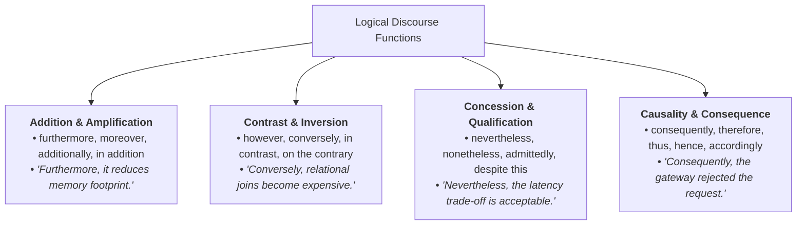

# Transition Words & Discourse Markers: Rhetorical Cohesion & Flow 🌉📑

> **Level:** CEFR B2–C2 (Discourse Cohesion, Conjunctive Adverbs & Punctuation Mechanics)  
> **Primary References:** Michael Swan (*Practical English Usage*, §240–270); M.A.K. Halliday & Ruqaiya Hasan (*Cohesion in English*)  
> **Core Premise:** Clear technical prose is not a disjointed series of isolated sentences; it is a coherent logical narrative. **Transition words** (or **discourse markers** and **conjunctive adverbs**) function as navigational signposts that signal to the reader how the incoming proposition relates to the preceding one—whether it adds evidence (*furthermore*), contrasts assumptions (*conversely*), concedes an objection (*admittedly*), or proves causality (*consequently*).

---

## 1. The Discourse Cohesion Architecture



---

## 2. Master Semantic Taxonomy of Discourse Markers

| Logical Relation | High-Impact Discourse Markers | Semantic Function | Engineering Illustration |
| :--- | :--- | :--- | :--- |
| **Addition / Amplification** | *Furthermore, moreover, additionally, in addition, besides* | Adds a stronger, supporting argument in the same direction. | *The patch fixes the race condition; **furthermore**, it simplifies thread synchronization.* |
| **Direct Contrast** | *In contrast, conversely, on the other hand, whereas* | Contrasts two opposing, mutually exclusive paradigms. | *SQL databases offer ACID consistency; **conversely**, NoSQL stores prioritize partition tolerance.* |
| **Concession (Unexpectedness)** | *Nevertheless, nonetheless, despite this, granted, admittedly* | Acknowledges a counter-fact while maintaining the primary conclusion. | *The migration was complex; **nevertheless**, zero downtime was experienced.* |
| **Causal Consequence** | *Consequently, therefore, thus, hence, as a result, accordingly* | Demonstrates a direct, logical, or mathematical result. | *The token expired; **consequently**, the client was redirected to the login flow.* |
| **Exemplification** | *Specifically, namely, for instance, to illustrate* | Narrows down a broad concept to concrete instances. | *Many components were refactored, **specifically** the billing and authentication modules.* |
| **Reformulation / Clarity** | *In other words, that is to say, put simply* | Rephrases complex logic for clarity or pedagogical focus. | *The algorithm is idempotent; **in other words**, executing it ten times produces the same state.* |
| **Sequential Progression** | *Initially, subsequently, thereafter, ultimately* | Steps through chronological stages or architectural pipelines. | *The proxy validates the TLS cert; **subsequently**, it forwards the decrypted payload.* |

---

## 3. Punctuation Mechanics: The Semicolon & Comma Invariant

Conjunctive adverbs (*however, therefore, furthermore, consequently*) are **not coordinating conjunctions**. Joining two independent clauses with just a comma and a conjunctive adverb produces a **fatal comma splice**:

$$\mathbf{\text{Independent Clause 1}} \mathbf{;} + \mathbf{\text{Conjunctive Adverb}} \mathbf{,} + \mathbf{\text{Independent Clause 2}}$$
$$\mathbf{\text{Independent Clause 1}} \mathbf{.} \quad \mathbf{\text{Conjunctive Adverb}} \mathbf{,} + \mathbf{\text{Independent Clause 2}}$$

| Structure | Syntax Example | Status |
| :--- | :--- | :--- |
| ❌ **Comma Splice Bug** | *The build failed, therefore, we rolled back the deployment.* | ❌ **SYNTAX ERROR** (Comma Splice) |
| ✅ **Semicolon + Comma** | *The build failed**; therefore,** we rolled back the deployment.* | ✅ **CORRECT** |
| ✅ **Two Independent Sentences** | *The build failed**. Therefore,** we rolled back the deployment.* | ✅ **CORRECT** |

---

## 4. The Resultative "Thereby + Gerund" Structure

In advanced technical documentation and RFCs, engineers use **`thereby + Verb-ing`** to describe an automatic, secondary outcome without starting a new clause:

$$\text{Action Clause} \mathbf{,} + \mathbf{thereby} + \mathbf{V\text{-ing (Gerund)}} + \text{Result}$$

- *“We introduced an in-memory Redis cache, **thereby reducing** database read load by 80%.”*
- *“The proxy compresses outgoing JSON payloads, **thereby saving** outbound bandwidth costs.”*
- *“The kernel isolates container namespaces, **thereby preventing** privilege escalation across tenants.”*

---

## 5. Practical Dual-Domain Examples

### Everyday Conversation & General Writing

1. *Addition:* *The hotel was clean; **furthermore**, the staff was incredibly hospitable.*
2. *Contrast:* *My brother loves cold climates; **conversely**, I prefer tropical heat.*
3. *Concession:* *The weather was rainy and cold; **nevertheless**, our camping trip was delightful.*
4. *Causality:* *The train was delayed by forty minutes; **consequently**, she missed the interview.*
5. *Exemplification:* *He enjoys outdoor sports, **specifically** mountain climbing and kayaking.*
6. *Reformulation:* *She is bilingual; **that is to say**, she speaks both English and Spanish natively.*
7. *Sequential:* *We discussed the budget; **subsequently**, we voted on the proposal.*
8. *Thereby:* *He worked overtime every weekend, **thereby saving** enough money to buy a house.*

### Software Engineering & Technical Documentation

9. *Addition:* *The new compiler optimizes dead-code elimination; **moreover**, it reduces binary size by 18%.*
10. *Contrast:* *Synchronous REST APIs block client threads; **in contrast**, asynchronous WebSockets allow full-duplex streaming.*
11. *Concession:* *Adopting Rust introduces a steep learning curve; **nonetheless**, its memory safety guarantees eliminate runtime crashes.*
12. *Causality:* *The primary node ran out of available disk inodes; **as a result**, all disk write operations failed.*
13. *Thereby + Gerund:* *The database engine partitions the table by customer ID, **thereby eliminating** cross-shard lock contention.*
14. *Exemplification:* *Our microservices depend on cloud-managed storage, **namely** AWS DynamoDB and S3.*
15. *Reformulation:* *The consensus protocol is Paxos-compliant; **in other words**, it guarantees safety even under network partitions.*
16. *Sequential Pipeline:* *The ingress gateway terminates TLS; **subsequently**, it validates JWT bearer signatures before proxying.*

---

## 6. Common Antipattern Diagnostic Bug-and-Patch Table

| ❌ Broken Anti-Pattern (Bug) | Corrected Idiomatic English (Patch) | Diagnostic Grammar Explanation |
| :--- | :--- | :--- |
| ❌ *The server crashed, **however** the backup started.* | ✅ *The server crashed**; however,** the backup started.* | Conjoining two independent clauses with *however* and a single comma is a comma splice. |
| ❌ *The cache hit rate was 99%, **therefore** latency dropped.* | ✅ *The cache hit rate was 99%**; therefore,** latency dropped.* | Conjunctive adverbs require a semicolon before and a comma after when joining clauses. |
| ❌ *We refactored the code, **thereby we reduced** bugs.* | ✅ *We refactored the code, **thereby reducing** bugs.* | *Thereby* must be followed directly by a **gerund** (`-ing`), not a finite subject-verb clause. |
| ❌ ***On the contrary**, Python is slower than C++.* | ✅ *Python is fast for scripting; **on the other hand / in contrast**, it is slower than C++.* | *On the contrary* is used strictly to deny an untruth; general contrasts use *in contrast* or *on the other hand*. |
| ❌ ***Besides**, we must run the tests.* | ✅ * **In addition / Furthermore**, we must run the tests.* | In formal technical writing, *besides* sounds overly conversational and argumentative. |
| ❌ *The tests passed, **consequently** we deployed.* | ✅ *The tests passed**. Consequently,** we deployed.* | Use a period or semicolon before *consequently*. |

---

## 7. Self-Assessment Practice Exercises

### Exercise 1: Discourse Marker Selection
Select the most appropriate transition word (*Furthermore, Conversely, Consequently, Nevertheless, Specifically*):
1. The memory allocation exceeded the container limit; ________, the Linux kernel OOM-killer terminated the process.
2. Monolithic systems are simple to build initially; ________, microservices offer superior modularity at scale.
3. The legacy codebase lacked automated tests; ________, the engineering team delivered the critical patch without introducing regressions.
4. The new network protocol decreases packet overhead; ________, it incorporates built-in end-to-end encryption.
5. The cloud provider experienced regional outages, ________ in availability zones `us-east-1a` and `us-east-1b`.

### Exercise 2: Punctuation & "Thereby" Repair
Identify and correct the punctuation or structural defect in each sentence:
6. *The server was unresponsive, therefore, the circuit breaker tripped.*
7. *We indexed the foreign key columns, thereby we improved search performance.*
8. *The release candidate contained multiple security flaws, however, management approved the launch.*
9. *The cron job compresses old logs, thereby it frees disk space.*
10. *The database failed over automatically, consequently zero data was lost.*

---

## 8. Answer Key with Diagnostic Explanations

1. **Consequently** (or **Therefore**) — Denotes the direct causal result of exceeding memory limits.
2. **Conversely** (or **In contrast**) — Contrasts two opposite architectural styles.
3. **Nevertheless** (or **Nonetheless**) — Marks a concession where an unexpected positive result occurred despite obstacles.
4. **Furthermore** (or **Moreover**) — Adds an additional supporting benefit in the same direction.
5. **specifically** (or **namely**) — Narrows down to explicit availability zones.
6. **Correction:** *The server was unresponsive**; therefore,** the circuit breaker tripped.* (or *. Therefore,*)  
   *Explanation:* Semicolon before and comma after *therefore* to repair the comma splice.
7. **Correction:** *We indexed the foreign key columns, **thereby improving** search performance.*  
   *Explanation:* *Thereby* requires a direct gerund (`-ing`), not *we improved*.
8. **Correction:** *The release candidate contained multiple security flaws**; however,** management approved the launch.*  
   *Explanation:* Repairs comma splice using a semicolon before *however*.
9. **Correction:** *The cron job compresses old logs, **thereby freeing** disk space.*  
   *Explanation:* Converts *thereby it frees* to standard *thereby freeing*.
10. **Correction:** *The database failed over automatically**; consequently,** zero data was lost.*  
    *Explanation:* Inserts semicolon before and comma after *consequently*.

---

## 9. High-Density Revision Flashcards

```
Q: What is the fatal punctuation error associated with words like 'however', 'therefore', and 'consequently'?
A: The Comma Splice! You CANNOT join two clauses with: 'Clause 1, however, Clause 2' ❌.
   Rule: 'Clause 1; however, Clause 2' OR 'Clause 1. However, Clause 2' ✅.
```

```
Q: What is the grammatical formula for 'thereby' in technical documentation?
A: Main Clause + , thereby + GERUND (-ing)
   Example: 'We enabled caching, thereby reducing latency by 40%.'
```

```
Q: What is the semantic difference between 'furthermore' and 'nevertheless'?
A: • 'Furthermore' adds an additional argument supporting the SAME direction (Addition).
   • 'Nevertheless' introduces an unexpected fact despite the previous point (Concession).
```
