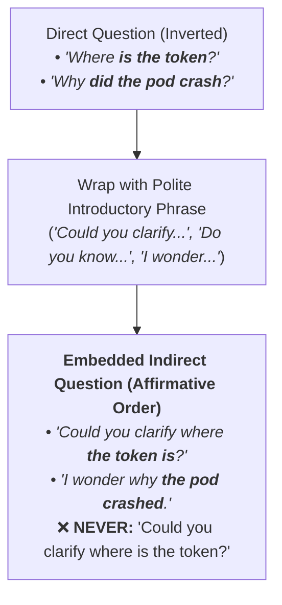

# Asking Questions & Seeking Clarification: Embedded Invariance & Unblocking ❓🦆

> **Level:** CEFR B1–C1 (Indirect Interrogatives, Inversion Invariants & Diagnostic Inquiries)  
> **Primary References:** Raymond Murphy (*English Grammar in Use*, Units 49–50); Michael Swan (*Practical English Usage*, §24, 258); The Rubber Duck Debugging Methodology  
> **Core Premise:** Asking questions in software engineering is not a sign of ignorance; it is an active risk-mitigation discipline. However, asking questions poorly—such as using broken double-inverted syntax (*“Can you tell me where is the database?”*), asking vague queries (*“It doesn't work, help”*), or failing to state prior troubleshooting attempts—wastes senior engineering bandwidth. High-level technical communication requires **indirect embedded interrogative invariance** and **structured four-part problem framing**.

---

## 1. The Indirect Question Structural Invariant

In direct questions, English grammar mandates **subject-auxiliary inversion** (*Where is the server?*). However, when a question is embedded inside a polite introductory phrase (*Could you tell me...*, *Do you know...*, *I wonder...*), the embedded clause **ceases to be a syntactic question** and returns to standard **Subject + Verb affirmative word order**:

$$\mathbf{\text{Polite Lead-in}} + \mathbf{\text{Wh-Word / If / Whether}} + \mathbf{\text{Subject}} + \mathbf{\text{Verb}} \quad \text{--- NO AUXILIARY INVERSION}$$



---

## 2. Direct vs. Indirect Question Transformation Matrix

Notice how the auxiliary verbs *do, does,* and *did* disappear completely in affirmative embedded clauses, and the main verb reflects the tense:

| Direct Question (Inverted) | Polite Introductory Frame | Correct Embedded Indirect Question | ❌ Fatal Double-Inversion Bug |
| :--- | :--- | :--- | :--- |
| *Where is the API key?* | *Could you tell me...* | *“Could you tell me **where the API key is**?”* | ❌ *where is the API key?* |
| *Why did the build fail?* | *Do you happen to know...* | *“Do you know **why the build failed**?”* | ❌ *why did the build fail?* |
| *How does this cache work?* | *Could you explain...* | *“Could you explain **how this cache works**?”* | ❌ *how does this cache work?* |
| *Did the database migration finish?* | *I was wondering whether...* | *“I was wondering **whether the database migration finished**.”* | ❌ *whether did the migration finish.* |
| *What time does the deploy start?* | *Can you confirm...* | *“Can you confirm **what time the deploy starts**?”* | ❌ *what time does the deploy start?* |
| *Who is on call tonight?* | *Could you let me know...* | *“Could you let me know **who is on call** tonight?”* | *(Who is subject; order preserved).* |

---

## 3. Clarifying Ambiguous Requirements & Jira Tickets

When assigned a ticket with incomplete requirements, use structured clarifying questions to establish boundaries:

### Pattern 1: Confirming Ambiguous Error Handling
$$\text{Just to confirm, should the service} + \mathbf{V_{\text{base}}} + \text{when} + \text{Condition, or should it} + \mathbf{V_{\text{base}}}?$$
- *“Just to confirm, should the endpoint **return an HTTP 404** when a user is not found, or should it **return an empty array** with status 200?”*

### Pattern 2: Clarifying Non-Functional Performance Boundaries
$$\text{What are the expected} + \text{Metric} + \text{for this feature under} + \text{Condition}?$$
- *“What are the expected **throughput (QPS) and $p99$ latency targets** for this search endpoint during peak Black Friday sales?”*
- *“Could you clarify **what the data retention policy should be** for these audit logs?”*

### Pattern 3: Clarifying Edge Case Handling
$$\text{How should the system behave if} + \text{Edge Case Condition}?$$
- *“How should the checkout flow behave **if a user's credit card is charged but the inventory reservation fails**?”*
- *“What should occur **if an incoming webhook payload contains duplicate transaction IDs**?”*

---

## 4. The 4-Part Unblocking Framework (Rubber-Duck Communication)

When asking a teammate, senior engineer, or community channel for assistance, never say *“It’s broken, help!”*. Follow the structured 4-part unblocking framework:

```markdown
### 🦆 The 4-Part Engineering Unblocking Format

1. **The Objective (Intent):** What are you trying to accomplish?
   > *"I am attempting to configure mutual TLS (mTLS) between the auth service and the billing gateway."*

2. **The Expected Behavior:** What did you expect to happen?
   > *"I expected the client certificate to validate successfully against our internal CA."*

3. **The Actual Behavior (with Error Payload):** What actually occurred?
   > *"The gateway immediately terminates the handshake with `SSL_ERROR_UNKNOWN_CA_ALERT` (trace attached)."*

4. **Prior Troubleshooting Steps:** What hypotheses and fixes have you already tested?
   > *"I have verified that the intermediate cert is bundled in `/etc/ssl/certs` and confirmed that `openssl s_client` connects fine from the host VM. I suspect the Go binary is reading the wrong system trust store."*
```

---

## 5. Diplomatic Inquiries with Seniors & Tech Leads

When seeking feedback or questioning an architectural direction chosen by a senior colleague, use **tentative modals** and **exploratory phrasing**:

- ❌ **Aggressive Direct Question:** *“Why didn't you use PostgreSQL for this?”*
- ✅ **Exploratory Architectural Question:** *“Could you walk me through the trade-offs that led to choosing Cassandra over PostgreSQL for this use case? Was write throughput the primary factor?”*
- ❌ **Demanding Clarification:** *“Explain what you mean by caching.”*
- ✅ **Collaborative Clarification:** *“I want to make sure I’m aligned with your architectural vision—when you mentioned caching, were you envisioning an in-memory client cache or a shared Redis cluster?”*

---

## 6. Practical Dual-Domain Examples

### Everyday Conversation & Inquiries

1. *Embedded where:* *Excuse me, could you tell me **where the nearest train station is**?*
2. *Embedded if:* *Do you know **if the grocery store is still open**?*
3. *Embedded what time:* *Could you let me know **what time the movie starts**?*
4. *Embedded why:* *I was wondering **why the delivery was delayed**.*
5. *Clarifying intent:* *Just to clarify, are we meeting at the restaurant or at your apartment first?*
6. *Clarifying preference:* *Would you prefer to cook dinner at home or order takeout tonight?*
7. *Polite inquiry:* *Could you explain **how this coffee machine works**?*
8. *Embedded whether:* *I'm not sure **whether we need to buy tickets in advance**.*

### Software Engineering & Technical Unblocking

9. *Embedded API query:* *Could you clarify **where the refresh token is stored** in local storage?*
10. *Embedded Crash inquiry:* *Do you know **why the Redis node restarted** at 04:00 UTC?*
11. *Requirement Clarification:* *Just to confirm, should the `/v2/users` endpoint **support pagination via cursor or offset**?*
12. *Performance Inquiry:* *Could you let me know **what the expected query latency SLA is** for this new microservice?*
13. *Edge Case Inquiry:* *How should the application respond **if an expired JWT is presented during an active websocket session**?*
14. *Unblocking (Intent):* *I am trying to run the integration test suite locally via Docker Compose.*
15. *Unblocking (Prior attempts):* *I have already confirmed that Docker daemon is running and re-pulled all base images, but the postgres container continues to exit with code 1.*
16. *Diplomatic Design Inquiry:* *Could you help me understand **how this circuit breaker handles upstream connection pool timeouts**?*

---

## 7. Common Antipattern Diagnostic Bug-and-Patch Table

| ❌ Broken Anti-Pattern (Bug) | Corrected Idiomatic English (Patch) | Diagnostic Grammar Explanation |
| :--- | :--- | :--- |
| ❌ *Could you tell me **where is the server**?* | ✅ *Could you tell me **where the server is**?* | In embedded indirect questions, auxiliary inversion is prohibited; use standard Subject + Verb order. |
| ❌ *Do you know **why did the build fail**?* | ✅ *Do you know **why the build failed**?* | Auxiliary *did* must be deleted in affirmative embedded clauses; the main verb takes past tense (*failed*). |
| ❌ *Can you explain me how this works?* | ✅ *Can you explain **to me** how this works?* | *Explain* cannot take a direct personal object (*explain me*); it requires *explain to [person]*. |
| ❌ *I wonder **can we deploy** today.* | ✅ *I wonder **whether / if we can deploy** today.* | Embedded yes/no questions require the subordinator *whether* or *if*, followed by affirmative word order. |
| ❌ *Slack: “It doesn't work. What should I do?”* | ✅ *Slack: “The auth service returns 401 on login. I verified the secret key matches `.env`. Could someone advise?”* | Vague requests waste time; provide exact failure codes and verified prerequisites. |
| ❌ *I don't know what is the problem.* | ✅ *I don't know **what the problem is**.* | In embedded noun clauses, place the subject (*the problem*) before the copula (*is*). |

---

## 8. Self-Assessment Practice Exercises

### Exercise 1: Indirect Question Transformation
Convert each direct question into a polite indirect question using the provided prompt:
1. *Where does this script store the temporary files?* $\rightarrow$ *Could you show me...*
2. *Why did the Kubernetes ingress return a 504 timeout?* $\rightarrow$ *Do you happen to know...*
3. *Is the staging database currently available?* $\rightarrow$ *Could you tell me if...*
4. *How does the garbage collector handle circular references?* $\rightarrow$ *I was wondering how...*
5. *What time will the production release begin?* $\rightarrow$ *Can you confirm what time...*

### Exercise 2: Grammar & Word Order Correction
Identify and correct the syntactic error in each sentence:
6. *Could you explain me how the authentication handshake is verified?*
7. *Do you know where did they deploy the new microservice?*
8. *I was wondering what is the maximum payload size supported by this endpoint.*
9. *Can someone tell me why is the CI pipeline failing on the master branch?*
10. *Just to clarify, does the API returns a 200 or a 204 on successful deletion?*

---

## 9. Answer Key with Diagnostic Explanations

1. **Could you show me where this script stores the temporary files?**  
   *Explanation:* Auxiliary *does* is removed; verb *stores* takes 3rd person singular `-s`; word order is `Subject + Verb`.
2. **Do you happen to know why the Kubernetes ingress returned a 504 timeout?**  
   *Explanation:* Auxiliary *did* is removed; main verb shifts to past simple *returned*.
3. **Could you tell me if the staging database is currently available?**  
   *Explanation:* Inverted *is the database* reverts to affirmative order *the database is*.
4. **I was wondering how the garbage collector handles circular references.**  
   *Explanation:* Embedded clause uses standard affirmative word order without *does*.
5. **Can you confirm what time the production release will begin?**  
   *Explanation:* Auxiliary modal *will* moves after the subject *the production release*.
6. **Correction:** *Could you explain **to me** how the authentication handshake is verified?*  
   *Explanation:* *Explain* strictly governs *to + person*, never a direct personal object.
7. **Correction:** *Do you know where **they deployed** the new microservice?*  
   *Explanation:* Eliminate auxiliary *did*; change *deploy* to past simple *deployed*.
8. **Correction:** *I was wondering what **the maximum payload size supported by this endpoint is**.*  
   *Explanation:* The copular verb *is* must move to the end of the embedded noun clause following the complete subject.
9. **Correction:** *Can someone tell me why **the CI pipeline is failing** on the master branch?*  
   *Explanation:* Revert auxiliary inversion (*is the pipeline*) to standard subject-verb order (*the pipeline is*).
10. **Correction:** *Just to clarify, **does the API return** a 200 or a 204 on successful deletion?*  
    *Explanation:* After auxiliary *does*, the main verb must remain in bare infinitive form (*return*, not *returns*).

---

## 10. High-Density Revision Flashcards

```
Q: What is the single most important grammatical rule for indirect (embedded) questions?
A: NO AUXILIARY INVERSION! The embedded clause returns to standard affirmative word order (Subject + Verb).
   Example: 'Could you tell me WHERE THE SERVER IS?' (NOT: 'where is the server').
```

```
Q: What happens to 'do', 'does', and 'did' when converting to an indirect question?
A: They are completely REMOVED, and the main verb takes the appropriate tense:
   'Why did it crash?' -> 'Do you know why it CRASHED?'
   'How does it work?' -> 'Could you explain how it WORKS?'
```

```
Q: What are the four parts of an effective engineering unblocking request?
A: 1. Objective (What you are trying to do).
   2. Expected behavior (What should happen).
   3. Actual behavior (Error message/trace).
   4. Prior troubleshooting (What you have already tested/hypothesized).
```
