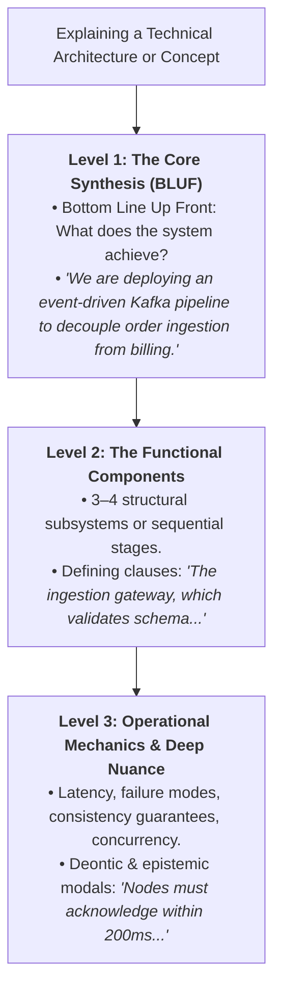

# Explaining Technical Concepts & Architecture: Top-Down Structuring & Analogies 🏛️💡

> **Level:** CEFR B2–C2 (Discourse Cohesion, Rhetorical Structuring & Register Adaptation)  
> **Primary References:** Michael Swan (*Practical English Usage*, §240–270); Barbara Minto (*The Pyramid Principle*); Google Technical Writing Guide  
> **Core Premise:** The hallmark of senior engineering leadership is the ability to explain complex, distributed architectures with clarity and elegance. Poor technical explanations suffer from the “Curse of Knowledge”—dumping low-level implementation details on listeners without context. Mastering **top-down discourse structuring (BLUF)**, **logical transitional signposts**, **precise defining relative clauses**, and **structural analogies** enables you to communicate persuasively with both C-suite executives and principal kernel engineers.

---

## 1. The Architectural Explanation Hierarchy (The Minto Pyramid)



---

## 2. The Language of Analogy & Metaphor

When explaining unfamiliar concepts to cross-functional partners or junior engineers, analogies build conceptual bridges. Use these standardized syntactic frames:

| Syntactic Framing Pattern | Algebraic Formula | Production Engineering Example |
| :--- | :--- | :--- |
| **Simile / Direct Resemblance** | $\text{System A} + \mathbf{\text{acts / operates like}} + \text{Familiar Object}$ | *“A message broker **operates like a post office sorting room**, holding packages until postal carriers are ready to deliver them.”* |
| **Functional Analogy** | $\text{System A} + \mathbf{\text{is analogous to}} + \text{Familiar Concept}$ | *“Database indexing **is analogous to the index at the back of a textbook**, allowing $O(1)$ page lookups rather than a full book scan.”* |
| **Conceptual Equivalence** | $\text{System A} + \mathbf{\text{can be thought of as}} + \text{Metaphor}$ | *“A Docker container **can be thought of as a lightweight, pre-packaged shipping box** carrying everything an application needs to run.”* |
| **Role Assignment** | $\text{System A} + \mathbf{\text{serves as / functions as}} + \text{Entity}$ | *“The API gateway **serves as the front-desk concierge**, verifying tickets before letting visitors enter the hotel.”* |

> [!TIP]
> **The Boundary of Analogies:** Always state the limitation of the analogy:  
> *“While a container behaves like a virtual machine, it differs in that it shares the host kernel rather than virtualizing hardware.”*

---

## 3. Discourse Markers for Pipeline Sequencing & Causality

Clear architectural walkthroughs rely on signposts that guide listeners through time, causality, and concurrency:

```
┌─────────────────────────────────┬────────────────────────────────────────────────────────────────────────┐
│ Explanatory Function            │ High-Value Discourse Markers & Transitional Phrases                    │
├─────────────────────────────────┼────────────────────────────────────────────────────────────────────────┤
│ Initial Stage / Genesis         │ Initially, To begin with, First and foremost, At the entry point       │
│ Sequential Progression          │ Subsequently, Following this, Thereupon, In the next stage             │
│ Concurrency & Parallelism       │ Simultaneously, Concurrently, In parallel, In the background           │
│ Causal Result / Impact          │ Consequently, As a result, Thereby reducing, Leading to               │
│ Contrast & Trade-off            │ In contrast, Whereas, Conversely, On the other hand, Nonetheless       │
│ Exemplification & Elaboration   │ Specifically, To illustrate, Namely, That is to say                    │
│ Synthesis & Conclusion          │ In essence, Ultimately, To summarize, The primary takeaway is          │
└─────────────────────────────────┴────────────────────────────────────────────────────────────────────────┘
```

### Architectural Walkthrough Example:
> *“**Initially**, the client initiates an HTTPS connection to our Cloudflare edge network. **Following this**, the CDN terminates TLS and inspects the payload for DDoS signatures. **Concurrently**, edge workers check Redis for a cached response. If a cache miss occurs, the request is **subsequently** routed to our Kubernetes ingress controller. **Consequently**, our origin servers are shielded from 95% of raw network traffic, **thereby** preserving backend CPU cycles.”*

---

## 4. Register Adaptation: Executive vs. Deep Engineering

A senior engineer changes their syntactic register and lexical choices depending on whether they are pitching to business leadership or debating with system architects:

| Dimension | Executive / Business Register (Non-Technical) | Principal Engineering Register (Technical) |
| :--- | :--- | :--- |
| **Primary Metric** | Revenue impact, uptime SLAs, cost reduction, delivery speed | Throughput (QPS), $p99$ latency, consistency model, race conditions |
| **Syntactic Style** | High-level active voice, impact-driven verbs, analogies | Precise technical nouns, mathematical complexity, operational invariants |
| **Jargon Level** | Minimal (translate concepts into business realities) | High (leverage precise technical vocabulary without apology) |
| **Example Pitch** | *“By caching customer profile data in memory, our checkout page loads three times faster, which reduces cart abandonment by 12%.”* | *“By implementing a distributed Redis cluster with write-through cache eviction, we reduce $p99$ database query latency from 350ms to under 8ms.”* |

---

## 5. Practical Dual-Domain Examples

### Everyday Conversation & General Explanations

1. *BLUF:* *We decided to move to a larger apartment because our current home doesn't have enough office space.*
2. *Analogy:* *Her role as project manager is like an orchestra conductor—she doesn't play every instrument, but keeps everyone in tempo.*
3. *Sequential:* *First, chop all the vegetables; subsequently, sauté the onions until translucent.*
4. *Concurrent:* *I can prepare the dessert while you finish roasting the chicken.*
5. *Causal:* *Heavy snowfall delayed the delivery trucks; consequently, the store shelves remained empty.*
6. *Conceptual metaphor:* *Learning a second language can be thought of as building a new mental operating system.*
7. *Contrast:* *Public transit is slower than driving; conversely, it is much cheaper and environmentally sustainable.*
8. *Synthesis:* *Ultimately, our goal is to achieve financial independence by saving consistently.*

### Software Engineering & Architecture Walkthroughs

9. *BLUF (System Design):* *We are adopting an event-driven architecture using Apache Kafka to decouple customer checkout from payment processing.*
10. *Analogy (Load Balancing):* *A reverse proxy behaves like a traffic cop at a busy intersection, directing incoming HTTP streams to the least busy server.*
11. *Sequential Pipeline:* *The parser tokenizes the raw source code; subsequently, the AST builder creates a hierarchical syntax tree.*
12. *Concurrent Operation:* *The primary database writes transactions to WAL storage while concurrently replicating bytes to hot standby replicas.*
13. *Causal Architecture:* *We partitioned the database by customer ID, thereby reducing write lock contention on the global transactions table.*
14. *Trade-off Analysis:* *NoSQL stores offer horizontal scalability; conversely, they sacrifice relational joins and multi-table ACID guarantees.*
15. *Defining Relative Clause:* *An immutable ledger is a database that permits only append operations, preventing retroactive tampering.*
16. *Executive Summary:* *Migrating our workloads from AWS to GCP will lower our cloud infrastructure spend by 22% without impacting system uptime.*

---

## 6. Common Antipattern Diagnostic Bug-and-Patch Table

| ❌ Broken Anti-Pattern (Bug) | Corrected Idiomatic English (Patch) | Diagnostic Grammar Explanation |
| :--- | :--- | :--- |
| ❌ *“So, like, basically we used Docker because it puts things in boxes.”* | ✅ *“We adopted Docker containers to package our applications with their dependencies, ensuring environmental consistency across staging and production.”* | Eliminate conversational crutches (*like, basically*) and replace trivializing descriptions with precise professional terminology. |
| ❌ *“The system does the parsing and after it does the saving.”* | ✅ *“The parser processes the payload; subsequently, the persistence service saves the records to PostgreSQL.”* | Replace weak verbs (*does the parsing*) and informal time markers (*and after*) with precise active verbs and formal sequence adverbials (*subsequently*). |
| ❌ *“Explaining to VP: We had an OOM panic in the pod.”* | ✅ *“Explaining to VP: Our service ran out of memory under peak traffic, causing temporary service restarts for five minutes.”* | Avoid throwing cryptic low-level technical acronyms (*OOM panic*) at non-technical stakeholders without explaining the operational consequence. |
| ❌ *“A microservice is when you break things up.”* | ✅ *“A microservice architecture is a software design approach in which an application is decomposed into small, independent services.”* | Never define a noun concept using the grammatical antipattern *“X is when / is where”*; use *“X is a [Category] that / in which...”*. |
| ❌ *“The cache is very fast. It makes everything fast.”* | ✅ *“The in-memory Redis cache reduces $p99$ response times from 250ms to 12ms by eliminating redundant disk I/O.”* | Replace subjective, childlike adjectives (*very fast, makes everything fast*) with concrete engineering metrics and mechanisms. |

---

## 7. Self-Assessment Practice Exercises

### Exercise 1: Discourse Signpost Insertion
Fill in the blanks with the most appropriate transitional phrase (*Subsequently, Concurrently, Initially, Consequently, Conversely*):
1. ________, the user enters their credentials into the mobile login form.
2. The authorization service verifies the bcrypt password hash; ________, it dispatches an audit telemetry event to Datadog in the background.
3. The cryptographic verification succeeded; ________, the gateway issued a signed JWT bearer token to the client.
4. Monolithic architectures offer simple single-repo deployments; ________, microservices introduce distributed network complexity.
5. The connection pool exhausted all 200 available sockets; ________, subsequent incoming queries were queued until threads became available.

### Exercise 2: Technical Definition Repair (Eliminate "is when / is where")
Rewrite the following definitions using standard noun classification (`X is a [Noun Category] that / in which...`):
6. *A race condition is when two threads try to change the same memory at the same time.*
7. *Horizontal scaling is where you add more servers instead of making one server bigger.*
8. *Continuous Integration is when developers merge their code changes frequently into a shared repo.*
9. *A dead letter queue is where messages go if they fail processing.*
10. *Sharding is when a database splits rows across multiple machines.*

---

## 8. Answer Key with Diagnostic Explanations

1. **Initially** — Introduces the opening step of a chronological operational pipeline.
2. **concurrently** (or **in parallel**) — Describes an action executing simultaneously in the background.
3. **subsequently** (or **thereupon**) — Marks the immediate next sequential event in the pipeline.
4. **conversely** (or **in contrast**) — Contrasts two opposing architectural paradigms.
5. **consequently** (or **as a result**) — Denotes the direct causal consequence of socket exhaustion.
6. **Rewrite:** *A race condition **is a software concurrency defect in which** multiple threads concurrently access and modify shared memory without proper synchronization.*
7. **Rewrite:** *Horizontal scaling **is an infrastructure strategy that** expands capacity by adding more compute nodes to an existing cluster.*
8. **Rewrite:** *Continuous Integration (CI) **is a software development practice in which** engineers regularly merge code branches into a central repository, triggering automated builds and tests.*
9. **Rewrite:** *A dead-letter queue (DLQ) **is a dedicated storage queue that** isolates malformed or unprocessable messages for offline inspection.*
10. **Rewrite:** *Sharding **is a database partitioning technique that** distributes rows across distinct physical server nodes to balance load.*

---

## 9. High-Density Revision Flashcards

```
Q: What is BLUF in technical communication?
A: Bottom Line Up Front: State the core takeaway, decision, or conclusion in the very first sentence
   before explaining the supporting details or technical mechanics.
```

```
Q: Why is the structure 'A microservice is when you...' grammatically flawed for technical definitions?
A: 'When' defines a time condition, NOT a conceptual category.
   Standard Formula: X is a [Noun Category / System] that / in which [Functional Behavior].
```

```
Q: How should you adapt your communication register when presenting to non-technical executives?
A: Focus on business outcomes (uptime, latency, revenue, costs, user impact), eliminate low-level jargon,
   and use high-level analogies rather than raw implementation details.
```
