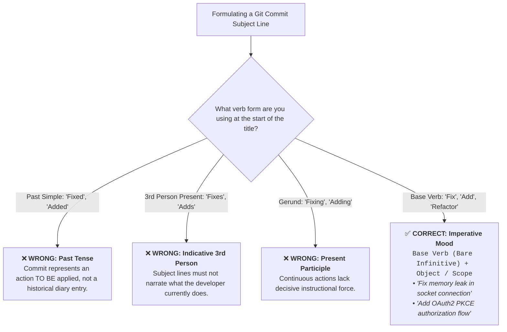

# Git Commit Messages & Release Notes: The Imperative Mood Standard 📜🔀

> **Level:** CEFR B1–B2 (Verb Mood, Conventional Commits & Changelog Syntax)  
> **Primary References:** Michael Swan (*Practical English Usage*, §268); The Conventional Commits Specification (v1.0.0); Git Project Documentation Guidelines  
> **Core Premise:** A git commit message is an instructional recipe executed by Git’s merge and cherry-pick machinery. The global standard for commit subject lines is strictly the **imperative mood** (e.g., *“Fix race condition”*, not *“Fixed”* or *“Fixes”*). When written correctly, a commit subject completes the implicit sentence: **“If applied, this commit will [Your Message].”**

---

## 1. The Git Grammar Decision Architecture



---

## 2. The Universal Golden Rule: The Sentence Completion Test

To guarantee your commit message adheres to international open-source and enterprise standards, test it against this sentence:

$$\text{“If applied, this commit will } \mathbf{[\text{Your Commit Subject Line}]} \text{.”}$$

| Proposed Subject Line | Does it complete the sentence cleanly? | Grammatical Evaluation | Status |
| :--- | :--- | :--- | :--- |
| *Fixed crash on login* | *“If applied, this commit will **fixed crash on login**.”* | Ungrammatical past tense | ❌ INVALID |
| *Fixes crash on login* | *“If applied, this commit will **fixes crash on login**.”* | Ungrammatical 3rd person singular | ❌ INVALID |
| *Fixing crash on login* | *“If applied, this commit will **fixing crash on login**.”* | Ungrammatical participle / gerund | ❌ INVALID |
| **Fix crash on login** | *“If applied, this commit will **fix crash on login**.”* | Perfect grammatical imperative mood | ✅ **VALID** |
| **Add Redis caching layer** | *“If applied, this commit will **add Redis caching layer**.”* | Perfect grammatical imperative mood | ✅ **VALID** |

---

## 3. High-Frequency Imperative Commit Verbs

Replace vague verbs (*Update*, *Change*) with precise, unambiguous imperative action verbs:

| Category | Recommended Imperative Verbs | Purpose / Semantic Scope |
| :--- | :--- | :--- |
| **Creation & Feature Work** | `Add`, `Implement`, `Introduce`, `Create`, `Support` | Adding new endpoints, libraries, or functional capabilities. |
| **Bug Fixing & Repair** | `Fix`, `Resolve`, `Patch`, `Correct`, `Prevent` | Repairing broken logic, exceptions, crashes, or security defects. |
| **Code Refactoring** | `Refactor`, `Extract`, `Simplify`, `Consolidate`, `Decouple` | Restructuring existing code without modifying external behavior. |
| **Performance Optimization** | `Optimize`, `Index`, `Cache`, `Accelerate`, `Reduce` | Decreasing latency, reducing memory footprint, eliminating full scans. |
| **Hygiene & Maintenance** | `Remove`, `Deprecate`, `Drop`, `Clean up`, `Upgrade` | Deleting dead code, removing unused dependencies, bumping versions. |
| **Documentation & Tests** | `Document`, `Clarify`, `Annotate`, `Test`, `Verify` | Updating READMEs, adding docstrings, writing unit or integration tests. |

---

## 4. The Conventional Commits 1.0.0 Grammatical Specification

The **Conventional Commits** standard overlays structured metadata on top of the imperative mood:

$$\mathbf{type}(\mathbf{scope})!: \mathbf{Imperative\ Subject\ (50\ chars\ max)}$$

```
feat(auth): add biometric passkey authentication support
│     │     │
│     │     └─ Imperative verb + concrete feature description (no trailing period)
│     └─ Optional scope specifying modified subsystem
└─ Structural type (lowercase)
```

### Standard Commit Types:
- `feat`: A new user-facing feature (*feat: add dark mode toggle*).
- `fix`: A bug fix for the user or system (*fix: resolve race condition in token refresh*).
- `refactor`: A code change that neither fixes a bug nor adds a feature (*refactor: extract user validation helper*).
- `perf`: A code change that improves performance (*perf: index foreign key on orders table*).
- `test`: Adding missing tests or correcting existing tests (*test: add unit tests for JWT validator*).
- `docs`: Documentation-only changes (*docs: update deployment prerequisites in README*).
- `chore`: Routine maintenance, dependencies, tooling (*chore: bump dependencies to Vite 5*).

> [!IMPORTANT]
> **Breaking Changes:** When a commit introduces a breaking change, append an exclamation mark (`!`) before the colon and include `BREAKING CHANGE:` in the body footer:
> ```
> feat(api)!: remove deprecated v1 user endpoint
> 
> BREAKING CHANGE: The `/v1/users` endpoint has been removed. Migrate all 
> client requests to `/v2/users` using Bearer token authentication.
> ```

---

## 5. Multi-Paragraph Commit Message Body Architecture

While the subject line uses the **imperative mood**, the body of a commit explains the **context (past/present simple)**, the **technical rationale (why)**, and the **architectural consequences**:

```git
fix(billing): prevent double-charging on checkout retry

Under high latency conditions, users clicking the 'Submit Payment' 
button multiple times triggered concurrent POST requests to Stripe. 
Because the idempotency key was generated client-side inside the 
click handler, each request was treated as a unique transaction.

This commit resolves the issue by:
1. Generating a unique idempotency token once when the checkout modal opens.
2. Disabling the checkout button immediately upon the first click.
3. Adding a distributed Redis lock keyed to the customer ID for 10 seconds.

Closes #1402
```

---

## 6. Writing Professional Release Notes & Changelogs

Industry-standard changelogs (such as *Keep a Changelog*) categorize version updates using past participles or active imperatives grouped by category:

```markdown
# Release Notes - Version 2.4.0 (2026-11-09)

### 🚀 Added
- Support for distributed tracing via OpenTelemetry instrumentation.
- Webhook signature verification using HMAC-SHA256 headers.

### ⚡ Performance
- Reduced cold start latency in AWS Lambda by 40% through bundle minification.
- Added database composite index on `(tenant_id, created_at)`.

### 🐛 Fixed
- Resolved socket leak when handling prematurely aborted client connections (#112).
- Fixed incorrect date parsing for ISO-8601 timestamps with millisecond offsets.

### ⚠️ Deprecated
- Legacy basic auth header support will be removed in v3.0.0. Use Bearer tokens instead.
```

---

## 7. Practical Dual-Domain Examples

### Everyday Instructions & Log Entries

1. *Imperative recipe:* *Add two tablespoons of olive oil to the pan.*
2. *Imperative instruction:* *Turn off the main water valve before replacing the faucet.*
3. *Notice:* *Do not leave personal belongings unattended.*
4. *Changelog (Home improvement):* *Repaired roof leak and replaced attic insulation.*
5. *Imperative command:* *Sign the receipt and return the yellow copy to the cashier.*
6. *Daily checklist item:* *Check tire pressure before starting the road trip.*
7. *Instructional step:* *Insert the micro-USB cable into the charging dock.*
8. *Notice:* *Keep refrigerated after opening.*

### Software Engineering Commits & Release Notes

9. *Conventional Commit (Feature):* `feat(search): implement fuzzy matching for product titles`
10. *Conventional Commit (Bug Fix):* `fix(cache): resolve deadlock during concurrent eviction sweeps`
11. *Conventional Commit (Refactor):* `refactor(db): decouple connection pooling from query builders`
12. *Conventional Commit (Performance):* `perf(api): replace JSON serialization with Protocol Buffers`
13. *Conventional Commit (Docs):* `docs(readme): add docker compose local development setup instructions`
14. *Conventional Commit (Test):* `test(e2e): add Cypress test suite for multi-factor authentication flow`
15. *Conventional Commit (Breaking Change):* `feat(routes)!: rename `/api/v1/auth` to `/api/v2/tokens``
16. *Release Note Summary:* *All inbound HTTP requests are now validated against our OpenAPI 3.1 specification.*

---

## 8. Common Antipattern Diagnostic Bug-and-Patch Table

| ❌ Broken Anti-Pattern (Bug) | Corrected Idiomatic English (Patch) | Diagnostic Grammar Explanation |
| :--- | :--- | :--- |
| ❌ *Commit: **Fixed the bug in the login page**.* | ✅ *Commit: **Fix login validation error on empty password**.* | Replace past tense (*Fixed*) with the imperative mood (*Fix*), and specify the precise failure condition. |
| ❌ *Commit: **Updating README.md**.* | ✅ *Commit: **docs: update installation steps in README**.* | Replace gerund (*Updating*) with imperative (*update*); add conventional type prefix (*docs:*). |
| ❌ *Commit: **Adds support for Postgres 16**.* | ✅ *Commit: **feat: add support for PostgreSQL 16**.* | Strip 3rd person singular `-s` (*Adds* $\rightarrow$ *Add*) to adhere to the imperative standard. |
| ❌ *Commit: **wip / changes / misc fixes**.* | ✅ *Commit: **refactor(auth): simplify JWT payload extraction**.* | Vague, lazy commit titles fail to communicate semantic value to teammates inspecting `git log`. |
| ❌ *Commit: **Bugfix in payment logic.** (with period)* | ✅ *Commit: **fix(payment): prevent duplicate order charges**.* | Commit subject lines must not end with a period; they are titles, not full sentences. |
| ❌ *Commit: **I refactored the database queries**.* | ✅ *Commit: **refactor(repo): optimize user profile queries**.* | Never use first-person pronouns (*I, my*); git commits represent impersonal, programmatic operations. |

---

## 9. Self-Assessment Practice Exercises

### Exercise 1: Imperative Mood Correction
Convert each of the following flawed commit titles into standard, professional imperative commit messages:
1. *Fixed crash when parsing invalid JSON payloads.*
2. *Adding unit tests for user registration endpoint.*
3. *Updated the Dockerfile to use Alpine Linux base image.*
4. *Fixes race condition in Redis lock manager.*
5. *I removed deprecated v1 API routes from the router.*

### Exercise 2: Conventional Commits Formatting
Reformat the following descriptions into standard Conventional Commit format (`type(scope): imperative summary`):
6. You added a new user-facing export to CSV button on the analytics dashboard.
7. You resolved a bug in the email service where verification emails were not sent.
8. You migrated the database connection logic to use a connection pool to improve response time by 50%.
9. You changed the documentation in `CONTRIBUTING.md` to explain the git workflow.
10. You upgraded Node.js from version 18 to version 20 in the CI pipeline configuration.

---

## 10. Answer Key with Diagnostic Explanations

1. **Fix crash when parsing invalid JSON payloads** — Converts past tense *Fixed* to imperative *Fix*.
2. **test(auth): add unit tests for user registration endpoint** — Converts gerund *Adding* to imperative *add* with `test` type.
3. **chore(docker): update Dockerfile to use Alpine Linux base image** — Converts past tense *Updated* to imperative *update*.
4. **fix(lock): resolve race condition in Redis lock manager** — Converts 3rd person *Fixes* to imperative *resolve*.
5. **refactor(routes): remove deprecated v1 API routes** — Removes personal pronoun *I*, converts *removed* to imperative *remove*.
6. `feat(analytics): add CSV export button to dashboard` — New user-facing feature uses `feat`.
7. `fix(email): resolve failure in sending verification emails` — Bug repair uses `fix`.
8. `perf(db): implement connection pooling to reduce query latency` — Performance improvement uses `perf`.
9. `docs(contributing): clarify git workflow guidelines` — Documentation change uses `docs`.
10. `ci: upgrade Node.js runtime to version 20` — Tooling/CI maintenance uses `ci` or `chore`.

---

## 11. High-Density Revision Flashcards

```
Q: What is the grammatical test for a valid git commit message title?
A: Complete the sentence: 'If applied, this commit will [Your Message].'
   It must make sense with an IMPERATIVE verb (e.g., 'Fix memory leak', 'Add endpoint').
```

```
Q: What are the three forbidden verb forms in git commit subject lines?
A: 1. Past tense (Fixed, Added) ❌
   2. 3rd-person singular present (Fixes, Adds) ❌
   3. Gerund / Present participle (Fixing, Adding) ❌
   Use the BARE INFINITIVE / IMPERATIVE (Fix, Add) ✅.
```

```
Q: What is the anatomy of a Conventional Commit?
A: type(optional-scope): imperative subject line (no trailing period, max 50-72 chars).
   Types: feat, fix, docs, style, refactor, perf, test, build, ci, chore, revert.
```
