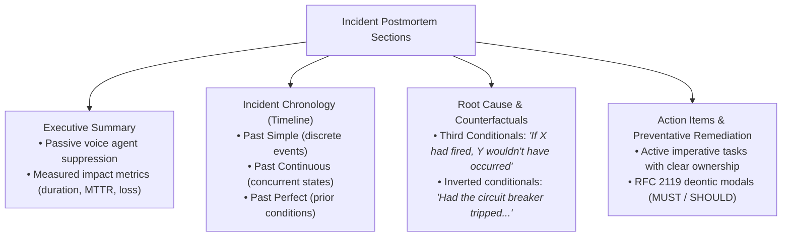

# Incident Postmortems & Root Cause Analysis: Blameless Voice & Chronology 🚨🛡️

> **Level:** CEFR B2–C1 (Blameless Discourse, Narrative Chronology & Counterfactual Conditionals)  
> **Primary References:** Michael Swan (*Practical English Usage*, §412–421, §22); Google Site Reliability Engineering (SRE) Handbook, Chapter 15 (*“Postmortem Culture”*)  
> **Core Premise:** A production incident postmortem (or Root Cause Analysis, RCA) exists to strengthen system resiliency, not to assign personal guilt. Accusatory language (*“Alice broke the cluster”*, *“Bob made a typo”*) destroys psychological safety and incentives engineers to conceal future errors. Mastering the **blameless passive voice**, **temporal aspect sequencing (Past Simple vs. Past Continuous vs. Past Perfect)**, and **third conditional counterfactuals** is essential for high-maturity SRE reporting.

---

## 1. The Postmortem Linguistic Architecture



---

## 2. Transforming Accusatory Attacks into Blameless Systemic Observations

Blameless postmortem syntax shifts the subject from the **human operator** to the **systemic vulnerability, mechanism, or state**:

| ❌ Broken / Accusatory Active Voice | ⚠️ Psychological / Linguistic Defect | ✅ Professional Blameless Passive / Systemic Voice |
| :--- | :--- | :--- |
| ❌ *“Bob pushed a bad config at 14:15 and took down the payments service.”* | Accuses an individual human (*Bob*); ignores lack of automated validation. | ✅ *“At 14:15 UTC, an invalid configuration payload **was deployed**, causing payment service pods to enter a crash loop.”* |
| ❌ *“The on-call engineer forgot to read the alerts.”* | Moral indictment of human memory (*forgot*). | ✅ *“Alert notifications **were not routed** to the on-call pager due to a misconfigured PagerDuty escalation policy.”* |
| ❌ *“Sarah deleted the customer table because she didn’t verify the database connection.”* | Scapegoats an engineer for an architectural lack of access controls. | ✅ *“The customer table **was inadvertently dropped** during a manual cleanup procedure because the CLI tool lacked an environment confirmation guardrail.”* |
| ❌ *“The QA team failed to test the caching logic.”* | Hostile inter-departmental finger-pointing (*failed to test*). | ✅ *“The caching regression **was not detected** prior to release due to an absence of automated integration tests for TTL expiry.”* |

---

## 3. Tense & Aspect Sequencing in Incident Timelines

An incident timeline requires precise grammatical aspect to separate **point-in-time events**, **ongoing background processes**, and **prior historical configurations**:

```
Timeline Point: 14:00 ──── 14:10 ──── 14:22 ──── 14:35 ──── 14:50 UTC
                  │          │          │          │          │
                  ▼          ▼          ▼          ▼          ▼
             Past Perfect   Past Simple    Past Continuous    Past Simple    Past Simple
             (prior state)  (trigger)     (concurrent state) (intervention) (recovery)
```

### The Three Timeline Tenses:
1. **Past Simple (`V-ed / irregular`):** For discrete, instantaneous actions and milestones:
   - *14:10 UTC: The primary database node **crashed** due to kernel OOM.*
   - *14:35 UTC: The incident response team **initiated** a roll-back to version 2.4.1.*
2. **Past Continuous (`was/were + V-ing`):** For ongoing background states while other events occurred:
   - *While the secondary node **was synchronizing** replication logs, incoming client queries **timed out**.*
   - *14:22 UTC: Traffic **was surging** due to a flash promotion event.*
3. **Past Perfect (`had + V3`):** For antecedent conditions that occurred *prior* to the incident trigger:
   - *A previous maintenance script **had disabled** automated failover triggers three days earlier.*
   - *The team discovered that telemetry alerts **had been muted** during an earlier migration.*

---

## 4. Counterfactual Analysis (The Third Conditional)

In the Root Cause Analysis (RCA) section, engineers evaluate what systemic guardrails could have prevented the failure. This requires the **Third Conditional** (unreal past counterfactual):

$$\mathbf{If} + \text{Subject} + \mathbf{had + V_3} \dots , \ \text{Subject} + \mathbf{would / could / might + have + V_3}$$

### Standard Third Conditional:
- *“**If the automated test suite had validated** memory limits under simulated load, this memory leak **would have been caught** before reaching production.”*
- *“**If rate limiting had been enabled** on the `/login` endpoint, the credential stuffing attack **would not have degraded** database performance.”*

### Advanced Inverted Conditional (Elevated SRE Register):
Drop *if* and invert the auxiliary *had* with the subject:
$$\mathbf{Had} + \text{Subject} + \mathbf{V_3} \dots , \ \text{Subject} + \mathbf{would\ have} + \mathbf{V_3}$$
- *“**Had canary deployment verification been in place**, the faulty container **would have been halted** before serving 100% of user traffic.”*
- *“**Had database query timeouts been configured** to 500ms, downstream thread pools **would not have starved**.”*

---

## 5. Formulating Action Items & Preventative Remediation

Action items must never use vague modal recommendations (*“We should look into testing”*). They must use **direct active imperatives**, **designated owners**, and **verifiable criteria**:

```markdown
## Action Items & Preventative Measures

| Preventative Action Item | Owner | Priority | Target Date |
| :--- | :--- | :--- | :--- |
| **Implement** automated schema validation in the CI/CD deployment pipeline. | DevOps / Alex | P0 (Critical) | 2026-11-14 |
| **Add** synthetic end-to-end canary monitoring for the checkout API. | SRE / Dave | P1 (High) | 2026-11-18 |
| **Configure** circuit breaker thresholds in Envoy to fail fast at 95% latency. | Architecture | P1 (High) | 2026-11-21 |
| **Deprecate** manual SQL execution on production clusters via Bastion hosts. | Security | P2 (Medium) | 2026-12-01 |
```

---

## 6. Practical Dual-Domain Examples

### Everyday Conversation & Retrospective Analysis

1. *Blameless passive:* *The milk was accidentally spilled across the kitchen floor.*
2. *Timeline (Past Continuous):* *While we were driving to the airport, our tire blew out.*
3. *Timeline (Past Perfect):* *The flight had already departed before we reached the boarding gate.*
4. *Counterfactual:* *If we had checked the weather forecast, we would have brought umbrellas.*
5. *Inverted counterfactual:* *Had I known the restaurant was closed on Mondays, I would have booked elsewhere.*
6. *Action item:* *Set an alarm for 06:00 to ensure we catch the early train.*
7. *Blameless observation:* *The reservation was lost due to a system glitch in the booking software.*
8. *Root cause summary:* *The car failed to start because the battery terminals had corroded over the winter.*

### Software Engineering Incident Postmortems & RCAs

9. *Blameless Summary:* *On November 8, 2026, the payments gateway experienced 42 minutes of downtime (**was degraded**) due to an unindexed database query.*
10. *Timeline (Past Simple):* *15:04 UTC: API error rates **surpassed** the 1% threshold, triggering a Sev-1 alert.*
11. *Timeline (Past Continuous):* *While the engineering team **was diagnosing** packet loss, backend thread pools **became** completely saturated.*
12. *Timeline (Past Perfect):* *The deployment pipeline **had bypassed** end-to-end tests because a developer had pushed the emergency hotfix flag.*
13. *Third Conditional:* *If the load balancer **had dropped** unhealthy nodes automatically, the outage duration **would have been reduced** by 25 minutes.*
14. *Inverted Conditional:* * **Had database read replicas been provisioned** in `us-east-1`, the primary node **would not have collapsed** under read traffic.*
15. *Action Item:* *Refactor authentication token expiry checks to run locally in memory without querying Redis.*
16. *Systemic RCA:* *The outage was caused by a cascading thread pool starvation, which originated from an unthrottled downstream dependency.*

---

## 7. Common Antipattern Diagnostic Bug-and-Patch Table

| ❌ Broken Anti-Pattern (Bug) | Corrected Idiomatic English (Patch) | Diagnostic Grammar Explanation |
| :--- | :--- | :--- |
| ❌ *“A catastrophic outage **was happened** at 10:00.”* | ✅ *“A catastrophic outage **occurred** at 10:00.”* | *Happen* and *occur* are strictly intransitive and cannot be passivized. |
| ❌ *“John broke the production Redis database.”* | ✅ *“The production Redis instance **crashed** due to memory exhaustion.”* | Avoid pointing fingers at individuals; describe the system failure mode objectively. |
| ❌ *“If we would have tested it, this wouldn't happen.”* | ✅ *“If we **had tested** it, this **would not have happened**.”* | Third conditional *if*-clauses strictly take `had + V3`, never *would have*. |
| ❌ *“We discovered that the alert **muted** two weeks ago.”* | ✅ *“We discovered that the alert **had been muted** two weeks earlier.”* | An action occurring prior to another past event requires the **Past Perfect Passive** (`had been + V3`). |
| ❌ *“Action item: We should maybe think about tests.”* | ✅ *“Action item: **Write integration tests** for token revocation.”* | Replace weak, vague modal suggestions with direct, actionable imperatives. |
| ❌ *“Had the team **tested** the migration, it **will not fail**.”* | ✅ *“Had the team **tested** the migration, it **would not have failed**.”* | Inverted counterfactual conditional requires `would + have + V3` in the main clause. |

---

## 8. Self-Assessment Practice Exercises

### Exercise 1: Blameless Transformation
Rewrite each accusatory statement into an objective, blameless postmortem observation:
1. *“Mark forgot to set up an index on the `orders` table, which killed database performance.”*
2. *“The junior engineer ran a `DROP TABLE` command on the wrong terminal tab.”*
3. *“DevOps pushed the Helm chart without checking if the secrets existed in AWS Vault.”*

### Exercise 2: Tense & Conditional Precision
Select the grammatically correct form to complete each incident report sentence:
4. At 11:15 UTC, while the engineers (investigated / were investigating) the latency spike, the primary node restarted.
5. The postmortem revealed that an intern (modified / had modified) the nginx proxy timeout configuration three days before the crash.
6. If the SRE team (implemented / had implemented) automated circuit breaking, the failure (would not propagate / would not have propagated) to the auth service.
7. (Had the synthetic monitor fired / If the synthetic monitor would fire), the on-call team would have intervened 20 minutes earlier.
8. A complete network partition (was occurred / occurred) across availability zones `us-east-1a` and `us-east-1b`.

---

## 9. Answer Key with Diagnostic Explanations

1. **Model Answer:** *“An unindexed query on the `orders` table **was executed**, resulting in severe CPU contention and delayed transaction processing.”*  
   *Explanation:* Removes *Mark forgot*; focuses on the query and systemic index omission.
2. **Model Answer:** *“A table **was inadvertently dropped** because database CLI tooling lacked environment protection guards against destructive commands.”*  
   *Explanation:* Removes *junior engineer*; emphasizes the missing safeguard in CLI tooling.
3. **Model Answer:** *“The Helm chart **was deployed** before the required secrets **had been provisioned** in AWS Vault, causing container initialization failures.”*  
   *Explanation:* Uses passive voice to describe the configuration race condition without blaming DevOps.
4. **were investigating** — Past continuous for an ongoing action interrupted by a point-in-time event (*restarted*).
5. **had modified** — Past perfect for an action completed prior to the timeline's main events.
6. **had implemented; would not have propagated** — Standard third conditional structure (`If + had + V3 ..., would + have + V3`).
7. **Had the synthetic monitor fired** — Inverted third conditional without *if*.
8. **occurred** — *Occur* is strictly intransitive; *was occurred* is a fatal syntactic error.

---

## 10. High-Density Revision Flashcards

```
Q: Why is passive voice strictly preferred in SRE incident postmortems?
A: It suppresses personal human agents, eliminating blame and directing engineering focus
   toward systemic vulnerabilities, process gaps, and missing automated guardrails.
```

```
Q: What tense is used for events occurring PRIOR to the incident trigger?
A: The Past Perfect (had + V3) or Past Perfect Passive (had been + V3)
   (e.g., 'A previous migration had removed the index').
```

```
Q: What is the third conditional formula for postmortem counterfactuals?
A: 'If + had + V3 ..., would have + V3' OR Inverted: 'Had + Subject + V3 ..., would have + V3'
   (e.g., 'Had the canary run, the regression would not have reached production').
```
