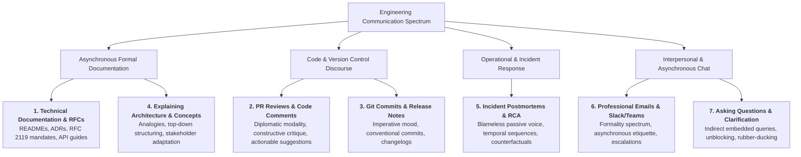

# Module 15: Practical English & Engineering Communication 🛠️💬

> **Level:** CEFR B1–C2 (Applied Professional & Technical Discourse)  
> **Target Audience:** Software engineers, cloud architects, site reliability engineers, technical leads, and engineering managers.  
> **Core Premise:** Grammatical mastery is only as valuable as its practical application. In global software development, communication defects—such as ambiguous specifications, accusatory code review comments, sloppy commit logs, and imprecise incident reports—cause real engineering outages, team friction, and architectural debt. This module bridges theoretical grammatical syntax with day-to-day engineering deliverables.

---

## 1. The Engineering Communication Taxonomy



---

## 2. Curated Curriculum of Topic Guides

| Guide | Core Grammatical Mechanics Applied | Primary Engineering Deliverable | CEFR Level |
| :--- | :--- | :--- | :--- |
| **[Technical Documentation Writing](./technical-documentation-writing.md)** | RFC 2119 deontic modals (*MUST, SHOULD, MAY*), active imperative voice, fronted conditions, zero/first conditionals | Production READMEs, Architecture Decision Records (ADRs), API references | B2–C1 |
| **[Pull Request Reviews & Code Comments](./pull-request-reviews-and-code-comments.md)** | Tentative epistemic modals (*could, might*), interrogative phrasing, hedged imperatives, subjunctive polite suggestions | Constructive PR reviews, inline architectural comments, code hygiene guidance | B1–C1 |
| **[Git Commit Messages & Release Notes](./git-commit-messages-and-release-notes.md)** | Imperative mood syntax, past participle state descriptions, present simple descriptions, conventional commits | Git commit titles/bodies, semantic changelogs, breaking change announcements | B1–B2 |
| **[Explaining Technical Concepts & Architecture](./explaining-technical-concepts-and-architecture.md)** | Sequential linking adverbials (*initially, subsequently*), metaphorical analogies, defining relative clauses, passive abstraction | System design walk-throughs, engineering all-hands presentations, onboarding docs | B2–C2 |
| **[Incident Postmortems & Root Cause Analysis](./incident-postmortems-and-root-cause-analysis.md)** | Blameless passive voice, past perfect temporal markers, third conditionals (*If X had occurred...*), causal prepositions | Postmortem reports (RCAs), timeline chronologies, preventative action items | B2–C1 |
| **[Professional Emails & Workplace Chat](./professional-emails-and-workplace-chat.md)** | Politeness formulas, degree modifiers, asynchronous Discourse Markers, diplomatic escalation syntax | Slack/Teams messages, vendor communications, leadership status updates | B1–B2 |
| **[Asking Questions & Seeking Clarification](./asking-questions-and-seeking-clarification.md)** | Embedded indirect questions (no auxiliary inversion), clarifying conditional triggers, exploratory hypothetical framing | Unblocking blockers, clarifying ambiguous user stories, architecture syncs | B1–C1 |

---

## 3. The Grammar-to-Engineering Integration Matrix

How the foundational grammar from previous modules powers professional software workflows:

```
┌─────────────────────────────────┬──────────────────────────────────┬──────────────────────────────────────────┐
│ Foundational Grammar Module     │ Linguistic Tool                  │ Software Engineering Use Case            │
├─────────────────────────────────┼──────────────────────────────────┼──────────────────────────────────────────┤
│ Module 02: Modal Verbs          │ MUST / SHOULD / MAY              │ RFC specifications & contractual APIs    │
│ Module 02: Modals & Hedging     │ Could we / What if we tried...   │ Non-offensive, collaborative PR reviews  │
│ Module 04: Articles (a/the/ø)   │ Unique definite reference        │ Exact resource IDs vs generic classes   │
│ Module 07: Prepositions         │ in / on / at topological bounds  │ in memory, on disk, at port 8080         │
│ Module 09: Passive Voice        │ Blameless agent suppression      │ Incident postmortems & root cause logs   │
│ Module 10: Conditionals         │ Third conditional counterfactual │ 'If the alert had fired, the outage...'  │
│ Module 12: Inversion & Clefts   │ Focus & topicalization           │ Highlighting key bottlenecks in ADRs     │
│ Module 13: Disambiguations      │ say vs tell / like vs as         │ Professional verbal and written clarity  │
└─────────────────────────────────┴──────────────────────────────────┴──────────────────────────────────────────┘
```

---

## 4. Universal Principles of Technical Communication

1. **The Active Voice Default:** Prefer active voice (*The worker thread processes events*) for operational clarity, reserving the passive voice (*Events are dispatched*) strictly when the agent is irrelevant or when delivering a blameless postmortem.
2. **The RFC 2119 Precision Standard:** Never use ambiguous modals (*ought to, needs to*) in specifications. Adhere strictly to standardized deontic verbs: `MUST` (mandatory), `SHOULD` (strongly recommended with exceptions), and `MAY` (optional).
3. **The Imperative Commit Standard:** Complete the sentence *“If applied, this commit will [Your Commit Message]”*. Write *“Fix race condition”*, never *“Fixed race condition”* or *“Fixes race condition”*.
4. **The Principle of Diplomatic Modality:** In peer reviews, transform blunt commands (*“Change this function”*) into collaborative inquiries (*“Could we extract this logic into a pure helper function to improve testability?”*).
5. **Indirect Embedded Invariance:** When asking for information, never invert subject and auxiliary in embedded clauses: *“Could you clarify **where the auth token is generated**?”* (❌ NOT: *“where is the auth token generated”*).

---

## 5. Navigation & Next Steps

Select a guide from the curriculum above to master specific engineering communication artifacts, or proceed directly to:
- ➡️ **[1. Technical Documentation Writing](./technical-documentation-writing.md)**
- 🔙 **[Module 13: Comparisons & Disambiguation](../13-comparisons-and-disambiguation/index.md)**
- 🏠 **[Master Knowledge Base Index](../index.md)**
