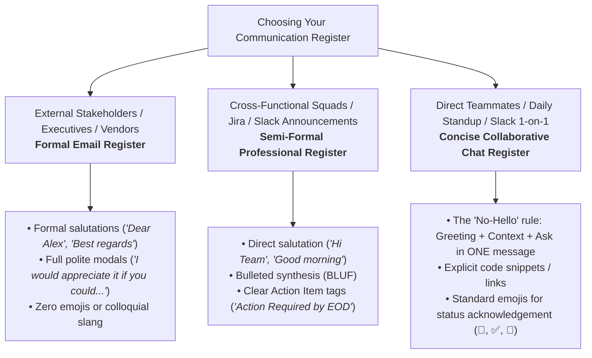

# Professional Emails & Workplace Chat: Tone, Modality & Asynchronous Etiquette ✉️💬

> **Level:** CEFR B1–C1 (Business Register, Diplomatic Escalation & Asynchronous Discourse)  
> **Primary References:** Michael Swan (*Practical English Usage*, §240–270); Google Workplace Communication Guidelines; The “No-Hello” Asynchronous Communication Standard  
> **Core Premise:** Modern software engineering is overwhelmingly asynchronous. Engineers collaborate across time zones through emails, Slack, Teams, and issue trackers. Ineffective communication—such as sending greeting-only messages (*“Hi, are you free?”*), using aggressive imperatives (*“Do this now”*), or burying actionable requests in walls of text—wastes engineering hours and creates friction. Mastering **polite request modality**, **asynchronous discourse structuring**, and **diplomatic disagreement syntax** is critical for remote teamwork.

---

## 1. The Workplace Formality Spectrum



---

## 2. High-Precision Syntactic Formulas for Requests

Never issue bare commands (*“Send me the log file”*) in workplace communications. Choose your syntactic pattern based on social distance and request size:

| Formality Level | Syntactic Formula | Production Engineering Example |
| :--- | :--- | :--- |
| **Ultra-Formal / High Social Distance** | $\text{I would appreciate it if you could} + \mathbf{V_{\text{base}}}$ | *“**I would appreciate it if you could grant** our team read access to the production analytics cluster.”* |
| **Formal / Respectful** | $\text{Could you please} + \mathbf{V_{\text{base}}} + \text{when you have a moment?}$ | *“**Could you please review** the attached vendor SLA contract when you have a moment?”* |
| **High Politeness (Mind)** | $\text{Would you mind} + \mathbf{V\text{-ing}} \dots ?$ | *“**Would you mind checking** whether the staging database credentials have been rotated?”* |
| **Tentative Collaborative** | $\text{I was wondering if we could} + \mathbf{V_{\text{base}}}$ | *“**I was wondering if we could schedule** a brief 15-minute sync to align on API contract changes.”* |
| **Direct Semi-Formal (Slack/Teams)** | $\text{Could you share} + \text{Object} + \text{by [Time/Date]?}$ | *“Hi Sarah, **could you share** the Datadog dashboard link for the auth service by 2 PM?”* |

> [!WARNING]
> **The "Would You Mind" Invariant:**
> 1. It **strictly demands a gerund** (`-ing`), never an infinitive:  
>    *“Would you mind **reviewing** this PR?”* (❌ NOT: *Would you mind to review*).
> 2. Answering **“Yes”** literally means *“Yes, I mind (I object)”*. To agree politely, answer:  
>    *“Not at all!”*, *“Sure thing!”*, or *“Happy to help!”*.

---

## 3. The "No-Hello" Asynchronous Chat Standard

In distributed software engineering teams, sending a message containing only a greeting (*“Hi”*, *“Hey Dave”*) and waiting for a response forces a synchronous context switch and wastes time.

### The Antipattern: Multi-Turn Synchronous Drag
> ❌ **09:02 AM:** *“Hi Bob”*  
> ❌ **09:14 AM:** *“Hey Alice, what’s up?”*  
> ❌ **09:16 AM:** *“Do you have a minute?”*  
> ❌ **09:25 AM:** *“Yes, what do you need?”*  
> ❌ **09:27 AM:** *“Can you approve my PR?”*  
> *(Total wasted latency: 25 minutes).*

### The Idiomatic Asynchronous Pattern: All-in-One Message
> ✅ **09:02 AM:**  
> *“Hi Bob 👋 — When you have a moment today, **could you review PR #412** ([link])? It refactors the Stripe webhook idempotency logic. No rush, but we are hoping to merge before the 3 PM UTC release freeze. Thanks!”*  
> *(Zero latency; Bob can review whenever he reaches a natural stopping point).*

---

## 4. The Grammar of Asynchronous Status Reports

When providing sprint or standup updates in Slack, Teams, or Jira, use grammatical aspect deliberately:

- **What you completed:** Use the **Present Perfect** (`have/has + V3`) to show finished work with current relevance:  
  *“I **have completed** the unit tests for the auth service and **have submitted** the PR.”*
- **What you are actively doing:** Use the **Present Continuous** (`am/is/are + V-ing`):  
  *“Today, I **am investigating** the intermittent Redis socket timeouts in staging.”*
- **Blockers & Impediments:** Use the **Present Simple** with explicit cause-and-effect:  
  *“**I am currently blocked by** AWS permissions; I **need** access to KMS key `alias/payment-vault`.”*

---

## 5. Diplomatic Pushback & Disagreement Syntax

Junior engineers often agree to impossible deadlines or react aggressively to unreasonable requests. Senior engineers employ **diplomatic hedging**, **the conditional mood**, and **concessive conjunctions (*while / although*)**:

### Pattern 1: The Concessive Pushback (`While I understand... however...`)
- *“**While I understand the business urgency** to release the checkout feature by Friday, **shipping without end-to-end integration tests introduces a significant risk** of payment failures in production.”*

### Pattern 2: The Conditional Trade-Off (`If we prioritize X, we will have to defer Y`)
- *“**If we prioritize** the multi-tenant migration for this sprint, **we will need to defer** the performance optimization epic to next month.”*

### Pattern 3: The Alternative Solution (`Instead of X, what if we Y?`)
- *“**Instead of modifying** the legacy database schema directly, **what if we created** a read replica to offload the reporting queries?”*

---

## 6. Practical Dual-Domain Examples

### Everyday Conversation & Administrative Correspondence

1. *Polite inquiry:* *I was wondering if you might have time for a coffee this Friday afternoon.*
2. *Would you mind:* *Would you mind closing the window? There is a cold breeze coming in.*
3. *Appreciation formula:* *I would really appreciate it if you could water my plants while I'm away.*
4. *Diplomatic decline:* *Thank you for the invitation; however, I already have prior commitments that evening.*
5. *Asynchronous update:* *I have finished buying the groceries and am now heading over to pick up the cake.*
6. *Direct request:* *Could you please send me the recipe when you get a chance?*
7. *Follow-up email:* *I am writing to check whether there are any updates regarding my apartment application.*
8. *Concise check-in:* *Hi Mark — Could you let me know if you received the house keys I left on the kitchen counter?*

### Software Engineering Workplace Emails & Slack/Teams Chat

9. *Asynchronous PR Request:* *Hi team 👋 — Could someone take a look at PR #304 (optimizing Postgres index for user queries) when you have 10 minutes? [Link]*
10. *Diplomatic Blocker Notification:* *I am currently blocked on the Stripe billing migration because our staging API keys have expired. Could DevOps please rotate them?*
11. *Formal Vendor Inquiry:* *Dear Datadog Support Team, We have observed a 15% discrepancy between our internal Prometheus metrics and Datadog APM traces. Could you please review the attached diagnostic bundle?*
12. *Diplomatic Deadline Pushback:* *While we would love to deliver the search feature by Wednesday, adding fuzzy matching requires three additional days of testing to ensure accuracy.*
13. *Executive Status Update:* *We have successfully completed Phase 1 of the AWS cloud migration. All auth workloads are now operating in `us-east-1` with 99.99% uptime.*
14. *Standup Update:* *Yesterday, I finalized the Docker Compose setup. Today, I am writing unit tests for the gRPC server. No blockers.*
15. *Permission Escalation:* *I would appreciate it if you could approve my IAM role request in AWS Access Manager so I can inspect the CloudWatch logs for incident #402.*
16. *Constructive Suggestion:* *Instead of running full regression suites on every commit, what if we executed unit tests on PRs and scheduled full suites for nightly builds?*

---

## 7. Common Antipattern Diagnostic Bug-and-Patch Table

| ❌ Broken Anti-Pattern (Bug) | Corrected Idiomatic English (Patch) | Diagnostic Grammar Explanation |
| :--- | :--- | :--- |
| ❌ *Slack: **“Hi”** (and nothing else)* | ✅ *Slack: **“Hi Sarah 👋 — Do you happen to know where the staging API tokens are stored?”**.* | Sending “Hi” alone creates context switches and idle waiting; state greeting, context, and request in one message. |
| ❌ *“Would you mind **to review** my pull request?”* | ✅ *“Would you mind **reviewing** my pull request?”* | *Would you mind* strictly takes the **gerund** (`-ing`), never a to-infinitive. |
| ❌ *“Do this task before 5 PM.”* | ✅ *“Could you please finish this task by 5 PM today so we can unblock the QA release?”* | Bare imperatives to colleagues sound rude and demanding; use polite modal framing and explain the rationale. |
| ❌ *“I did not do the task because you didn't give access.”* | ✅ *“I was unable to complete the task because I currently lack access to the AWS bucket. Could you grant permission?”* | Replace aggressive personal accusations (*you didn't give*) with objective blocker statements (*I currently lack*). |
| ❌ *“I am writing to you for asking about...”* | ✅ *“I am writing **to inquire about / to ask about**...”* | Purpose after *write* requires the **to-infinitive** (*to inquire*), not *for + gerund*. |
| ❌ *“I am waiting on you.”* | ✅ *“I am currently awaiting your approval before I can merge this branch.”* | Replace blunt colloquial phrasing (*waiting on you*) with precise, professional dependency descriptions. |

---

## 8. Self-Assessment Practice Exercises

### Exercise 1: Workplace Request Transformation
Rewrite the following blunt or clumsy messages into professional, diplomatically framed engineering requests:
1. *“Send me the database password right now.”* (Slack message to colleague)
2. *“Would you mind to approve my AWS access ticket?”* (Correction of grammar)
3. *“Your timeline is impossible. We can’t do it.”* (Email response to product manager)
4. *“Hey guys, do you know why the server is down?”* (Transformation into asynchronous post with context)
5. *“Give me feedback on this design doc immediately.”* (Slack message to tech lead)

### Exercise 2: Grammar & Register Selection
Choose the correct grammatical option for each scenario:
6. Would you mind (to verify / verifying) that this secret key is active in the staging vault?
7. I would appreciate it if you (can / could) approve my pull request before the afternoon release window.
8. I am writing (to request / for requesting) an extension on the security compliance audit.
9. Yesterday, our team (has completed / completed) the database schema migration without downtime.
10. If we (prioritize / would prioritize) the checkout refactor, we will need to postpone the dark mode feature.

---

## 9. Answer Key with Diagnostic Explanations

1. **Model Answer:** *“Hi Dave, could you please share the staging database password when you have a moment? I need it to test the migration script.”*  
   *Explanation:* Replaces command with polite modal inquiry and provides the context/purpose.
2. **Model Answer:** *“Would you mind **approving** my AWS access ticket when you have a chance?”*  
   *Explanation:* *Would you mind* strictly takes the gerund (`-ing`).
3. **Model Answer:** *“While we want to deliver this feature as quickly as possible, completing both the API and the end-to-end test suite by Friday is not feasible without introducing quality risks. Could we deliver the core API this week and follow up with the UI components in the next sprint?”*  
   *Explanation:* Transforms defensive refusal into diplomatic concessive framing and an actionable alternative.
4. **Model Answer:** *“Hi team 👋 — The staging auth service appears to be returning 502 Bad Gateway errors as of 10:15 UTC. Is anyone currently deploying to that environment?”*  
   *Explanation:* Adds timestamps, exact error codes, and a specific investigative question.
5. **Model Answer:** *“Hi Alex — When you have some time today, I would appreciate your feedback on the new caching design doc [link]. We're hoping to finalize architectural decisions before Wednesday's planning meeting.”*  
   *Explanation:* Adds respectful polite phrasing (*I would appreciate your feedback*) and the timeline constraint.
6. **verifying** — *Would you mind* strictly takes the gerund (`-ing`).
7. **could** — Conditional polite formula *I would appreciate it if you could + V*.
8. **to request** — Infinitive of purpose after *I am writing*.
9. **completed** — Specific past time marker (*Yesterday*) demands the Past Simple, not the Present Perfect.
10. **prioritize** — First conditional *if*-clause takes the Present Simple (*If we prioritize*).

---

## 10. High-Density Revision Flashcards

```
Q: What is the grammatical rule for the verb following 'Would you mind...'?
A: It STRICTLY takes a GERUND (-ing), NEVER an infinitive.
   Example: 'Would you mind reviewing this PR?' (NOT: 'Would you mind to review').
```

```
Q: What is the 'No-Hello' rule in asynchronous engineering chat?
A: Never send just a greeting ('Hi') and wait for a reply.
   Send the greeting, the technical context, the link, and the explicit question in ONE single message.
```

```
Q: What syntactic structure is ideal for pushing back on unrealistic deadlines?
A: The concessive conditional: 'While I understand [Business Goal], if we rush [Action],
   we risk [Technical Outage/Defect]. What if we [Alternative Compromise] instead?'
```
