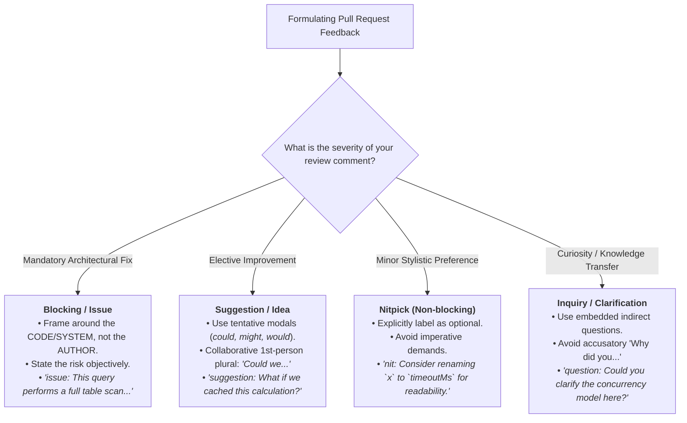

# Pull Request Reviews & Code Comments: Modality & Constructive Phrasing 🔍💬

> **Level:** CEFR B1–C1 (Collaborative Discourse & Diplomatic Modality)  
> **Primary References:** Michael Swan (*Practical English Usage*, §240, 338, 422); Google Code Review Developer Guide; Conventional Comments Standard  
> **Core Premise:** Code reviews are collaborative quality gates, not personal interrogations. Blunt commands (*“Fix this”*, *“You wrote bad code”*, *“Why did you do this?”*) provoke defensive reactions, damage psychological safety, and slow down engineering velocity. Professional software engineers use **epistemic modality**, **hedged interrogatives**, **collaborative first-person plurals (*we/us*)**, and **explicit intent tags** to deliver high-rigor, zero-friction peer feedback.

---

## 1. The Code Review Politeness & Rigor Matrix



---

## 2. Transforming Blunt Attacks into Collaborative Engineering Feedback

The table below contrasts adversarial phrasing with diplomatically hedged, grammatically sophisticated review alternatives:

| ❌ Broken / Adversarial Phrasing | ⚠️ Grammatical Defect | ✅ Professional Collaborative Phrasing |
| :--- | :--- | :--- |
| ❌ *“Why did you write this loop like this?”* | Accusatory past simple interrogation directed at the person (*you*). | ✅ *“Could you walk me through the logic here? Would a hash map lookup reduce the time complexity?”* |
| ❌ *“You forgot to handle null pointer exceptions.”* | Direct accusation of negligence (*You forgot*). | ✅ *“It looks like `user` might be null here if the session expires. Should we add a null check or default fallback?”* |
| ❌ *“Delete this function. It’s useless.”* | Harsh, dismissive imperative with insulting judgment. | ✅ *“Since `validateEmail()` is now handled by the auth middleware, can we safely remove this helper to prevent duplication?”* |
| ❌ *“Change this variable name immediately.”* | Authoritarian command; ignores context and collaborative respect. | ✅ *“nit: Renaming `temp` to `unverifiedPayload` might make this parsing logic clearer to future maintainers.”* |
| ❌ *“Your test doesn't cover edge cases.”* | Broad personal criticism (*Your test*). | ✅ *“Could we add a test case covering empty strings and negative integers to ensure robust error boundaries?”* |
| ❌ *“This is totally wrong.”* | Destructive, unspecific subjective attack. | ✅ *“issue: This implementation appears to create a race condition under concurrent requests because the counter is not atomic.”* |

---

## 3. Grammatical Modality for Constructive Suggestions

To provide suggestions without sounding demanding or passive-aggressive, use these four proven grammatical structures:

### Structure 1: The Tentative Modal Inquiry (`Could we + Bare Infinitive`)
$$\text{Could we} + \mathbf{V_{\text{base}}} + \dots + \text{to} + \text{Purpose?}$$
- *“**Could we extract** this SQL query into a dedicated repository method **to keep** the controller lightweight?”*
- *“**Could we leverage** optional chaining here (`user?.profile?.id`) **to simplify** the null checks?”*

### Structure 2: The Hypothetical Subjunctive Proposal (`What if we + Past Simple`)
$$\text{What if we} + \mathbf{V_{\text{past}}} + \dots ?$$
- *“**What if we used** a set instead of an array to ensure unique user IDs in $O(1)$ time?”*
- *“**What if we moved** this secret into AWS Secrets Manager rather than passing it via environment variables?”*

### Structure 3: The Hedged Epistemic Observation (`It seems / looks like + Clause`)
$$\text{It seems / looks like} + \text{Subject} + \mathbf{\text{might / could}} + \mathbf{V_{\text{base}}}$$
- *“**It looks like this connection might** stay open if an exception is thrown before line 45.”*
- *“**It seems that this method could** return `undefined` when the cache misses.”*

### Structure 4: The Conditional Recommendation (`Would it make sense to + Infinitive`)
$$\text{Would it make sense to} + \mathbf{V_{\text{base}}} + \dots ?$$
- *“**Would it make sense to** debounce this search input handler to reduce redundant API calls?”*
- *“**Would it make sense to** split this 800-line PR into two smaller, isolated changes?”*

---

## 4. The Conventional Comments Standard

High-performing engineering teams adopt the **Conventional Comments** syntax (`<label> [decorations]: <subject>`). This standard makes the intent and blocking nature of every comment grammatically explicit:

```markdown
<!-- Blocking architectural flaw -->
**issue (blocking):** This database transaction is not rolled back when the webhook dispatch fails.
Could we wrap lines 52–68 in a `try...catch` block with an explicit `transaction.rollback()`?

<!-- Non-blocking stylistic suggestion -->
**nit (non-blocking):** We usually sort these import statements alphabetically according to our ESLint config.

<!-- Inquiry to understand architecture -->
**question:** What was the motivation behind using a custom semaphore here instead of the built-in mutex pool?

<!-- Positive reinforcement and praise -->
**praise:** The test coverage for edge cases in this PR is fantastic! Especially love the fuzz test for malformed JSON.

<!-- Proposing an alternative optimization -->
**suggestion:** We could memoize this computation using `useMemo` so that the table doesn't re-render on unrelated state updates.
```

---

## 5. Inline Code Comments: Explaining the "WHY", Not the "WHAT"

Code comments should never narrate syntax that the code itself makes obvious. Comments exist to articulate **intent**, **business constraints**, and **non-obvious edge cases**.

### Grammatical Patterns for Code Comments:
1. **Purposive Infinitive (`To + Verb`):**
   ```python
   # To prevent race conditions during concurrent account balance updates,
   # we acquire an exclusive row-level lock before computing interest.
   ```
2. **Causal Prepositional Phrases (`Due to / Because of + Noun Phrase`):**
   ```typescript
   // Due to a known WebKit bug in iOS 16 (issue #4412),
   // CSS backdrop-filter must be accompanied by -webkit-backdrop-filter.
   ```
3. **Conditionals for Edge Cases (`If / Unless + Clause`):**
   ```go
   // If the upstream payment gateway fails to respond within 2500ms,
   // fallback to the secondary provider to avoid dropping the transaction.
   ```

---

## 6. Practical Dual-Domain Examples

### Everyday Conversation & Peer Feedback

1. *Tentative inquiry:* *Could we try eating at that new Italian restaurant downtown tonight?*
2. *Hedged suggestion:* *What if we left an hour earlier to avoid morning traffic?*
3. *Softened criticism:* *It looks like the front door wasn't locked completely when we left.*
4. *Diplomatic observation:* *Would it make sense to make a packing checklist before our camping trip?*
5. *Praise & appreciation:* *The dinner you prepared tonight was absolutely delicious!*
6. *Clarifying intent:* *Could you explain what you meant when you said we should reorganize the schedule?*
7. *Non-accusatory notice:* *It seems the milk might have spoiled; let's check the date on the carton.*
8. *Constructive recommendation:* *I wonder if painting this wall light grey would make the room feel brighter.*

### Software Engineering PR Reviews & Code Comments

9. *Blocking Issue:* *`issue (blocking):` This API endpoint does not validate user permissions. Could we add the `@RequireAuth` decorator to prevent unauthorized access?*
10. *Suggestion:* *`suggestion:` What if we used `Promise.allSettled()` here instead of `Promise.all()` so that one failing request doesn't abort the entire batch?*
11. *Question:* *`question:` I'm curious about the choice of `localStorage` here. Would `sessionStorage` be safer for temporary authorization tokens?*
12. *Nitpick:* *`nit:` Consider extracting this magic number `86400` into a named constant like `SECONDS_IN_A_DAY`.*
13. *Praise:* *`praise:` Outstanding refactoring of the billing service! The code is much easier to read and test.*
14. *Code Comment (Purposive):* `// To avoid memory leaks in single-page apps, unsubscribe from the event stream on component unmount.`
15. *Code Comment (Historical Consequence):* `// We explicitly sleep for 50ms here because the third-party legacy hardware drops back-to-back serial packets.`
16. *Code Comment (Contractual Mandate):* `// Deprecated: This method is preserved strictly for backward compatibility with mobile v1.4 clients.`

---

## 7. Common Antipattern Diagnostic Bug-and-Patch Table

| ❌ Broken Anti-Pattern (Bug) | Corrected Idiomatic English (Patch) | Diagnostic Grammar Explanation |
| :--- | :--- | :--- |
| ❌ *Why did you use recursion here? It’s bad.* | ✅ *Could you explain the choice of recursion here? Would an iterative approach protect against stack overflow on large inputs?* | Replace accusatory *Why did you* with a polite request for rationale and a concrete hypothetical question. |
| ❌ *You must fix this formatting now.* | ✅ *nit: Running `prettier --write` on this file will align the formatting with our project rules.* | Avoid authoritarian modal commands (*You must*) for non-blocking styling details. |
| ❌ *Your commit broke the build.* | ✅ *It looks like the build failed on this branch due to a missing mock in `auth_test.go`. Should we update the mock?* | Shift focus from the person (*Your commit broke*) to the system state (*the build failed due to...*). |
| ❌ *I hate this variable name.* | ✅ *suggestion: Renaming `d` to `elapsedDurationDays` would make this calculation self-documenting.* | Replace emotional subjective criticism (*I hate*) with objective readability rationales. |
| ❌ *Code comment: `// Increment i by 1`* | ✅ *Code comment: `// Skip header row in CSV`* | Comments must explain the business/operational rationale (**why**), not narrate self-evident syntax (**what**). |
| ❌ *What did you do to the CSS? It looks terrible.* | ✅ *It seems the flexbox layout breaks on mobile viewport widths (<480px). Could we test this with responsive media queries?* | Replace subjective aesthetic complaints with specific, reproducible layout defect descriptions. |

---

## 8. Self-Assessment Practice Exercises

### Exercise 1: Diplomatic Modality Transformation
Rewrite the following blunt, aggressive code review comments into collaborative, professional English:
1. *“You forgot to close the file stream in line 34.”*
2. *“Why didn't you write a unit test for this edge case?”*
3. *“This algorithm is way too slow.”*
4. *“Delete this console.log statement right now.”*
5. *“Your regex pattern is completely unreadable.”*

### Exercise 2: Conventional Comment Labeling & Grammar
Choose the correct Conventional Comments prefix (`issue`, `suggestion`, `question`, `nit`, or `praise`) and complete the sentence using appropriate modality:
6. `[______]:` Great job implementing the distributed tracing! The observability on this endpoint is fantastic.
7. `[______]:` This unindexed query on a 20-million-row table will cause timeouts in production. Could we add an index to the migration?
8. `[______]:` Consider sorting these object keys alphabetically to match our team style guide.
9. `[______]:` What was the reasoning behind using SHA-1 here instead of SHA-256?
10. `[______]:` What if we memoized this calculation using `useCallback` to prevent unnecessary component re-renders?

---

## 9. Answer Key with Diagnostic Explanations

1. **Model Answer:** *“It looks like the file stream might remain open if an exception occurs. Could we wrap this in a `try...finally` block (or `using` statement) to ensure proper cleanup?”*  
   *Explanation:* Removes accusatory *You forgot*, introduces tentative *might*, and proposes an actionable syntactic solution.
2. **Model Answer:** *“Could we add a unit test covering this scenario (e.g., when the API returns an empty array) to ensure regression safety?”*  
   *Explanation:* Converts accusatory past question *Why didn't you* into a forward-looking collaborative proposal.
3. **Model Answer:** *“issue: This algorithm appears to operate in $O(n^2)$ time complexity. Would it make sense to use a hash set to reduce the lookup time to $O(1)$?”*  
   *Explanation:* Replaces subjective dismissal (*way too slow*) with objective algorithmic analysis and an actionable optimization.
4. **Model Answer:** *“nit: Could we remove this `console.log` statement before merging to keep production logs clean?”*  
   *Explanation:* Tags the comment as a minor nitpick, eliminates the aggressive command, and provides the operational reason.
5. **Model Answer:** *“suggestion: This regular expression is quite complex. Could we break it into named capturing groups or add a brief explanatory comment to help future maintainers?”*  
   *Explanation:* Replaces personal insult (*unreadable*) with constructive architectural advice for maintainability.
6. **praise:** (Compliments and positive feedback).
7. **issue (blocking):** (Architectural risk or critical bug that must be resolved prior to merging).
8. **nit (non-blocking):** (Minor stylistic preference).
9. **question:** (Inquiry aimed at understanding architectural motivations or trade-offs).
10. **suggestion:** (Non-blocking proposal for performance or quality improvement).

---

## 10. High-Density Revision Flashcards

```
Q: What is the linguistic problem with asking 'Why did you write it this way?' in a code review?
A: It is an accusatory past simple interrogation directed at the person, triggering defensive reactions.
   Better: 'Could you walk me through the logic here? What if we tried [Alternative]?'
```

```
Q: What four grammatical structures provide polite, non-demanding review suggestions?
A: 1. 'Could we + Verb...?' (Tentative modal inquiry)
   2. 'What if we + Past Simple...?' (Hypothetical subjunctive)
   3. 'It seems/looks like X might...' (Hedged epistemic observation)
   4. 'Would it make sense to + Verb...?' (Conditional recommendation)
```

```
Q: What is the golden rule for writing inline code comments?
A: Explain the 'WHY' (intent, business logic, constraints, edge cases), NEVER the 'WHAT'
   (the syntax itself). E.g., '// To prevent memory leaks...' NOT '// Clear the array'.
```
