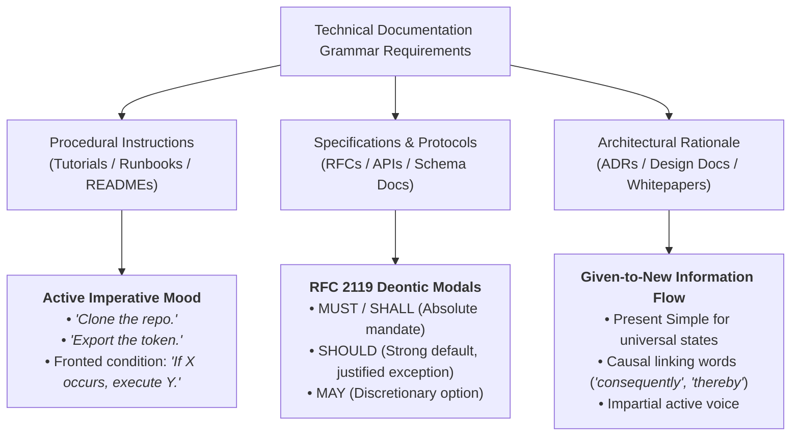

# Technical Documentation Writing: Syntax, Clarity & Precision 📘⚙️

> **Level:** CEFR B2–C1 (Technical & Professional Documentation Standards)  
> **Primary References:** Michael Swan (*Practical English Usage*, §240–270); IETF RFC 2119 / RFC 8174; Google Technical Writing Style Guide  
> **Core Premise:** Technical documentation exists to transfer operational knowledge and architectural constraints with zero cognitive friction. Ambiguous syntax, vague modal verbs, misplaced modifiers, and conversational filler create catastrophic engineering errors. High-grade documentation relies on **active voice**, **the imperative mood**, **fronted conditional clauses**, and **strictly standardized deontic modal operators (RFC 2119)**.

---

## 1. The Technical Documentation Syntax Tree



---

## 2. Standardized Specification Modals (RFC 2119 / RFC 8174)

In engineering specifications, APIs, and protocol standards, modal verbs are not stylistic choices; they establish legal and architectural compliance boundaries. Authors capitalize these terms to indicate strict adherence:

| Keyword | RFC 2119 Definition | Plain English Grammatical Equivalent | Engineering Consequence of Violation |
| :--- | :--- | :--- | :--- |
| **`MUST`** / **`REQUIRED`** / **`SHALL`** | Absolute, non-negotiable requirement of the specification. | *It is mandatory that the client send...* | Complete failure, rejection of payload, protocol disconnection. |
| **`MUST NOT`** / **`SHALL NOT`** | Absolute, unconditional prohibition. | *It is forbidden to allow...* | Security vulnerability, fatal data corruption, undefined behavior. |
| **`SHOULD`** / **`RECOMMENDED`** | Valid reasons may exist to ignore it, but the full implications must be understood and weighed. | *It is strongly advised to...* | Sub-optimal performance, latency degradation, technical debt. |
| **`SHOULD NOT`** / **`NOT RECOMMENDED`** | Valid reasons may exist when this is acceptable, but the full implications must be understood. | *You are strongly advised against...* | Deprecation warning, fragile system coupling. |
| **`MAY`** / **`OPTIONAL`** | Truly discretionary item; interoperability remains valid whether implemented or omitted. | *You have permission to... / It is possible to...* | None; fully elective feature. |

### Contrast: Ambiguous Natural English vs. RFC Precision
- ❌ **Vague Prose:** *“The client probably needs to send a bearer token, and it is nice to compress the payload.”*
- ✅ **RFC 2119 Compliant:** *“The client **MUST** transmit a Bearer token in the `Authorization` header. The client **MAY** compress the payload using gzip.”*

---

## 3. Core Grammatical Rules for Technical Writers

### Rule 1: Fronting Conditional Clauses (Condition Before Action)
Always state the condition, triggering event, or prerequisite **before** the instruction so the reader doesn't execute the command prematurely:
- ❌ **Action First:** *Restart the worker process if memory utilization exceeds 85%.*  
  *(Risk: The operator reads "Restart the worker process" and begins doing so before finishing the sentence).*
- ✅ **Condition Fronted:** * **If memory utilization exceeds 85%**, restart the worker process.*

### Rule 2: The Direct Imperative in Procedural Runbooks
Eliminate conversational padding, second-person pronouns (*you*), and weak auxiliary verbs (*should, can, please*):
- ❌ **Conversational / Weak:** *You should probably run `docker compose up` to see if it starts.*
- ❌ **Awkward Passive:** *The `docker compose up` command can be executed by the developer.*
- ✅ **Direct Imperative:** *Run `docker compose up -d` to initialize container dependencies.*

### Rule 3: The Antecedent Clarity Invariant (Ban Vague "This / It / They")
In technical writing, pronouns like *this*, *it*, and *that* must never stand alone at the beginning of a sentence without an explicit noun antecedent:
- ❌ **Ambiguous Antecedent:** *The service failed to connect to Redis and crashed Nginx. **This** caused customer requests to drop.*  
  *(What caused requests to drop? The Redis failure, the Nginx crash, or both?)*
- ✅ **Resolved Antecedent:** *...crashed Nginx. **This web server failure** caused customer requests to drop.*

### Rule 4: Eliminate Cognitive Dismissers ("Simply", "Just", "Obviously", "Easy")
Words like *just*, *simply*, *clearly*, and *easily* provide zero semantic information while alienating readers who are troubleshooting complex issues:
- ❌ **Dismissive:** *Simply run the database migration and it will easily configure the tables.*
- ✅ **Objective:** *Run the database migration script (`npm run migrate`) to generate the relational schema.*

---

## 4. Architecture Decision Records (ADR) Grammar Template

An Architecture Decision Record (ADR) captures why a software decision was made. It demands a specific grammatical balance:

```markdown
# ADR-004: Adopting PostgreSQL Partitioning for Audit Logs

## Status
Accepted

## Context (Present Simple & Past Simple for Current Architecture & Pain Points)
Our audit log table currently stores over 450 million records. Query execution times 
have degraded significantly, and vacuum operations consume 90% of available disk I/O. 
Horizontal sharding would introduce distributed transaction overhead that our team cannot sustain.

## Decision (Present Simple & Active Voice for System Commitment)
We adopt native PostgreSQL range partitioning based on the `created_at` timestamp. 
We create monthly partitions and automatically archive tables older than 365 days to S3.

## Consequences (Future Simple & Present Simple for Trade-offs)
- Query performance for recent audit logs will improve from 14s to under 45ms.
- Automated partition maintenance scripts must be monitored via Datadog.
- Cross-partition updates are strictly prohibited to prevent deadlocks.
```

---

## 5. Practical Dual-Domain Examples

### Everyday Conversation & Instructions

1. *Imperative:* *Stir the sauce continuously over medium heat for five minutes.*
2. *Fronted condition:* *Before entering the laboratory, put on your protective safety glasses.*
3. *RFC-style rule:* *Tenants must not alter the external structure of the property without written consent.*
4. *Clear antecedent:* *The dishwasher leaked and damaged the hardwood floor. This leakage occurred during the spin cycle.*
5. *Direct instruction:* *Press the green button to initiate calibration.*
6. *Conditional trigger:* *If your flight is delayed by more than three hours, contact customer care for meal vouchers.*
7. *Eliminating filler:* *Fill in the application form and return it to the registrar.*
8. *Modality of permission:* *Guests may check in anytime after 15:00.*

### Software Engineering & Technical Documentation

9. *RFC 2119 Mandate:* *The API gateway **MUST** reject any payload that exceeds 10MB with an `HTTP 413 Payload Too Large` response.*
10. *RFC 2119 Recommendation:* *Production services **SHOULD** implement exponential backoff with jitter when retrying failed RPC calls.*
11. *Fronted Condition:* *Before executing `terraform apply`, verify that the AWS target region is configured to `us-east-1`.*
12. *Direct Imperative:* *Add the generated SSH public key to your GitLab account profile.*
13. *Clear Antecedent:* *The auth pod consumed 100% CPU and stopped responding to health checks. **This unresponsive state** triggered a Kubernetes pod eviction.*
14. *API Specification:* *The `offset` parameter **MUST NOT** be negative; a negative integer results in an `HTTP 400 Bad Request`.*
15. *Zero Dismissers:* *To generate the TLS certificates, execute `make certs` from the repository root.* (NOT: *Just simply execute...*).
16. *ADR Decision:* *The platform team **prohibits** raw SQL queries in controller logic to eliminate SQL injection vulnerabilities.*

---

## 6. Common Antipattern Diagnostic Bug-and-Patch Table

| ❌ Broken Anti-Pattern (Bug) | Corrected Idiomatic English (Patch) | Diagnostic Grammar Explanation |
| :--- | :--- | :--- |
| ❌ *You should simply just click the save button.* | ✅ *Click **Save** to persist your changes.* | Remove dismissive filler words (*simply, just*) and replace weak advice (*you should*) with direct imperative. |
| ❌ *Deploy the Helm chart if the staging tests pass.* | ✅ *If staging tests pass, deploy the Helm chart.* | Front conditional triggers to prevent engineers from executing commands before verifying the prerequisite. |
| ❌ *The microservice needs to return a 200 OK.* | ✅ *The microservice **MUST** return `HTTP 200 OK`.* | Specifications require RFC 2119 deontic modals (*MUST*), not colloquial obligation (*needs to*). |
| ❌ *The database locked up. This was terrible.* | ✅ *The database locked up. **This lock contention** halted order processing.* | Vague standalone *this* lacks a noun antecedent; add the specific noun concept (*This lock contention*). |
| ❌ *The config file can easily be edited by you.* | ✅ *Edit `config.yaml` to specify cluster parameters.* | Avoid wordy, awkward passives in procedural instructions; use active imperative. |
| ❌ *Clients might want to cache responses maybe.* | ✅ *Clients **MAY** cache responses for up to 300 seconds.* | Replace double hedges (*might, maybe*) with unambiguous RFC modal operator *MAY*. |
| ❌ *Run `npm install` after you cloned the repo.* | ✅ *After cloning the repository, run `npm install`.* | Temporal dependencies must be sequenced chronologically: prerequisite first, subsequent action second. |

---

## 7. Self-Assessment Practice Exercises

### Exercise 1: RFC 2119 Selection (Insert MUST, SHOULD, or MAY)
1. For security compliance, all passwords stored in the database ________ be hashed with Argon2id. (Mandatory)
2. Microservices ________ implement rate limiting on public endpoints to protect against DDoS attacks, although internal services behind the firewall may omit this. (Strong recommendation)
3. The client ________ include a `Correlation-ID` header; if omitted, the API gateway will generate one automatically. (Elective option)
4. Under no circumstances ________ the authentication service log raw user passwords in plaintext. (Strict prohibition)
5. Webhook receivers ________ acknowledge event delivery with an HTTP 200 response within 2.0 seconds. (Required protocol mandate)

### Exercise 2: Technical Style Refactoring (Rewrite following technical writing rules)
6. *You should simply just run the test suite if you want to make sure the build is green.*
7. *Restart the production database server if the memory consumption is over 95%.*
8. *The caching layer failed and the backend crashed. This was bad for throughput.*
9. *A backup can be taken by the administrator by running `backup.sh`.*
10. *The application needs to probably support UTF-8 encoding.*

---

## 8. Answer Key with Diagnostic Explanations

1. **MUST** — Security requirements of non-negotiable nature demand *MUST*.
2. **SHOULD** — A strong architectural best practice with valid exceptions is governed by *SHOULD*.
3. **MAY** — An elective, non-mandatory feature that causes no protocol error when omitted is governed by *MAY*.
4. **MUST NOT** (or **SHALL NOT**) — Absolute prohibitions demand *MUST NOT*.
5. **MUST** — Strict SLA requirements with automated consequences demand *MUST*.
6. **Rewrite:** *Before merging code, run `npm test` to verify that all test suites pass.*  
   *Explanation:* Eliminates *simply, just, you should*; fronts the prerequisite condition; uses active imperative.
7. **Rewrite:** *If memory consumption exceeds 95%, restart the database server.*  
   *Explanation:* Fronts the condition clause before the action clause to prevent accidental premature restarts.
8. **Rewrite:** *The caching layer failed and the backend crashed. **This cascading failure** reduced API throughput by 80%.*  
   *Explanation:* Replaces vague standalone *this* with a concrete noun phrase (*This cascading failure*) and specifies the impact.
9. **Rewrite:** *Run `./backup.sh` to take a database backup.*  
   *Explanation:* Replaces clumsy passive voice (*can be taken by*) with direct active imperative.
10. **Rewrite:** *The application **MUST** support UTF-8 character encoding.*  
    *Explanation:* Replaces weak colloquial hedging (*needs to probably*) with definitive RFC 2119 standard modal (*MUST*).

---

## 9. High-Density Revision Flashcards

```
Q: What are the three core RFC 2119 modal verbs and their exact engineering meanings?
A: 1. MUST / SHALL = Absolute requirement (non-negotiable).
   2. SHOULD / RECOMMENDED = Strong default recommendation (justifiable exceptions permitted).
   3. MAY / OPTIONAL = Discretionary option (omission causes no protocol breach).
```

```
Q: Why must conditional clauses be placed at the start of procedural instructions?
A: To prevent engineers from executing an action before understanding the prerequisite conditions or risks
   (e.g., 'If the cluster is degraded, run...' vs. 'Run... if the cluster is degraded').
```

```
Q: Why are words like 'simply', 'just', and 'obviously' banned from technical documentation?
A: They provide zero actionable information, increase cognitive clutter, and frustrate developers
   when the task is not simple or when an outage is occurring.
```
