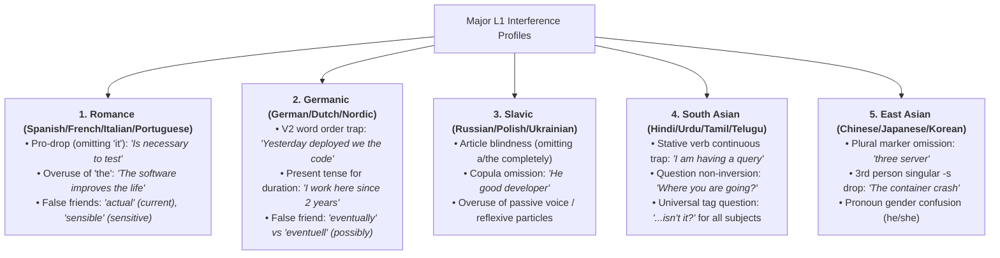

# ESL Language Interference Patterns: Cross-Linguistic Diagnostics & Fixes 🌐🧠

> **Level:** CEFR B1–C1 (Contrastive Linguistics & L1 Transfer Diagnostics)  
> **Primary References:** Michael Swan & Bernard Smith (*Learner English: A Teacher’s Guide to Interference and Other Problems*); Terence Odlin (*Language Transfer*)  
> **Core Premise:** Adult English learners do not make random errors; their mistakes are overwhelmingly governed by **negative language transfer** (or **L1 interference**). When an engineer’s brain cannot find an immediate English grammatical formula, it unconsciously borrows the syntactic template of their mother tongue and translates words literally. By understanding the specific structural failure modes of your native language family, you can systematically diagnose and debug your speech and writing.

---

## 1. The Global L1 Interference Architecture



---

## 2. Romance Language Profile (Spanish, French, Italian, Portuguese)

### Bug 1: Pro-Drop (Missing Dummy Subject "It")
- *L1 Root:* Romance languages are "null-subject" (pro-drop) languages; verb inflections carry the subject. English **strictly requires an explicit grammatical subject**.
- ❌ *“Is important to backup the database.”*
- ✅ *“**It is** important to backup the database.”*

### Bug 2: Overuse of the Definite Article (*The*)
- *L1 Root:* Romance languages place articles before generic abstract concepts (*el amor, la vie*). English uses the **zero article** for general abstract nouns.
- ❌ *“The technology changes the society.”*
- ✅ *“Technology changes society.”*

### Bug 3: False Friends (*Faux Amis*)
- **`Actual`**: In French/Spanish, *actuel/actual* means *current / present*. In English, *actual* means *real / factual*.  
  - ❌ *“This is our actual roadmap.”* $\rightarrow$ ✅ *“This is our **current** roadmap.”*
- **`Sensible`**: In French/Spanish, *sensible* means *sensitive*. In English, *sensible* means *having good judgment / practical*.  
  - ❌ *“The API handles sensible user data.”* $\rightarrow$ ✅ *“The API handles **sensitive** user data.”*

---

## 3. Germanic Language Profile (German, Dutch)

### Bug 1: Verb-Second (V2) Word Order Inversion
- *L1 Root:* In German/Dutch main clauses, the finite verb must occupy the second position, inverting subject and verb when an adverbial fronts the sentence (*Gestern haben wir...*). English strictly maintains **`Adverbial + Subject + Verb`**.
- ❌ *“Yesterday deployed we the microservice.”*
- ✅ *“Yesterday, **we deployed** the microservice.”*

### Bug 2: Present Simple for Ongoing Duration
- *L1 Root:* German uses present tense + *seit* (*Ich arbeite hier seit drei Jahren*). English requires the **Present Perfect Continuous** + *for*.
- ❌ *“I work here since three years.”*
- ✅ *“I **have been working** here **for** three years.”*

### Bug 3: The "Eventually" False Friend
- *L1 Root:* German *eventuell* means *possibly / perhaps*. In English, *eventually* means *in the end / ultimately*.
- ❌ *“We will eventually migrate to AWS, but we might choose GCP.”* (Nonsensical in English).
- ✅ *“We might **possibly** migrate to AWS...”*

---

## 4. Slavic Language Profile (Russian, Polish, Ukrainian, Czech)

### Bug 1: Article Blindness (Total Omission of *A / An / The*)
- *L1 Root:* Slavic languages (except Bulgarian/Macedonian) possess **no grammatical article system**. Learners frequently omit articles entirely.
- ❌ *“We created new branch and fixed bug.”*
- ✅ *“We created **a** new branch and fixed **the** bug.”*

### Bug 2: Zero Copula (Omission of the Verb "To Be")
- *L1 Root:* Russian frequently omits the present tense of *to be*.
- ❌ *“This cluster very scalable.”*
- ✅ *“This cluster **is** very scalable.”*

### Bug 3: Aspectual Mapping Errors
- *L1 Root:* Slavic languages rely on perfective/imperfective verb prefixes, causing confusion between English Past Simple and Present Perfect.
- ❌ *“I have finished the report yesterday.”*
- ✅ *“I **finished** the report yesterday.”*

---

## 5. South Asian / Indic Profile (Hindi, Urdu, Tamil, Telugu, Bengali)

### Bug 1: Stative Verbs in Continuous Aspect
- *L1 Root:* Indic languages permit continuous aspect with verbs of possession, cognition, and perception (*main soch raha hoon*). In standard English, stative verbs cannot be continuous.
- ❌ *“I am having a doubt regarding the architecture.”*
- ✅ *“I **have a question** regarding the architecture.”*
- ❌ *“Are you understanding this concept?”*
- ✅ *“**Do you understand** this concept?”*

### Bug 2: Question Non-Inversion
- *L1 Root:* Indic languages signal questions with tone or question particles (*kahan ja rahe ho?*) without auxiliary inversion.
- ❌ *“Where you are deploying the container?”*
- ✅ *“Where **are you deploying** the container?”*

### Bug 3: The Universal Tag Question ("Isn't it?")
- *L1 Root:* Translation of *hai na?* or *na?* as an invariant tag question for all subjects.
- ❌ *“They deployed the code, isn't it?”*
- ✅ *“They deployed the code, **didn't they**?”*

### Bug 4: Lexical Redundancies ("Prepone", "Revert Back")
- ❌ *“Please revert back to me.”* $\rightarrow$ ✅ *“Please **reply / get back** to me.”*
- ❌ *“We preponed the meeting.”* $\rightarrow$ ✅ *“We **moved the meeting forward**.”*

---

## 6. East Asian Profile (Chinese, Japanese, Korean)

### Bug 1: Plural Marker & Countability Drop
- *L1 Root:* Chinese and Japanese use numerical classifiers/measure words rather than plural noun inflections (*-s*).
- ❌ *“We provisioned three server.”*
- ✅ *“We provisioned three **servers**.”*

### Bug 2: Dropping 3rd-Person Singular "-s"
- *L1 Root:* East Asian verbs do not conjugate for person or number.
- ❌ *“The daemon restart every night.”*
- ✅ *“The daemon **restarts** every night.”*

### Bug 3: Subject Omission
- *L1 Root:* High-context topic-prominent languages drop pronouns when obvious from context.
- ❌ *“Looked at logs. Found memory leak.”*
- ✅ *“**We inspected** the logs and **found** a memory leak.”*

---

## 7. Practical Dual-Domain Examples

### Everyday Conversation & General Writing

1. *Romance fix (Dummy it):* * **It is** cold outside today. (NOT: *Is cold*).*
2. *Germanic fix (V2 order):* *Tomorrow **we will visit** the museum. (NOT: *Tomorrow visit we*).*
3. *Slavic fix (Articles):* *I bought **a** loaf of bread and **some** cheese.*
4. *Indic fix (Stative verb):* *I **hear** music coming from next door. (NOT: *I am hearing*).*
5. *East Asian fix (Plural):* *She read four **books** over the holiday weekend.*
6. *Romance fix (Zero article):* * **Science** helps us understand the universe.*
7. *Indic fix (Tag question):* *You are coming to the party, **aren't you**? (NOT: *isn't it?*).*
8. *Germanic fix (Duration):* *She **has lived** here for five years.*

### Software Engineering & Technical Documentation

9. *Romance fix (Dummy it):* * **It is necessary to run** automated tests before merging to master.*
10. *Germanic fix (V2 order):* *In this architecture, **the gateway terminates** TLS traffic.*
11. *Slavic fix (Articles):* *The application throws **an** exception when **the** database times out.*
12. *Indic fix (Stative verb):* *I **have a question** regarding the Redis failover policy.* (NOT: *I am having a doubt*).
13. *East Asian fix (3rd-person -s):* *The Kubernetes scheduler **monitors** node resource utilization.*
14. *Romance fix (False friend):* *Store **sensitive** API credentials inside AWS Secrets Manager.* (NOT: *sensible*).
15. *Indic fix (Inversion):* *Could you clarify **why the build failed**?* (NOT: *why did the build fail* in embedded clause).
16. *Slavic fix (Copula be):* *This implementation **is** thread-safe.* (NOT: *This implementation thread-safe*).

---

## 8. Common Antipattern Diagnostic Bug-and-Patch Table

| ❌ Broken Anti-Pattern (Bug) | Corrected Idiomatic English (Patch) | L1 Root Cause Family |
| :--- | :--- | :--- |
| ❌ *Is possible to configure HTTPS?* | ✅ ***It is** possible to configure HTTPS?* | **Romance:** Null-subject (pro-drop) transfer; missing dummy *it*. |
| ❌ *Yesterday reviewed I the pull request.* | ✅ *Yesterday, **I reviewed** the pull request.* | **Germanic:** Verb-Second (V2) word order inversion error. |
| ❌ *We found memory leak in pod.* | ✅ *We found **a** memory leak in **the** pod.* | **Slavic:** Total article omission (article blindness). |
| ❌ *I am having a doubt about this API.* | ✅ *I **have a question** about this API.* | **Indic:** Stative verb in continuous form + Indian English *doubt* for *question*. |
| ❌ *The microservice scale automatically.* | ✅ *The microservice **scales** automatically.* | **East Asian:** Dropping 3rd-person singular present inflection `-s`. |
| ❌ *The system handles sensible user info.* | ✅ *The system handles **sensitive** user info.* | **Romance:** False friend: *sensible* (prudent) vs *sensitive* (confidential). |
| ❌ *We discussed about the outage.* | ✅ *We **discussed** the outage.* | **Cross-Linguistic:** Redundant preposition after transitive verb *discuss*. |

---

## 9. Self-Assessment Practice Exercises

### Exercise 1: L1 Defect Diagnosis
Identify which L1 language family likely generated each defect and patch the sentence:
1. *Is very important to sanitize all incoming SQL parameters.*
2. *Tomorrow deploy we the new release candidate.*
3. *We implemented two new feature in this sprint.*
4. *I am knowing the answer to this technical problem.*
5. *We downloaded software to test database.*

### Exercise 2: Error Correction
6. *Please revert back to me with the telemetry metrics.*
7. *The server was offline since three hours.*
8. *The team merged the PR, isn't it?*
9. *Our actual infrastructure is hosted on Microsoft Azure.* (Meaning: our infrastructure right now)
10. *Where the configuration file is located?*

---

## 10. Answer Key with Diagnostic Explanations

1. **Patch:** ***It is** very important to sanitize all incoming SQL parameters.*  
   *Diagnosis:* Romance pro-drop error (missing dummy subject *it*).
2. **Patch:** *Tomorrow, **we deploy (or we will deploy)** the new release candidate.*  
   *Diagnosis:* Germanic V2 word order error (inverted *deploy we*).
3. **Patch:** *We implemented two new **features** in this sprint.*  
   *Diagnosis:* East Asian plural marker omission (*two new feature* $\rightarrow$ *features*).
4. **Patch:** *I **know** the answer to this technical problem.*  
   *Diagnosis:* Indic stative verb continuous error (*know* is stative).
5. **Patch:** *We downloaded **some software (or a tool)** to test **the** database.*  
   *Diagnosis:* Slavic article omission (*the database*) + uncountable noun error (*software*).
6. **Correction:** *Please **reply / get back** to me with the telemetry metrics.*  
   *Explanation:* *Revert back* is an unidiomatic redundancy; use *reply* or *get back*.
7. **Correction:** *The server **has been** offline **for** three hours.*  
   *Explanation:* Duration spanning to the present requires Present Perfect + *for*.
8. **Correction:** *The team merged the PR, **didn't they**?*  
   *Explanation:* Tag question must match the auxiliary verb of the main clause (*did $\rightarrow$ didn't they*).
9. **Correction:** *Our **current** infrastructure is hosted on Microsoft Azure.*  
   *Explanation:* False friend: *actual* means real/factual; *current* means present time.
10. **Correction:** *Where **is the configuration file** located?*  
    *Explanation:* Direct question requires subject-auxiliary inversion (*Where is the file...*).

---

## 11. High-Density Revision Flashcards

```
Q: What is the pro-drop error common to Spanish, French, and Italian speakers?
A: Omitting the dummy subject 'it' (e.g., 'Is necessary to run tests' ❌).
   In English, 'it' is mandatory: 'IT IS necessary to run tests' ✅.
```

```
Q: What is the stative verb error common to Indian English speakers?
A: Using continuous aspect with stative verbs (e.g., 'I am having a doubt', 'I am knowing him' ❌).
   Correct: 'I have a question' ✅, 'I know him' ✅.
```

```
Q: What is the V2 word order error common to German and Dutch speakers?
A: Inverting subject and verb after fronted adverbs (e.g., 'Yesterday deployed we' ❌).
   In English, maintain Subject + Verb: 'Yesterday, WE DEPLOYED' ✅.
```
