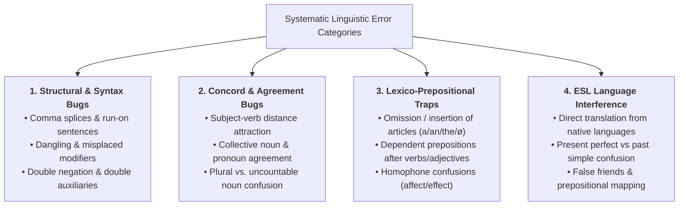

# Module 16: Common Mistakes & Diagnostic Guide 🩺🛠️

> **Level:** CEFR A2–C1 (Error Analysis, Remediation & L1 Interference Diagnostics)  
> **Primary References:** Michael Swan (*Practical English Usage*, §31, 32–35); *Cambridge Learner Corpus*; *Longman Dictionary of Common Errors*  
> **Core Premise:** Grammatical errors in adult language learners are not random; they follow **predictable, systematic failure modes**. These errors typically arise from **L1 mother-tongue interference** (translating native syntax directly into English), **overgeneralization of rules** (e.g., treating *information* or *advice* as countable), or **register leakage** (using conversational slang in technical specifications). This module provides an exhaustive diagnostic suite to detect, understand, and patch recurring linguistic bugs.

---

## 1. The Diagnostic Error Taxonomy



---

## 2. Curated Curriculum of Topic Guides

| Guide | Core Linguistic Focus | Primary Deliverable & Repair Target | CEFR Level |
| :--- | :--- | :--- | :--- |
| **[Top 50 Grammar Mistakes & Fixes](./top-50-grammar-mistakes-and-fixes.md)** | High-frequency syntax, concord, and morphological errors | Master diagnostic bug-and-patch encyclopedia across all grammar categories | A2–C1 |
| **[Sentence Formation & Run-On Repairs](./sentence-formation-and-run-on-repairs.md)** | Comma splices, fused sentences, fragments, dangling modifiers | Structural syntax repair, punctuation compliance, and sentence architecture | B1–C1 |
| **[Preposition & Article Diagnostic Checklist](./preposition-and-article-diagnostic-checklist.md)** | Countability violations, zero-article environments, dependent prepositions | Audit checklist for non-native article omissions and preposition mismatches | A2–B2 |
| **[ESL Language Interference Patterns](./esl-language-interference-patterns.md)** | Cross-linguistic L1 transfer errors (Romance, Germanic, Slavic, Asian) | Identifying and overcoming native-language grammatical interference | B1–C1 |
| **[Spoken vs. Written English Diagnostic](./spoken-vs-written-english-diagnostic.md)** | Register boundaries, conversational shortcuts, formality spectrum | Preventing informal spoken slang from contaminating formal documentation | B1–C2 |

---

## 3. The Debugging Protocol for English Writing

When reviewing technical documentation, emails, or architectural proposals, execute this four-step diagnostic pipeline:

```
┌────────────────────────────────────────────────────────────────────────────────────────┐
│ The 4-Step Linguistic Linting Pipeline                                                 │
├────────────────────────────────────────────────────────────────────────────────────────┤
│ Step 1: Sentence Boundary Audit                                                        │
│ • Check every comma. Are two independent clauses joined without FANBOYS? (Comma Splice)│
│ • Check every participial phrase. Does the subject of the main clause perform it?      │
│                                                                                        │
│ Step 2: Subject-Verb Agreement Audit                                                   │
│ • Strip prepositional phrases between subject and verb. Does the verb agree?          │
│                                                                                        │
│ Step 3: Noun & Article Audit                                                           │
│ • Identify all singular countable nouns. Do they have a determiner (a/an/the/this)?    │
│ • Identify uncountable nouns (information, software, data). Remove plural -s and 'a'.  │
│                                                                                        │
│ Step 4: Verb Complementation & Preposition Audit                                       │
│ • Check verbs taking gerunds vs infinitives (suggest, recommend, look forward to).     │
│ • Verify dependent prepositions (capable OF, responsible FOR, comply WITH).            │
└────────────────────────────────────────────────────────────────────────────────────────┘
```

---

## 4. Navigation & Next Steps

Select a guide from the curriculum above to begin systematic error remediation, or proceed directly to:
- ➡️ **[1. Top 50 Grammar Mistakes & Fixes](./top-50-grammar-mistakes-and-fixes.md)**
- 🔙 **[Module 14: Vocabulary & Word Usage](../14-vocabulary-and-word-usage/index.md)**
- 🏠 **[Master Knowledge Base Index](../index.md)**
