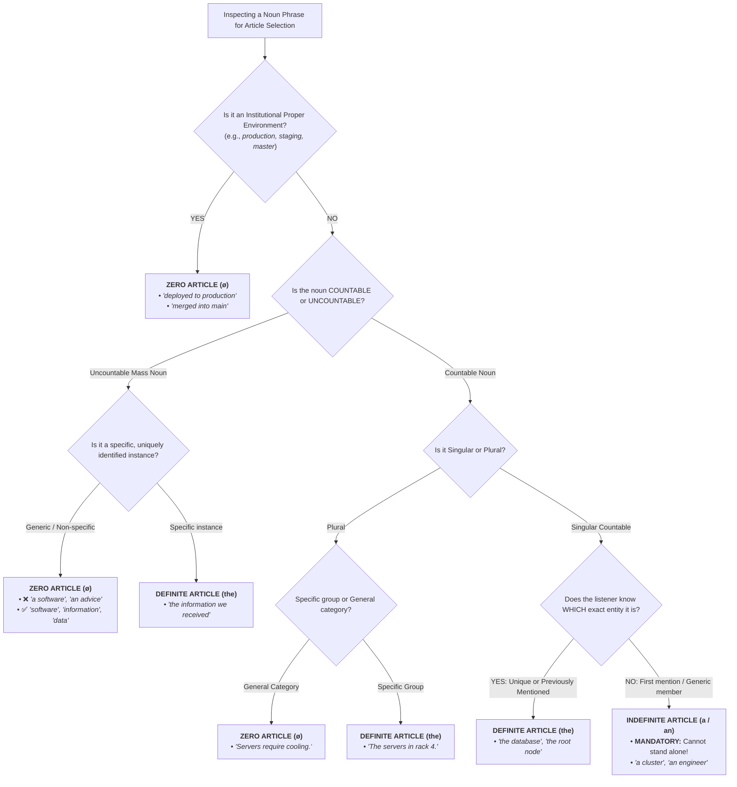

# Preposition & Article Diagnostic Checklist: The Non-Native Audit Guide 📋🔍

> **Level:** CEFR A2–B2 (Determiners, Noun Countability & Preposition Regimens)  
> **Primary References:** Michael Swan (*Practical English Usage*, §12–14, 18); Raymond Murphy (*English Grammar in Use*, Units 69–81, 119–136)  
> **Core Premise:** For speakers of languages without articles (such as Slavic, East Asian, or Indic languages), English **articles** (*a/an/the/ø*) and **dependent prepositions** represent the single highest concentration of persistent errors. Non-native writing frequently suffers from "article blindness" (omitting *a/an* before singular countables), "uncountable contamination" (*“a software”*), and "preposition drift" (*“depend from”*). This checklist provides a deterministic audit protocol to catch and fix every occurrence.

---

## 1. The Article Selection Decision Protocol



---

## 2. The 10 Invariant Uncountable Nouns in Computing

These high-frequency technical nouns are **strictly uncountable** in standard English. They **NEVER** take the indefinite article *a / an*, and they **NEVER** take a plural *-s*:

| Uncountable Noun | ❌ Fatal Non-Native Bug | ✅ Patched English Expression | Grammatical Unit Counter |
| :--- | :--- | :--- | :--- |
| **`Software`** | ❌ *a software / softwares* | ✅ *software / some software* | *a software application / a software tool* |
| **`Information`** | ❌ *an information / informations* | ✅ *information / some information* | *a piece of information / an item of data* |
| **`Hardware`** | ❌ *a hardware / hardwares* | ✅ *hardware / some hardware* | *a piece of hardware / a hardware device* |
| **`Equipment`** | ❌ *an equipment / equipments* | ✅ *equipment / new equipment* | *a piece of equipment* |
| **`Documentation`** | ❌ *a documentation / documentations*| ✅ *documentation / the docs* | *a documentation page / an article* |
| **`Feedback`** | ❌ *a feedback / feedbacks* | ✅ *feedback / some feedback* | *a piece of feedback / a comment* |
| **`Advice`** | ❌ *an advice / advices* | ✅ *advice / some advice* | *a piece of advice / a recommendation* |
| **`Traffic`** | ❌ *a traffic / traffics* | ✅ *traffic / network traffic* | *a volume of traffic / network packets* |
| **`Storage`** | ❌ *a storage / storages* | ✅ *storage / persistent storage* | *a storage volume / a storage partition* |
| **`Code`** (Source) | ❌ *a code / codes* | ✅ *code / source code* | *a line of code / a code snippet* |

---

## 3. The Singular Countable Invariant ("The Naked Noun Ban")

$$\mathbf{\text{Singular Countable Noun}} \implies \mathbf{\text{CANNOT Stand Alone (Naked)}}$$

A singular countable noun (*server, node, error, test, user, engineer*) **must always** be preceded by a determiner (*a, an, the, this, that, my, each*):
- ❌ *“I am software engineer.”* $\rightarrow$ ✅ *“I am **a** software engineer.”*
- ❌ *“System threw error.”* $\rightarrow$ ✅ *“The system threw **an** error.”*
- ❌ *“We deployed to new cluster.”* $\rightarrow$ ✅ *“We deployed to **a** new cluster.”*

---

## 4. Master Dependent Preposition Audit Tables

Dependent prepositions are fixed collocations dictated by the preceding verb or adjective.

### 1. Essential Technical Verbs & Their Dependent Prepositions
- **`adhere TO`**: *“All APIs must adhere **to** OpenAPI 3.1 standards.”* (NOT: *with* ❌).
- **`comply WITH`**: *“The architecture complies **with** SOC2 security guidelines.”* (NOT: *to* ❌).
- **`depend ON / UPON`**: *“Our microservices depend **on** high-speed networking.”* (NOT: *from* ❌).
- **`consist OF`**: *“The cluster consists **of** three master nodes.”* (NOT: *from* ❌).
- **`listen ON / AT`**: *“The daemon listens **on** port 8080.”* (NOT: *in* ❌).
- **`fallback ON / TO`**: *“The gateway falls back **on / to** cached responses.”*
- **`prevent ... FROM (+ gerund)`**: *“Mutexes prevent threads **from overwriting** shared state.”*
- **`subscribe TO`**: *“The consumer subscribes **to** the Kafka event stream.”* (NOT: *on* ❌).

### 2. Essential Technical Adjectives & Their Dependent Prepositions
- **`capable OF (+ gerund)`**: *“The engine is capable **of handling** 50,000 QPS.”* (NOT: *to handle* ❌).
- **`compatible WITH`**: *“PostgreSQL 16 is fully compatible **with** our ORM.”* (NOT: *to* ❌).
- **`responsible FOR`**: *“The DevOps engineer is responsible **for deploying** containers.”*
- **`vulnerable TO`**: *“Unpatched nodes remain vulnerable **to** remote code execution.”*
- **`equivalent TO`**: *“This SQL clause is equivalent **to** a hash join.”*
- **`interested IN`**: *“We are interested **in optimizing** our AWS spending.”*

---

## 5. Topological Prepositions in Computing: *In* vs. *On* vs. *At*

| Preposition | Spatial / Architectural Domain | Standard Computing Collocations |
| :--- | :--- | :--- |
| **`IN`** | **Volumetric / Enclosed / Internal State** | *in memory, in the database, in the cloud, in production, in a container, in a thread, in a loop* |
| **`ON`** | **Surfaces / Platforms / Disks / Host Systems** | *on disk, on the server, on AWS, on Linux, on port 8080, on the network, on branch main* |
| **`AT`** | **Pinpoint Addresses / Coordinates / Network Endpoints** | *at port 8080, at address 0x7FFF, at line 42, at 14:00 UTC, at endpoint `/v1/auth`* |

---

## 6. Practical Dual-Domain Examples

### Everyday Conversation & General Writing

1. *Countable singular:* *She adopted **a puppy** from the animal shelter.*
2. *Uncountable mass:* *Could you give me **some advice** about buying a house?*
3. *Zero article:* * **Life** is full of unexpected surprises.*
4. *Dependent verb:* *Children depend **on** their parents for guidance.*
5. *Dependent adjective:* *He is capable **of running** a marathon in under three hours.*
6. *Preposition of place:* *We met **at the restaurant** on 5th Avenue.*
7. *Preposition of vehicle:* *I am currently **on the bus** heading downtown.*
8. *Dependent verb:* *Please listen carefully **to** the instructions.*

### Software Engineering & Technical Documentation

9. *Uncountable Noun:* *Our platform team provisioned new **hardware** to support the machine learning cluster.* (NOT: *hardwares*).
10. *Singular Countable:* *The client must provide **a valid Bearer token** with every request.*
11. *Dependent Verb:* *The authentication proxy complies **with** OAuth 2.0 specifications.*
12. *Dependent Adjective:* *This distributed filesystem is capable **of scaling** horizontally across 1,000 nodes.*
13. *Topological IN:* *Cached user credentials remain stored **in memory** for five minutes.*
14. *Topological ON:* *Data write operations are flushed **on disk** to ensure ACID durability.*
15. *Topological AT:* *The microservice ingress listens for incoming traffic **at port 443**.*
16. *Institutional Environment:* *Hotfixes must be verified in staging before being deployed to **production**.* (NOT: *the production*).

---

## 7. Common Antipattern Diagnostic Bug-and-Patch Table

| ❌ Broken Anti-Pattern (Bug) | Corrected Idiomatic English (Patch) | Diagnostic Grammar Explanation |
| :--- | :--- | :--- |
| ❌ *We built **a new software**.* | ✅ *We built **a new software application / tool**.* | *Software* is uncountable; add a countable noun head (*application, tool*). |
| ❌ *The engineer is capable **to fix** the bug.* | ✅ *The engineer is capable **of fixing** the bug.* | *Capable* strictly governs the preposition *of* + gerund (`-ing`). |
| ❌ *The server listens **in** port 80.* | ✅ *The server listens **on / at** port 80.* | Port binding takes *on* or *at*, never *in*. |
| ❌ *We received **many feedbacks** on the PR.* | ✅ *We received **a lot of feedback / many comments** on the PR.* | *Feedback* is uncountable mass noun; it cannot take plural *-s* or *many*. |
| ❌ *This system depends **from** AWS.* | ✅ *This system depends **on / upon** AWS.* | Dependent preposition after *depend* is strictly *on*. |
| ❌ *User must enter **password**.* | ✅ *The user must enter **a password / their password**.* | Naked singular countable noun violation: *password* requires a determiner. |
| ❌ *The code complies **to** our standards.* | ✅ *The code complies **with** our standards.* | Fixed prepositional idiom: *comply with*, never *comply to*. |

---

## 8. Self-Assessment Practice Exercises

### Exercise 1: The Article Audit (Insert *a*, *an*, *the*, or *ø* for zero article)
1. The company invested in ________ state-of-the-art server hardware.
2. She works as ________ principal site reliability engineer at Google.
3. Once staging tests pass, we will deploy the release candidate directly to ________ production.
4. The backend service stores session tokens in ________ memory to accelerate lookups.
5. We need to write ________ unit test covering this authentication edge case.

### Exercise 2: Dependent Preposition Selection
6. The distributed database engine is capable (to process / of processing / processing) 100,000 QPS.
7. All inbound traffic must adhere (with / to / on) our corporate firewall policies.
8. Microservices must not depend (from / of / on) internal implementation details of other services.
9. Mutex locks prevent concurrent threads (to corrupt / from corrupting) shared heap memory.
10. Our deployment pipelines are fully compatible (to / with / against) Kubernetes 1.30.

---

## 9. Answer Key with Diagnostic Explanations

1. **ø (zero article)** — *Hardware* is uncountable and generic here; no article.
2. **a** — Singular countable profession requires indefinite article *a*.
3. **ø (zero article)** — Institutional computing environment *production* takes zero article.
4. **ø (zero article)** — Standard computing topological phrase is *in memory*.
5. **a** — Singular countable noun *unit test* requires indefinite article *a*.
6. **of processing** — *Capable* strictly takes *of + gerund*.
7. **to** — *Adhere* strictly governs preposition *to*.
8. **on** — *Depend* strictly governs preposition *on*.
9. **from corrupting** — *Prevent [object] from + gerund*.
10. **with** — *Compatible* strictly takes *with*.

---

## 10. High-Density Revision Flashcards

```
Q: What is the 'Naked Noun Ban' in English grammar?
A: Singular COUNTABLE nouns (e.g., server, bug, test, engineer) CANNOT stand alone without a determiner
   (a, an, the, this, my). E.g., 'System threw error' ❌ -> 'The system threw an error' ✅.
```

```
Q: What preposition follows: capable, depend, adhere, comply, prevent?
A: • capable OF (+ gerund)
   • depend ON
   • adhere TO
   • comply WITH
   • prevent ... FROM (+ gerund)
```

```
Q: What are the topological prepositions for memory, disk, and port?
A: • IN memory (internal storage volume)
   • ON disk (physical storage surface/platform)
   • AT / ON port 8080 (pinpoint network address)
```
