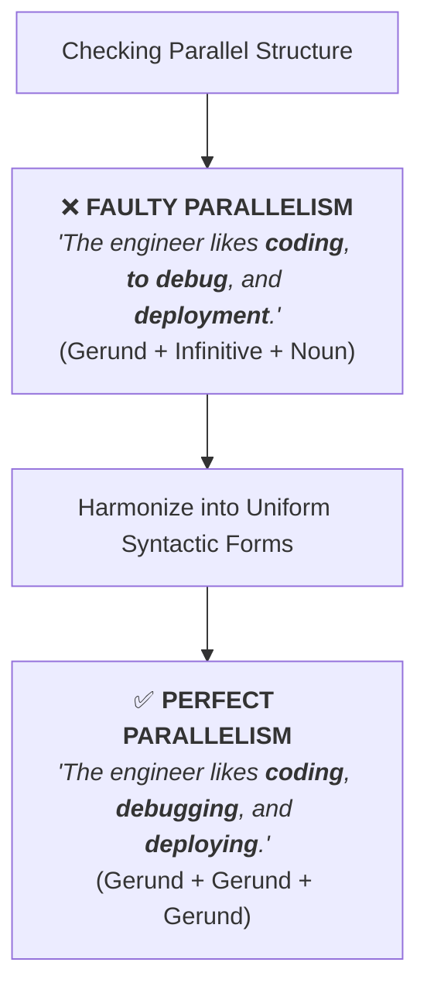

# Sentence Formation & Run-On Repairs: Structural Syntax Diagnostics 🧱🔨

> **Level:** CEFR B1–C1 (Sentence Boundaries, Comma Splices & Modifier Alignment)  
> **Primary References:** Michael Swan (*Practical English Usage*, §20, 240–270); William Strunk Jr. & E.B. White (*The Elements of Style*); *The Chicago Manual of Style*  
> **Core Premise:** A grammatically valid English sentence requires an **independent clause** containing a subject and a finite verb expressing a complete thought. The most prevalent structural bugs in technical documentation and engineering emails are **comma splices** (gluing two sentences together with a comma), **fused run-on sentences** (running clauses together with no punctuation), **sentence fragments** (orphan clauses posing as full sentences), and **dangling modifiers** (participial phrases modifying the wrong noun).

---

## 1. The Sentence Boundary Diagnostic Tree

```mermaid
graph TD
    SentenceCheck["Inspecting a Sentence for Structural Validity"]
    
    SentenceCheck --> HasSubjectVerb{"Does it contain a Subject and a FINITE Verb?"}
    
    HasSubjectVerb -->|NO: Lacks Subject, Finite Verb, or is Subordinate| Fragment["❌ <b>SENTENCE FRAGMENT</b><br/>• <i>'Because the cluster crashed.'</i><br/>• <b>Fix:</b> Attach to an independent clause."]
    
    HasSubjectVerb -->|YES| CheckClauses{"How many INDEPENDENT clauses are joined?"}
    
    CheckClauses -->|Single Independent Clause| ValidSimple["✅ <b>VALID SIMPLE SENTENCE</b>"]
    
    CheckClauses -->|Two Independent Clauses| InspectJoin{"How are the two clauses joined?"}
    
    InspectJoin -->|Comma ONLY (No Conjunction)| CommaSplice["❌ <b>COMMA SPLICE</b><br/>• <i>'The build failed, we reverted the commit.'</i>"]
    
    InspectJoin -->|Zero Punctuation / Blank Space| FusedSentence["❌ <b>FUSED RUN-ON</b><br/>• <i>'The build failed we reverted the commit.'</i>"]
    
    InspectJoin -->|Semicolon / FANBOYS / Period / Subordination| ValidCompound["✅ <b>VALID COMPOUND / COMPLEX SENTENCE</b>"]
```

---

## 2. The Four Surgical Repairs for Comma Splices & Run-Ons

When two independent clauses collide without proper syntactic scaffolding, apply one of these four proven repairs:

```
THE DEFECTIVE BUG:
❌ "The database node ran out of memory, the operating system terminated the daemon." (Comma Splice)
❌ "The database node ran out of memory the operating system terminated the daemon." (Fused Run-On)
```

| Surgical Repair Method | Syntactic Mechanics | Patched Production Sentence |
| :--- | :--- | :--- |
| **Repair 1: Two Independent Sentences** | $\text{Clause 1} \mathbf{.} \quad \text{Clause 2}$ | ✅ *“The database node ran out of memory**. The** operating system terminated the daemon.”* |
| **Repair 2: The Semicolon** | $\text{Clause 1} \mathbf{;} + \text{Clause 2}$ | ✅ *“The database node ran out of memory**; the** operating system terminated the daemon.”* |
| **Repair 3: Comma + FANBOYS** | $\text{Clause 1} \mathbf{,} + \mathbf{\text{so / and / but}} + \text{Clause 2}$ | ✅ *“The database node ran out of memory**, so** the operating system terminated the daemon.”* |
| **Repair 4: Subordination** | $\mathbf{\text{Because / When / As}} + \text{Clause 1} \mathbf{,} + \text{Clause 2}$ | ✅ *“**Because** the database node ran out of memory**, the** operating system terminated the daemon.”* |

---

## 3. Dangling & Misplaced Modifiers

A modifier must point unambiguously to the noun it describes. When an introductory participial phrase (`-ing` or `-ed`) begins a sentence, the **grammatical subject of the main clause MUST be the entity performing that action**:

$$\mathbf{\text{Participial Phrase (-ing / -ed)}} \mathbf{,} \quad \mathbf{\text{LOGICAL AGENT (Subject)}} + \text{Verb} \dots$$

### The Classic Dangling Participle Trap:
- ❌ **Dangling Modifier Bug:** *“Walking into the server room, **the fire alarm sounded**.”*  
  *(Did the fire alarm walk into the server room? Grammatically, the alarm is the subject!).*
- ✅ **Patched with Human Agent:** *“Walking into the server room, **the technician heard the fire alarm sound**.”*
- ✅ **Patched with Subordinate Clause:** *“**As the technician walked** into the server room, the fire alarm sounded.”*

### Technical Computing Dangling Modifiers:
- ❌ **Broken:** *“After upgrading the Linux kernel, **the server rebooted**.”*  
  *(Did the server upgrade the kernel itself?).*
- ✅ **Patched:** *“After upgrading the Linux kernel, **the SRE rebooted the server**.”*
- ❌ **Broken:** *“Having verified the TLS certificates, **the connection was established**.”*  
  *(The connection didn't verify the certificates).*
- ✅ **Patched:** *“Having verified the TLS certificates, **the gateway established the connection**.”*

---

## 4. Faulty Grammatical Parallelism

When items are grouped in a series, bulleted list, or conjoined by correlative pairs (*either...or, both...and*), all items must share the **identical grammatical form**:



### Parallelism in Technical Bulleted Lists:
- ❌ **Broken (Mixed forms):**
  - Run the test suite (Imperative verb)
  - Configuration of environment variables (Noun phrase)
  - You should check the logs (Full sentence)
- ✅ **Patched (Uniform Imperatives):**
  - **Run** the test suite.
  - **Configure** environment variables.
  - **Check** the logs.

---

## 5. Practical Dual-Domain Examples

### Everyday Conversation & General Writing

1. *Comma splice fix:* *I wanted to go for a run, but it started raining heavily.*
2. *Dangling modifier fix:* *While driving to the beach, we saw three deer beside the highway.*
3. *Fragment fix:* *Although he was exhausted, he finished his painting before going to bed.*
4. *Parallelism:* *She loves swimming, hiking, and cycling in the mountains.*
5. *Fused sentence fix:* *Turn off the oven; the cookies are finished baking.*
6. *Misplaced adverb:* *He almost ate all the cookies $\rightarrow$ He ate **almost all** the cookies.*
7. *Subordination fix:* *Since the train was delayed, we waited at the station cafe.*
8. *Parallel verbs:* *The chef washed the lettuce, sliced the tomatoes, and dressed the salad.*

### Software Engineering & Technical Documentation

9. *Comma Splice Fix:* *The cluster reached 100% capacity; consequently, the autoscaler provisioned two new nodes.*
10. *Dangling Participle Fix:* *Before applying database migrations, the DBA took a full snapshot backup.*
11. *Fragment Fix:* *The transaction was rolled back because the foreign key constraint was violated.*
12. *Parallel List:* *The microservice is responsible for **authenticating** users, **validating** tokens, and **logging** requests.*
13. *Fused Run-On Fix:* *The memory leak degraded response times; therefore, we deployed a hotfix.*
14. *Dangling Modifier Fix:* *By leveraging in-memory caching, the team reduced database query latency by 75%.*
15. *Parallel Commit List:* *Refactored auth controller, updated test suite, and fixed race condition in cache.*
16. *Semicolon Join:* *Kafka decouples message production from consumption; consumers process events at their own pace.*

---

## 6. Common Antipattern Diagnostic Bug-and-Patch Table

| ❌ Broken Anti-Pattern (Bug) | Corrected Idiomatic English (Patch) | Diagnostic Grammar Explanation |
| :--- | :--- | :--- |
| ❌ *The script failed, we checked the logs.* | ✅ *The script failed**; therefore,** we checked the logs.* | Comma splice: two independent clauses joined by only a comma without a coordinating conjunction. |
| ❌ *Because the API key expired.* (Standing alone) | ✅ *The request failed **because the API key expired**.* | Sentence fragment: a subordinating clause cannot stand alone as a complete sentence. |
| ❌ *Having rebooted the host, the bug disappeared.* | ✅ *After the technician rebooted the host, the bug disappeared.* | Dangling modifier: *the bug* was not the entity that rebooted the host. |
| ❌ *Our service provides high speed, scalability, and is secure.* | ✅ *Our service provides high **speed**, **scalability**, and **security**.* | Faulty parallelism: mixing nouns (*speed, scalability*) with a verb phrase (*is secure*). |
| ❌ *We only deployed two microservices yesterday.* | ✅ *We deployed **only two** microservices yesterday.* | Misplaced modifier: *only* modifies the quantifier *two*, not the verb *deployed*. |
| ❌ *The tests passed we merged the pull request.* | ✅ *The tests passed**, so** we merged the pull request.* | Fused sentence: two independent clauses running together with zero punctuation. |

---

## 7. Self-Assessment Practice Exercises

### Exercise 1: Identify the Sentence Defect
Classify each sentence as a (A) Comma Splice, (B) Sentence Fragment, (C) Dangling Modifier, (D) Faulty Parallelism, or (E) Grammatically Correct:
1. *While debugging the race condition, the power in the building went out.*
2. *The cache expired, the gateway returned an HTTP 504 gateway timeout.*
3. *Although the automated integration tests executed successfully in the staging pipeline.*
4. *The developer refactored the auth module, fixed two memory leaks, and the documentation was updated.*
5. *Before restarting the node, verify that replication lag is under 100 milliseconds.*

### Exercise 2: Sentence Repair
Apply surgical repairs to fix each broken sentence:
6. *The server was overloaded we added three more worker instances.*
7. *Looking at the APM dashboard, a huge spike in CPU was observed.*
8. *The cron job executes every midnight. Backing up the PostgreSQL database.*
9. *To improve performance, developers should profile memory, optimize SQL queries, and the cache should be used.*
10. *The token is valid, however, the user lacks permission to access this endpoint.*

---

## 8. Answer Key with Diagnostic Explanations

1. **(C) Dangling Modifier** — The power in the building was not debugging the race condition.
2. **(A) Comma Splice** — Two independent clauses joined with only a comma.
3. **(B) Sentence Fragment** — Subordinating clause beginning with *Although* without a main clause.
4. **(D) Faulty Parallelism** — Active verbs (*refactored, fixed*) mixed with a passive clause (*the doc was updated*).
5. **(E) Grammatically Correct** — Imperative sentence with a fronted prepositional time clause.
6. **Repair:** *The server was overloaded**; therefore,** we added three more worker instances.* (or *, so we added*)
7. **Repair:** *Looking at the APM dashboard, **the SRE observed** a huge spike in CPU.*  
   *Explanation:* Positions the logical human observer as the subject of the main clause.
8. **Repair:** *The cron job executes every midnight, **backing up the PostgreSQL database**.*  
   *Explanation:* Connects the participial fragment to the main clause.
9. **Repair:** *To improve performance, developers should **profile** memory, **optimize** SQL queries, and **leverage** caching.*  
   *Explanation:* Harmonizes the three items into parallel bare infinitive verbs.
10. **Repair:** *The token is valid**; however,** the user lacks permission to access this endpoint.*  
    *Explanation:* Replaces comma splice with a semicolon before *however*.

---

## 9. High-Density Revision Flashcards

```
Q: What is a comma splice, and how do you fix it?
A: A comma splice occurs when two independent clauses are joined by ONLY a comma.
   Fixes: 1. Period (. ) 2. Semicolon (; ) 3. Comma + FANBOYS (, so) 4. Subordination (Because...).
```

```
Q: What is a dangling modifier?
A: An introductory participial phrase (-ing/-ed) whose logical subject does not match
   the grammatical subject of the main clause (e.g., 'Walking in, the alarm rang' ❌).
```

```
Q: What is the rule of grammatical parallelism in lists?
A: All items in a series or bulleted list must share the exact same grammatical structure
   (e.g., all imperatives, all gerunds, or all nouns).
```
