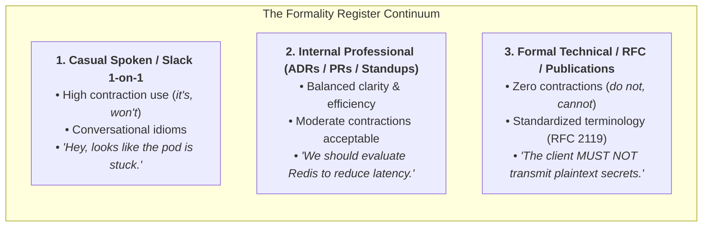

# Spoken vs. Written English Diagnostic: Register Leakage & Style Calibration 🎙️📝

> **Level:** CEFR B2–C2 (Sociolinguistics, Register Calibration & Stylistic Integrity)  
> **Primary References:** Michael Swan (*Practical English Usage*, §240–270); Douglas Biber et al. (*Longman Grammar of Spoken and Written English*)  
> **Core Premise:** English is not a monolithic language; it operates across a broad **register spectrum** ranging from informal conversational speech to formal written technical documentation. The most damaging stylistic failure mode is **register leakage**: allowing casual spoken shortcuts, filler words (*“like”*, *“kinda”*), and fragmented syntax to contaminate formal technical documentation—or, conversely, using archaic bureaucratic jargon (*“do the needful”*, *“heretofore”*) in casual engineering chat.

---

## 1. The Engineering Register Calibration Spectrum



---

## 2. Register Leakage Type 1: Casual Spoken Contamination in Tech Docs

When casual spoken habits leak into architecture docs, READMEs, or executive reports, technical authority is compromised:

| ❌ Casual Spoken Antipattern (Contamination) | ⚠️ Stylistic / Grammatical Defect | ✅ Calibrated Technical Standard (Patch) |
| :--- | :--- | :--- |
| ❌ *“The database has **tons of / lots of** records.”* | Vague, colloquial quantifier. | ✅ *“The database contains **over 50 million** records.”* |
| ❌ *“It’s **kinda / sort of** like a cache.”* | Conversational hedging and imprecision. | ✅ *“It **functions as** an in-memory caching layer.”* |
| ❌ *“You just **wanna** run this script.”* | Spoken elision (*wanna*) + dismissive filler (*just*). | ✅ *“**Execute** `./setup.sh` to initialize the cluster.”* |
| ❌ *“The server crashed, **though**.”* | Dangling colloquial sentence-final concessive particle. | ✅ *“**However**, the server crashed.”* |
| ❌ *“**They say that** microservices are better.”* | Vague, conversational pseudo-agent (*they say*). | ✅ *“**Industry consensus indicates that** microservices provide superior modularity.”* |
| ❌ *“The query is **super slow / crazy fast**.”* | Childish hyperbolic spoken intensifiers. | ✅ *“The query exhibits **unacceptable latency ($>2.5\text{s}$)** / achieves **sub-millisecond latency**.”* |

---

## 3. Register Leakage Type 2: Archaic Bureaucratic Pedantry in Chat

The inverse defect occurs when engineers use Victorian legalistic formulas, stilted bureaucracy, or archaic idioms in modern collaborative tools (Slack, Teams, PR reviews):

| ❌ Archaic / Stilted Bureaucratic Phrasing | ⚠️ Register Defect | ✅ Modern Professional Engineering Phrasing |
| :--- | :--- | :--- |
| ❌ *“Kindly do the needful.”* | Stilted, archaic colonial Indian-English formula; vague action. | ✅ *“Could you please review and approve the attached PR?”* |
| ❌ *“Please find attached herewith the logs.”* | Archaic legalistic redundancy (*herewith*). | ✅ *“I have attached the diagnostic logs below.”* |
| ❌ *“Revert back to me at the earliest.”* | Redundant lexical error + bureaucratic stiltedness. | ✅ *“Please let me know as soon as you have an update.”* |
| ❌ *“Heretofore, we have observed no errors.”* | Pseudo-intellectual archaic fossil (*heretofore*). | ✅ *“Until now, we have observed no errors.”* |
| ❌ *“I am receipt of your email.”* | Clumsy bureaucratic nominalization. | ✅ *“I have received your email.”* |

---

## 4. Contractions: When to Use Them vs. When to Ban Them

The treatment of **contractions** (*it’s, doesn’t, we’ll, cannot*) provides an immediate signal of document register:

```
┌─────────────────────────────────┬──────────────────────────────────┬──────────────────────────────────────────┐
│ Engineering Context             │ Contraction Policy               │ Example                                  │
├─────────────────────────────────┼──────────────────────────────────┼──────────────────────────────────────────┤
│ Formal RFC / Whitepaper         │ 🚫 BANNED (Strict formal)        │ "The system CANNOT accept invalid tokens"│
│ API Reference & Schema Docs     │ 🚫 BANNED (Strict precision)     │ "DO NOT modify this configuration file"  │
│ Architecture Decision Records   │ ⚠️ MINIMAL (Permitted sparingly) │ "We decided that this does not scale"    │
│ PR Reviews & Code Comments      │ ✅ ENCOURAGED (Collaborative)    │ "It doesn't seem to handle null pointers"│
│ Slack / Teams Workplace Chat    │ ✅ STANDARD (Natural flow)       │ "We'll deploy the hotfix after lunch"    │
└─────────────────────────────────┴──────────────────────────────────┴──────────────────────────────────────────┘
```

---

## 5. Practical Dual-Domain Examples

### Everyday Conversation vs. Formal Writing

1. *Spoken Casual:* *I'm gonna head out now, see ya tomorrow!*
2. *Written Formal:* *I will depart now; I look forward to meeting with you tomorrow.*
3. *Spoken Casual:* *The movie was, like, totally amazing.*
4. *Written Formal:* *The film received exceptional critical acclaim.*
5. *Spoken Casual:* *Got any questions? Hit me up.*
6. *Written Formal:* *Please do not hesitate to reach out if you have any questions.*
7. *Spoken Casual:* *We ran outta time, so we bailed.*
8. *Written Formal:* *Due to time constraints, the meeting was adjourned early.*

### Software Engineering & Technical Documentation

9. *Spoken Chat:* *Hey folks, the staging database is totally borked.*
10. *Incident Postmortem:* *At 09:14 UTC, the staging database cluster became completely unresponsive due to memory starvation.*
11. *Spoken Standup:* *I've been hacking on the auth module and it kinda works now.*
12. *PR Description:* *This pull request refactors the authentication module to support OAuth 2.0 PKCE verification.*
13. *Eliminating Slang in Docs:* *Run `npm start` to get things rolling $\rightarrow$ Run `npm start` to **initialize the local development server**.*
14. *Eliminating "Do the Needful":* *Kindly do the needful on Jira ticket #102 $\rightarrow$ **Could you please update the status of Jira ticket #102?***
15. *RFC Register (No contractions):* *Clients **must not** attempt to reconnect without exponential backoff.* (NOT: *mustn't*).
16. *Eliminating Hyperbole:* *This library is super awesome $\rightarrow$ This library **provides comprehensive test coverage and zero third-party dependencies**.*

---

## 6. Common Antipattern Diagnostic Bug-and-Patch Table

| ❌ Broken Anti-Pattern (Bug) | Corrected Idiomatic English (Patch) | Diagnostic Grammar Explanation |
| :--- | :--- | :--- |
| ❌ *README: You **wanna** clone the repo.* | ✅ *README: **Clone** the repository.* | Spoken phonetic elision (*wanna*) has no place in written documentation; use imperative. |
| ❌ *Slack: **Kindly do the needful**.* | ✅ *Slack: **Could you please review PR #204?**.* | Replace vague archaic colonial phrase with an explicit, actionable request. |
| ❌ *RFC: The server **doesn't** accept payloads.* | ✅ *RFC: The server **does not** accept payloads.* | Formal specifications and RFC standards prohibit informal contractions (*doesn't* $\rightarrow$ *does not*). |
| ❌ *Doc: It has a **ton of** advantages.* | ✅ *Doc: It provides **numerous** architectural advantages.* | *A ton of* is casual spoken slang; replace with *numerous, several,* or *substantial*. |
| ❌ *Email: **Please find attached herewith**.* | ✅ *Email: **I have attached the audit report below**.* | Eliminate archaic legalistic filler (*herewith*). |
| ❌ *Doc: The worker **freaks out** on nulls.* | ✅ *Doc: The worker **throws an unhandled exception** on null inputs.* | Replace colloquial anthropomorphic slang (*freaks out*) with precise technical failure terminology. |

---

## 7. Self-Assessment Practice Exercises

### Exercise 1: Register Calibration (Spoken to Formal Written)
Rewrite the following casual spoken sentences into publication-grade technical documentation:
1. *“You gotta make sure that the database is running first.”*
2. *“This algorithm is crazy fast compared to the old one.”*
3. *“We had a bunch of errors in the logs, but it fixed itself, though.”*
4. *“They say you shouldn't use MD5 for hashing passwords.”*
5. *“Just simply click this button and you’re good to go.”*

### Exercise 2: Modernization (Archaic to Modern Professional)
Rewrite each stilted, archaic workplace communication into clear, modern professional English:
6. *“Kindly do the needful regarding the server access credentials.”*
7. *“Please revert back to the undersigned at your earliest convenience.”*
8. *“We are in receipt of your pull request and shall peruse the same shortly.”*
9. *“Heretofore, no such vulnerability hath been detected.”*
10. *“Enclosed please find the invoice for the cloud migration services.”*

---

## 8. Answer Key with Diagnostic Explanations

1. **Model Rewrite:** *“Verify that the database service is running before initiating the application.”*  
   *Explanation:* Eliminates spoken *gotta make sure*; uses formal imperative and active verbs.
2. **Model Rewrite:** *“This algorithm executes in $O(n \log n)$ time, providing a fourfold performance improvement over the previous implementation.”*  
   *Explanation:* Replaces childish slang (*crazy fast*) with algorithmic complexity and concrete metrics.
3. **Model Rewrite:** *“Although numerous errors were recorded in the system logs, the service recovered automatically.”*  
   *Explanation:* Eliminates *bunch of*, dangling *though*, and spoken phrasing.
4. **Model Rewrite:** *“Industry security standards strictly prohibit the use of MD5 for password hashing due to collision vulnerabilities.”*  
   *Explanation:* Replaces vague *they say* with authoritative subject (*Industry security standards*).
5. **Model Rewrite:** *“Click **Submit** to finalize the configuration.”*  
   *Explanation:* Eliminates dismissive fillers (*just, simply*) and conversational idiom (*good to go*).
6. **Model Rewrite:** *“Could you please grant me read access to the staging server?”*  
   *Explanation:* Replaces *do the needful* with the specific actionable request.
7. **Model Rewrite:** *“Please let me know as soon as you have an update.”*  
   *Explanation:* Eliminates *revert back* and stilted *undersigned*.
8. **Model Rewrite:** *“We have received your pull request and will review it shortly.”*  
   *Explanation:* Replaces clumsy *in receipt of* and archaic *peruse the same*.
9. **Model Rewrite:** *“Until now, no such vulnerability has been detected.”*  
   *Explanation:* Modernizes archaic *heretofore* and pseudo-Biblical *hath*.
10. **Model Rewrite:** *“I have attached the invoice for the cloud migration services below.”*  
    *Explanation:* Replaces commercial fossil *enclosed please find* with natural professional phrasing.

---

## 9. High-Density Revision Flashcards

```
Q: What is 'Register Leakage'?
A: The inappropriate mixing of linguistic styles—either using casual spoken slang in formal technical docs
   or using archaic, stilted bureaucratic jargon in modern team chat.
```

```
Q: Why should 'Kindly do the needful' be purged from engineering communication?
A: It is an archaic, vague bureaucratic fossil that fails to specify what action is required,
   who is responsible, or what the timeline is. Always state the exact request clearly.
```

```
Q: What is the rule for contractions in formal RFCs and published API specifications?
A: BANNED! Write full, uncontracted forms: 'do not' (NOT 'don't'), 'cannot' (NOT 'can't'),
   'must not' (NOT 'mustn't') to maintain absolute technical precision and clarity.
```
