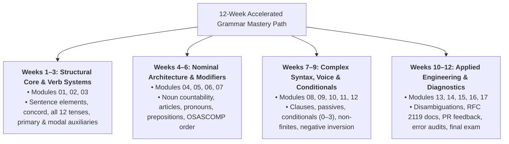

# Grammar Learning Roadmap & Study Plan: The 12-Week Mastery Path 🗺️🎯

> **Level:** CEFR A1–C2 (Pedagogical Sequencing, Study Planning & Habit Architecture)  
> **Primary References:** Council of Europe (*CEFR Curriculum Guidelines*); Raymond Murphy (*English Grammar in Use Study Guide*); Michael Swan (*Practical English Usage Overview*)  
> **Core Premise:** Attempting to master English grammar by haphazardly reading reference manuals produces rapid cognitive fatigue and poor retention. True grammatical mastery is acquired through **sequenced pedagogical progression**, moving from **structural foundations** to **finite verbal systems**, **complex clausal coordination**, and ultimately **applied engineering registers**. This 12-week accelerated roadmap transforms theoretical knowledge into automatic, unhesitating linguistic instinct.

---

## 1. The 12-Week Milestone Architecture



---

## 2. Weekly Curriculum & Actionable Study Units

### Phase 1: Structural Foundations & Verbal Mechanics (Weeks 1–3)

#### Week 1: Foundations & Word Order (Module 01)
- **Goal:** Master sentence elements (SV, SVO, SVIODO), phrase boundaries, and comma mechanics.
- **Daily Focus:**
  - Day 1: [Parts of Speech](../01-foundations/parts-of-speech.md) & open vs. closed word classes.
  - Day 2: [Sentence Elements & Word Order](../01-foundations/sentence-elements-and-word-order.md) (banish V2 errors).
  - Day 3: [Phrases and Clauses](../01-foundations/phrases-and-clauses.md) (independent vs. dependent).
  - Day 4: [Sentence Types](../01-foundations/sentence-types-and-purposes.md) & [Punctuation Mastery](../01-foundations/punctuation-mastery.md).
  - Day 5: [Capitalization & Spelling Rules](../01-foundations/capitalization-and-spelling-rules.md).
  - Day 6–7: Weekly review + complete Module 01 exercises.

#### Week 2: Verbs, Auxiliaries & Agreement (Module 02)
- **Goal:** Eliminate subject-verb agreement errors, master core modals and phrasal verbs.
- **Daily Focus:**
  - Day 1: [Action vs. Stative Verbs](../02-verbs-and-auxiliaries/verb-types-action-vs-stative.md).
  - Day 2: [Primary Auxiliaries (`be`, `do`, `have`)](../02-verbs-and-auxiliaries/primary-auxiliaries-be-do-have.md).
  - Day 3: [Transitive vs. Intransitive Verbs](../02-verbs-and-auxiliaries/transitive-and-intransitive-verbs.md) & [Subject-Verb Agreement](../02-verbs-and-auxiliaries/subject-verb-agreement.md).
  - Day 4: [Core Modal Verbs](../02-verbs-and-auxiliaries/modal-verbs-core.md) & [Semi-Modals](../02-verbs-and-auxiliaries/semi-modals-and-marginal-modals.md).
  - Day 5: [Phrasal Verbs Mechanics](../02-verbs-and-auxiliaries/phrasal-verbs-and-prepositional-verbs.md) (the pronoun sandwich).
  - Day 6–7: Weekly review + run Module 02 exercises.

#### Week 3: The 12 Tenses & Aspectual Geometry (Module 03)
- **Goal:** Perfect temporal aspect (Simple vs. Continuous vs. Perfect vs. Perfect Continuous).
- **Daily Focus:**
  - Day 1: Present Simple vs. Continuous vs. Perfect Simple vs. Perfect Continuous.
  - Day 2: Past Simple vs. Past Continuous vs. Past Perfect.
  - Day 3: Future Simple (*will*) vs. *Be going to* vs. Future Perfect (*will have finished*).
  - Day 4: Future time in subordinate clauses (*when the server restarts*, NOT *will restart*).
  - Day 5: Future-in-the-past forms (*was going to deploy*).
  - Day 6–7: Complete Module 03 tense diagnostic quizzes.

---

### Phase 2: Nominal Architecture, Modifiers & Prepositions (Weeks 4–6)

#### Week 4: Nouns & Articles (Module 04)
- **Goal:** Eradicate article blindness (*a/an/the/ø*) and uncountable noun traps (*software, information*).
- **Daily Focus:**
  - Day 1: Countable vs. Uncountable Nouns (mass nouns, partitives: *a piece of equipment*).
  - Day 2: Singular vs. Plural inflections and irregular plurals.
  - Day 3: Indefinite Articles (*a / an*) & the Naked Noun Ban.
  - Day 4: Definite Article (*the*) vs. Zero Article (*ø* in environments: *in production*).
  - Day 5: Compound nouns & genitives (*the server's CPU* vs. *CPU utilization*).
  - Day 6–7: Complete Module 04 article audit checklist.

#### Week 5: Pronouns & Determiners (Module 05)
- **Goal:** Master relative pronouns, quantifiers (*few* vs. *a few*), and dummy *it/there*.
- **Daily Focus:**
  - Day 1: Personal & Possessive Pronouns (subject vs. object: *between you and me*).
  - Day 2: Reflexive (*themselves*) & Demonstrative Pronouns (*this/that* antecedent clarity).
  - Day 3: Relative Pronouns (*who* vs. *which* vs. *that*).
  - Day 4: Quantifiers (*fewer* vs. *less*, *few* vs. *a few*, *little* vs. *a little*).
  - Day 5: Dummy *It* & Existential *There* (pro-drop repair: *It is necessary to...*).
  - Day 6–7: Review Module 05.

#### Week 6: Modifiers & Prepositions (Modules 06 & 07)
- **Goal:** Master adjective order (OSASCOMP), adverb placement, and topological prepositions.
- **Daily Focus:**
  - Day 1: Attributive vs. Predicative Adjectives & Order of Adjectives (OSASCOMP).
  - Day 2: Adverbs: Types, formation, and middle position rules (*always, already, definitely*).
  - Day 3: Degrees of Comparison (comparatives, superlatives, *as...as*).
  - Day 4: Prepositions of Time (*at 14:00, on Monday, in July*) & Place (*in, on, at*).
  - Day 5: Dependent Prepositions after Verbs (*comply with, depend on*) & Adjectives (*capable of*).
  - Day 6–7: Review Modules 06 and 07.

---

### Phase 3: Complex Syntax, Voice & Conditionals (Weeks 7–9)

#### Week 7: Conjunctions, Clauses & Voice (Modules 08 & 09)
- **Goal:** Write complex sentences without comma splices; master blameless passive voice.
- **Daily Focus:**
  - Day 1: Coordinating Conjunctions (FANBOYS) & Semicolon rules.
  - Day 2: Subordinating Conjunctions, Relative Clauses (Defining vs. Non-Defining).
  - Day 3: Passive Voice Mechanics & agent suppression in SRE postmortems.
  - Day 4: Impersonal Passives (*It is considered that...*) & Causatives (*have something done*).
  - Day 5: Reported Speech & Indirect Questions (banish double inversion).
  - Day 6–7: Module 08 & 09 writing practice.

#### Week 8: Conditionals & Non-Finite Verbs (Modules 10 & 11)
- **Goal:** Master counterfactual reasoning (Types 0–3) and gerund vs. infinitive shifts.
- **Daily Focus:**
  - Day 1: Zero & First Conditionals (system invariants & real possibilities).
  - Day 2: Second & Third Conditionals (hypotheticals & postmortem counterfactuals).
  - Day 3: Inverted Conditionals (*Had the alert fired...*).
  - Day 4: Gerunds vs. Infinitives: Verbs with radical meaning shifts (*stop, remember, try, regret*).
  - Day 5: Participial Clauses & Reduced Relatives.
  - Day 6–7: Review Modules 10 and 11.

#### Week 9: Advanced Sentence Structures (Module 12)
- **Goal:** Master rhetorical emphasis, fronting, cleft sentences, and negative inversion.
- **Daily Focus:**
  - Day 1: Negative & Limiting Inversion (*Never, Under no circumstances, Hardly*).
  - Day 2: Cleft Sentences (*It was the memory leak that...*, *What we need is...*).
  - Day 3: Fronting & Topicalization.
  - Day 4: The Mandative Subjunctive Mood (*It is imperative that the lead sign...*).
  - Day 5: Ellipsis & Substitution (*If so, If not, do so*).
  - Day 6–7: Module 12 advanced syntax drills.

---

### Phase 4: Applied Engineering English & Diagnostics (Weeks 10–12)

#### Week 10: Disambiguations & Vocabulary (Modules 13 & 14)
- **Goal:** Master confusing word pairs and engineering collocations.
- **Daily Focus:**
  - Day 1: Tense & Verb Contrasts (*past simple vs present perfect*, *make vs do*, *say vs tell*).
  - Day 2: Prepositional & Modifier Contrasts (*since/for/during*, *like vs as*, *so vs such*).
  - Day 3: Collocations & High-Frequency Engineering Phrasal Verbs (*spin up, tear down*).
  - Day 4: Prefixes, Suffixes & Curing Zombie Nouns (Nominalization refactoring).
  - Day 5: Confusing Words (*affect vs effect*, *ensure vs assure*, *discrete vs discreet*).
  - Day 6–7: Complete Module 13 & 14 exercises.

#### Week 11: Technical Writing & Workplace Communication (Module 15)
- **Goal:** Produce publication-grade READMEs, ADRs, PR reviews, and blameless postmortems.
- **Daily Focus:**
  - Day 1: [Technical Documentation & RFC 2119 Standards](../15-practical-english-and-communication/technical-documentation-writing.md).
  - Day 2: [Pull Request Reviews & Code Comments](../15-practical-english-and-communication/pull-request-reviews-and-code-comments.md) (modality & conventional comments).
  - Day 3: [Git Commit Messages & Release Notes](../15-practical-english-and-communication/git-commit-messages-and-release-notes.md) (the imperative mood standard).
  - Day 4: [Explaining Architecture & BLUF](../15-practical-english-and-communication/explaining-technical-concepts-and-architecture.md).
  - Day 5: [Incident Postmortems](../15-practical-english-and-communication/incident-postmortems-and-root-cause-analysis.md) & [Workplace Chat](../15-practical-english-and-communication/professional-emails-and-workplace-chat.md).
  - Day 6–7: Module 15 practical writing portfolio.

#### Week 12: Comprehensive Diagnostics & Final Assessment (Modules 16 & 17)
- **Goal:** Complete error audits, patch residual defects, and pass the 60-question exam.
- **Daily Focus:**
  - Day 1: [Top 50 Grammar Mistakes](../16-common-mistakes-and-diagnostic-guide/top-50-grammar-mistakes-and-fixes.md) review.
  - Day 2: [Sentence Formation & Run-On Repairs](../16-common-mistakes-and-diagnostic-guide/sentence-formation-and-run-on-repairs.md).
  - Day 3: [Preposition & Article Checklist](../16-common-mistakes-and-diagnostic-guide/preposition-and-article-diagnostic-checklist.md) & [ESL Interference](../16-common-mistakes-and-diagnostic-guide/esl-language-interference-patterns.md).
  - Day 4: Review [Master Grammar Cheat Sheet](./master-grammar-cheat-sheet.md) and [Irregular Verbs](./irregular-verbs-complete-paradigm-table.md).
  - Day 5: **Take the [Comprehensive 60-Question Diagnostic Exam](./comprehensive-60-question-diagnostic-exam.md)** under timed conditions.
  - Day 6: Score evaluation, error autopsy, and targeted module review.
  - Day 7: Graduation to C1/C2 autonomous professional writing.

---

## 3. The 25-Minute Daily Deliberate Practice Protocol

To make rapid, permanent progress without interfering with your engineering workload, execute this 25-minute study ritual every morning:

```
┌────────────────────────────────────────────────────────────────────────┐
│ The 25-Minute Daily Grammar Sprint                                     │
├────────────────────────────────────────────────────────────────────────┤
│ 00:00 – 07:00 (7 Mins): Theory & Formula Review                        │
│ • Read the daily topic guide (Mermaid diagram + algebraic formulas).   │
│                                                                        │
│ 07:00 – 14:00 (7 Mins): Bug-and-Patch Analysis                         │
│ • Study the Common Antipattern Diagnostic Table for that topic.        │
│ • Identify why the bug occurs and internalize the patch.               │
│                                                                        │
│ 14:00 – 20:00 (6 Mins): Active Production Practice                     │
│ • Write three original sentences applying the rule to your current      │
│   work project (e.g., a git commit, a PR comment, an ADR note).        │
│                                                                        │
│ 20:00 – 25:00 (5 Mins): Self-Assessment Quiz & Flashcards              │
│ • Complete the 5 quick exercises at the end of the guide.              │
│ • Review the high-density flashcard box.                               │
└────────────────────────────────────────────────────────────────────────┘
```

---

## 4. Spaced Repetition (SRS) Review Intervals

When you master a grammar rule or patch an antipattern, schedule reviews using the **Leitner Spaced Repetition Cadence**:

- **Review 1:** +1 day (Next morning's warm-up).
- **Review 2:** +3 days (End of week review).
- **Review 3:** +7 days (Weekly milestone checkpoint).
- **Review 4:** +21 days (Phase consolidation).
- **Review 5:** +60 days (Permanent synaptic memory).

---

## 5. Knowledge Base Navigation & Graduation

Congratulations on initiating your journey through the English Grammar Knowledge Base. Use this roadmap as your North Star, and begin today at:
- ➡️ **[Module 01: Foundations & Sentence Elements](../01-foundations/index.md)**
- 📋 **[Master Grammar Cheat Sheet](./master-grammar-cheat-sheet.md)**
- 🏠 **[Master Knowledge Base Index](../index.md)**
