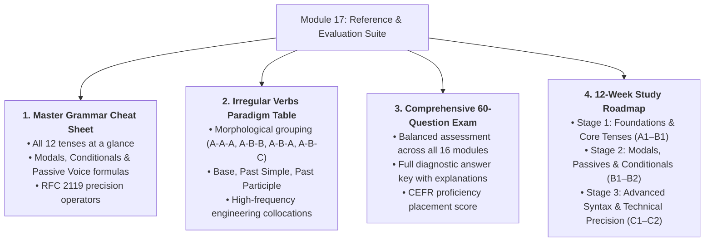

# Module 17: Resources, Practice & Diagnostic Assessment 🎓📊

> **Level:** CEFR A1–C2 (Comprehensive Reference, Diagnostic Evaluation & Study Planning)  
> **Primary References:** Council of Europe (*Common European Framework of Reference for Languages*); Syntheses of Raymond Murphy and Michael Swan  
> **Core Premise:** The final module functions as the **operational control center** of the English Grammar Knowledge Base. It synthesizes all theoretical rules, syntactic formulas, and professional conventions into **high-density reference cheat sheets**, an exhaustive **irregular verbs paradigm catalog**, a rigorous **60-question diagnostic assessment exam**, and a structured **12-week accelerated learning roadmap**.

---

## 1. The Resource & Assessment Architecture

---

## 2. Curated Resource Catalog

| Document | Purpose & Description | Target Deliverable | CEFR Scope |
| :--- | :--- | :--- | :--- |
| **[Master Grammar Cheat Sheet](./master-grammar-cheat-sheet.md)** | Single-page high-density reference sheet of all core grammatical formulas and invariants | Daily desk reference for rapid drafting and editing | A1–C1 |
| **[Irregular Verbs Complete Paradigm Table](./irregular-verbs-complete-paradigm-table.md)** | Alphabetical and morphologically categorized table of 150+ English irregular verbs | Complete morphological reference for $V_1, V_2,$ and $V_3$ forms | A1–C1 |
| **[Comprehensive 60-Question Diagnostic Exam](./comprehensive-60-question-diagnostic-exam.md)** | Full-spectrum diagnostic evaluation covering every grammar topic with scoring bands | Objective benchmarking of grammatical competence | A1–C2 |
| **[Grammar Learning Roadmap & Study Plan](./grammar-learning-roadmap-and-study-plan.md)** | 12-week pedagogical curriculum with daily routines and review schedules | Structured self-study path from intermediate to publication mastery | A1–C2 |

---

## 3. How to Use This Resource Suite

1. **For Rapid Code & Doc Review:** Bookmark the **[Master Grammar Cheat Sheet](./master-grammar-cheat-sheet.md)** to verify tenses, modals, and punctuation rules in under 30 seconds.
2. **For Skill Benchmarking:** Complete the **[Comprehensive 60-Question Diagnostic Exam](./comprehensive-60-question-diagnostic-exam.md)** before and after studying to identify specific module weaknesses.
3. **For Systematic Study:** Follow the **[Grammar Learning Roadmap & Study Plan](./grammar-learning-roadmap-and-study-plan.md)** for 30 minutes each day to build permanent, idiomatic fluency.

---

## 4. Navigation & Next Steps

Select a resource from the catalog above, or proceed directly to:
- ➡️ **[1. Master Grammar Cheat Sheet](./master-grammar-cheat-sheet.md)**
- 🔙 **[Module 16: Common Mistakes & Diagnostic Guide](../16-common-mistakes-and-diagnostic-guide/index.md)**
- 🏠 **[Master Knowledge Base Index](../index.md)**
