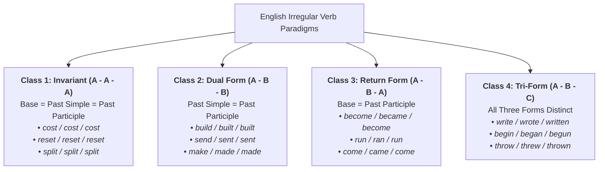

# Irregular Verbs Complete Paradigm Table: Morphological Classes & Tech Collocations 🧬📊

> **Level:** CEFR A1–C1 (Morphology & Irregular Verb Paradigms)  
> **Primary References:** Raymond Murphy (*English Grammar in Use*, Appendix 1); Michael Swan (*Practical English Usage*, §300); Douglas Biber et al. (*Longman Grammar of Spoken and Written English*)  
> **Core Premise:** English irregular verbs do not follow the productive `-ed` past tense rule; instead, they preserve ancient Germanic **ablaut vowel shifts** (apophony) and invariant root stems. Learning them alphabetically is cognitively inefficient; grouping them by **morphological patterns** (A-A-A, A-B-B, A-B-A, A-B-C) reveals systematic phonological rules. Furthermore, several high-frequency technical verbs (*broadcast, reset, split*) trap non-native engineers who attempt to regularize them (e.g., *“reseted”* ❌).

---

## 1. The Four Morphological Paradigm Classes



---

## 2. Class 1: The Invariant Verbs (A – A – A)

In this class, the vowel and consonant remain completely unchanged across the **Base Form ($V_1$)**, **Past Simple ($V_2$)**, and **Past Participle ($V_3$)**.

> [!CAUTION]
> **Common Trap:** Never add `-ed` to these verbs (*“reseted”*, *“costed”*, *“broadcasted”* are non-standard/errors in general English!).

| Base Form ($V_1$) | Past Simple ($V_2$) | Past Participle ($V_3$) | Computing / Engineering Illustration | ❌ Fatal Bug Pattern |
| :--- | :--- | :--- | :--- | :--- |
| **`Broadcast`** | **broadcast** | **broadcast** | *The node **broadcast** a UDP heartbeat packet.* | ❌ *broadcasted* |
| **`Burst`** | **burst** | **burst** | *Traffic **burst** past the rate limiter threshold.* | ❌ *bursted* |
| **`Cast`** | **cast** | **cast** | *The variable was **cast** to an integer.* | ❌ *casted* |
| **`Cost`** | **cost** | **cost** | *The cloud outage **cost** the business \$50,000.* | ❌ *costed* |
| **`Cut`** | **cut** | **cut** | *We **cut** CPU overhead by 25%.* | ❌ *cutted* |
| **`Hit`** | **hit** | **hit** | *The client **hit** the rate limit at 100 QPS.* | ❌ *hitted* |
| **`Hurt`** | **hurt** | **hurt** | *The memory leak **hurt** server performance.* | ❌ *hurted* |
| **`Let`** | **let** | **let** | *The firewall **let** the authorized packet pass.* | ❌ *letted* |
| **`Put`** | **put** | **put** | *We **put** the message on the Kafka queue.* | ❌ *putted* |
| **`Quit`** | **quit** | **quit** | *The worker process **quit** unexpectedly.* | ❌ *quitted* |
| **`Reset`** | **reset** | **reset** | *The kernel **reset** the TCP connection.* | ❌ *reseted* |
| **`Set`** | **set** | **set** | *The engineer **set** the environment flag.* | ❌ *setted* |
| **`Shut`** | **shut** | **shut** | *The load balancer **shut** down gracefully.* | ❌ *shutted* |
| **`Split`** | **split** | **split** | *We **split** the monolith into microservices.* | ❌ *splitted* |
| **`Spread`** | **spread** | **spread** | *The corrupted state **spread** across replicas.* | ❌ *spreaded* |

---

## 3. Class 2: Past Simple Equals Past Participle (A – B – B)

In this class, the $V_2$ and $V_3$ forms are identical, typically undergoing a terminal consonant hardening (`-d` $\rightarrow$ `-t`) or an internal vowel shift:

| Base Form ($V_1$) | Past Simple ($V_2$) | Past Participle ($V_3$) | High-Frequency Engineering Collocation |
| :--- | :--- | :--- | :--- |
| **`Build`** | **built** | **built** | *build a Docker container / built from source* |
| **`Catch`** | **caught** | **caught** | *catch an unhandled exception / caught by middleware* |
| **`Find`** | **found** | **found** | *find a memory leak / found in audit logs* |
| **`Have`** | **had** | **had** | *have an outage / had high latency* |
| **`Hear`** | **heard** | **heard** | *hear the alarm / heard across the team* |
| **`Hold`** | **held** | **held** | *hold a database lock / held by worker thread* |
| **`Keep`** | **kept** | **kept** | *keep a socket open / kept in cache* |
| **`Lead`** | **led** | **led** | *lead the architecture migration / led by SRE* |
| **`Leave`** | **left** | **left** | *leave a session active / left unattended* |
| **`Lose`** | **lost** | **lost** | *lose network packets / lost data packets* |
| **`Make`** | **made** | **made** | *make an API request / made a release candidate* |
| **`Pay`** | **paid** | **paid** | *pay cloud invoices / paid technical debt* |
| **`Read`** (/riːd/) | **read** (/rɛd/) | **read** (/rɛd/) | *read disk sectors / read from replica* |
| **`Send`** | **sent** | **sent** | *send a POST payload / sent over TLS* |
| **`Spend`** | **spent** | **spent** | *spend CPU cycles / spent on refactoring* |
| **`Stand`** | **stood** | **stood** | *stand up infrastructure / stood behind firewall* |
| **`Teach`** | **taught** | **taught** | *teach best practices / taught junior engineers* |
| **`Tell`** | **told** | **told** | *tell the team / told to roll back* |
| **`Understand`** | **understood** | **understood** | *understand the trade-offs / understood clearly* |

---

## 4. Class 3: Base Equals Past Participle (A – B – A)

| Base Form ($V_1$) | Past Simple ($V_2$) | Past Participle ($V_3$) | High-Frequency Computing Usage |
| :--- | :--- | :--- | :--- |
| **`Become`** | **became** | **become** | *The microservice **became** unresponsive; it has **become** stable.* |
| **`Come`** | **came** | **come** | *The request **came** through port 443; new traffic has **come** in.* |
| **`Run`** | **ran** | **run** | *The cron job **ran** at midnight; the test suite has **run** five times.* |

---

## 5. Class 4: All Three Distinct Forms (A – B – C)

### Sub-Pattern 4A: The Classic Vowel Shift ($i \rightarrow a \rightarrow u$)
| Base Form ($V_1$) | Past Simple ($V_2$) | Past Participle ($V_3$) | Engineering Example |
| :--- | :--- | :--- | :--- |
| **`Begin`** | **began** | **begun** | *The backup **began** at 02:00; it has **begun** syncing.* |
| **`Drink`** | **drank** | **drunk** | *The team drank coffee; they have drunk three pots.* |
| **`Ring`** | **rang** | **rung** | *The pager **rang** at 04:00; the alert has **rung** twice.* |
| **`Sing`** | **sang** | **sung** | *The choir sang beautifully; they have sung.* |
| **`Sink`** | **sank** | **sunk** | *The throughput **sank** by 50%; latency has **sunk**.* |
| **`Swim`** | **swam** | **swum** | *He swam; he has swum.* |

### Sub-Pattern 4B: Participles Ending in "-en" / "-n"
| Base Form ($V_1$) | Past Simple ($V_2$) | Past Participle ($V_3$) | Engineering Example |
| :--- | :--- | :--- | :--- |
| **`Break`** | **broke** | **broken** | *The hotfix **broke** CI; the build is **broken**.* |
| **`Choose`** | **chose** | **chosen** | *We **chose** PostgreSQL; the query planner has **chosen** an index.* |
| **`Drive`** | **drove** | **driven** | *Adopting microservices **drove** complexity; an event-**driven** system.* |
| **`Eat`** | **ate** | **eaten** | *The process **ate** all available memory; heap has been **eaten**.* |
| **`Fall`** | **fell** | **fallen** | *Throughput **fell** sharply; CPU load has **fallen**.* |
| **`Fly`** | **flew** | **flown** | *Traffic flew across edge networks; packets have **flown**.* |
| **`Forget`** | **forgot** | **forgotten** | *The engineer **forgot** the secret; credentials were **forgotten**.* |
| **`Freeze`** | **froze** | **frozen** | *The UI thread **froze**; the process has **frozen**.* |
| **`Give`** | **gave** | **given** | *The IAM policy **gave** full access; permissions have been **given**.* |
| **`Grow`** | **grew** | **grown** | *The table **grew** to 100GB; the cluster has **grown**.* |
| **`Hide`** | **hid** | **hidden** | *The code **hid** the implementation; secrets remain **hidden**.* |
| **`Know`** | **knew** | **known** | *We **knew** the risk; the bug is a **known** issue.* |
| **`Ride`** | **rode** | **ridden** | *The process rode the CPU wave; bug-**ridden** code.* |
| **`Rise`** | **rose** | **risen** | *Latency **rose** to 500ms; error rates have **risen**.* |
| **`See`** | **saw** | **seen** | *We **saw** the alert; no timeouts were **seen**.* |
| **`Speak`** | **spoke** | **spoken** | *The tech lead **spoke**; the team has **spoken**.* |
| **`Take`** | **took** | **taken** | *The backup **took** 12 minutes; snapshots were **taken**.* |
| **`Throw`** | **threw** | **thrown** | *The method **threw** an exception; an error was **thrown**.* |
| **`Wake`** | **woke** | **woken** | *The alert **woke** the on-call SRE; they were **woken** up.* |
| **`Wear`** | **wore** | **worn** | *The disk **wore** out; SSD sectors were **worn**.* |
| **`Write`** | **wrote** | **written** | *The engineer **wrote** unit tests; logs were **written** to disk.* |

---

## 6. Practical Dual-Domain Examples

### Everyday Conversation & General Writing

1. *Class 1:* *I **cut** my finger while chopping onions yesterday.*
2. *Class 2:* *She **bought** a new laptop for university.*
3. *Class 3:* *He **ran** five miles before breakfast this morning.*
4. *Class 4A:* *The concert **began** thirty minutes late.*
5. *Class 4B:* *I have **written** three letters to the city council.*
6. *Class 1:* *The sweater **cost** twenty dollars on sale.*
7. *Class 2:* *They **built** their own wooden dining table.*
8. *Class 4B:* *The lake **froze** over completely during the harsh winter.*

### Software Engineering & Technical Documentation

9. *Class 1 (Invariant):* *The gateway **reset** the TCP connection after a 30-second timeout.* (NOT: *reseted*).
10. *Class 1 (Invariant):* *The cluster **broadcast** cluster membership state over gossip protocol.*
11. *Class 2 (Dual):* *The compiler **built** the optimized release binary in under ten seconds.*
12. *Class 3 (Return):* *The background worker **ran** every ten minutes without memory leaks.*
13. *Class 4A (Ablaut):* *Database query latency **sank** from 300ms to 8ms after adding indices.*
14. *Class 4B (Past Participle):* *All incoming transactions are **written** to write-ahead logs before commit.*
15. *Class 4B (Ablaut):* *The API endpoint **threw** a `NullPointerException` on empty payloads.*
16. *Class 4B (State):* *Network traffic has **risen** by 35% following the product launch.*

---

## 7. Common Antipattern Diagnostic Bug-and-Patch Table

| ❌ Broken Anti-Pattern (Bug) | Corrected Idiomatic English (Patch) | Diagnostic Grammar Explanation |
| :--- | :--- | :--- |
| ❌ *The connection was **reseted** by peer.* | ✅ *The connection was **reset** by peer.* | *Reset* is an invariant Class 1 verb ($V_1 = V_2 = V_3$: *reset / reset / reset*). |
| ❌ *We **broadcasted** the event to consumers.* | ✅ *We **broadcast** the event to consumers.* | In standard technical English, *broadcast* is invariant ($V_2 = \text{broadcast}$). |
| ❌ *The monolith was **splitted** into services.* | ✅ *The monolith was **split** into services.* | *Split* is an invariant Class 1 verb ($V_3 = \text{split}$), never *splitted*. |
| ❌ *The method **throwed** an exception.* | ✅ *The method **threw** an exception.* | *Throw* is an irregular Class 4B verb: past simple is *threw*, participle is *thrown*. |
| ❌ *The build has **broke**.* | ✅ *The build has **broken** (or is **broken**).* | Present Perfect requires the past participle $V_3$ (*broken*), not the past simple $V_2$ (*broke*). |
| ❌ *Latency has **rose** significantly.* | ✅ *Latency has **risen** significantly.* | Present Perfect requires the past participle $V_3$ (*risen*), not past simple *rose*. |
| ❌ *The database has **began** syncing.* | ✅ *The database has **begun** syncing.* | In $i \rightarrow a \rightarrow u$ verbs, $V_3$ participle is *begun*, not past simple *began*. |

---

## 8. Self-Assessment Practice Exercises

### Exercise 1: Conjugation Precision (Insert $V_2$ or $V_3$)
1. Yesterday, the container suddenly (quit / quitted) due to an unhandled signal.
2. The network router has (broadcast / broadcasted) routing updates to all adjacent nodes.
3. Once the database had (began / begun) the snapshot procedure, read latencies normalized.
4. The transaction log was (wrote / written) to non-volatile SSD storage.
5. Error rates have (rose / risen) beyond the critical SLA threshold.

### Exercise 2: Error Correction
6. *The kernel reseted the socket connection after three dropped keepalive packets.*
7. *We have already splitted the customer table across four database shards.*
8. *The test suite throwed multiple assertion failures during execution.*
9. *The engineering team has chose PostgreSQL as the default relational engine.*
10. *The memory leak has ate up all remaining swap space.*

---

## 9. Answer Key with Diagnostic Explanations

1. **quit** — Invariant verb: past simple is *quit*.
2. **broadcast** — Standard past participle is *broadcast*.
3. **begun** — Past participle after *had* requires $V_3$ *begun* ($i \rightarrow a \rightarrow u$).
4. **written** — Passive voice `was + V3` requires participle *written*.
5. **risen** — Present perfect `have + V3` requires participle *risen*.
6. **Correction:** *The kernel **reset** the socket connection...*  
   *Explanation:* *Reset* is invariant; *reseted* is non-standard.
7. **Correction:** *We have already **split** the customer table...*  
   *Explanation:* *Split* is invariant ($V_3 = \text{split}$).
8. **Correction:** *The test suite **threw** multiple assertion failures...*  
   *Explanation:* Past simple of *throw* is *threw*.
9. **Correction:** *The engineering team has **chosen** PostgreSQL...*  
   *Explanation:* Past participle of *choose* is *chosen* ($V_3$).
10. **Correction:** *The memory leak has **eaten** up all remaining swap space.*  
    *Explanation:* Past participle of *eat* is *eaten*.

---

## 10. High-Density Revision Flashcards

```
Q: What are the three forms of: reset, broadcast, and split?
A: They are INVARIANT (Class 1: A-A-A)!
   • reset / reset / reset (NEVER 'reseted')
   • broadcast / broadcast / broadcast (NEVER 'broadcasted')
   • split / split / split (NEVER 'splitted')
```

```
Q: What are the three forms of 'throw' and 'write'?
A: Class 4B (A-B-C):
   • throw / threw / thrown (NEVER 'throwed')
   • write / wrote / written (NEVER 'writed' or 'has wrote')
```

```
Q: What is the ablaut pattern for begin, ring, and sink?
A: The i -> a -> u pattern:
   • begin / began / begun
   • ring / rang / rung
   • sink / sank / sunk
```
