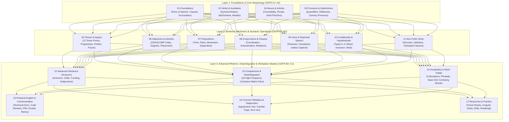

# English Grammar Knowledge System 📚🏛️

> *"Grammar is not a set of arbitrary rules to restrict freedom; it is the operating system of human thought and human collaboration. Clear grammar is clear thinking."*  
> — Adapted from Michael Swan, *Practical English Usage*

Welcome to the **English Grammar Knowledge System**. Designed specifically for software engineers, technical professionals, and advanced language learners, this repository structures the English language as a modular, three-layer engineering curriculum: from foundational syntax to intermediate mechanics, nuanced style, disambiguation, and production-grade workplace communication.

---

## 🧭 Master Curriculum & Knowledge Map

The curriculum is divided into **17 modules** organized sequentially from absolute beginner (A1) to near-native mastery (C2).

| Module | Category | Primary Focus | Target CEFR | Authoritative Literature |
| :---: | :--- | :--- | :---: | :--- |
| **01** | [Foundations](01-foundations/) | Word classes, S-V-O-C order, phrases, punctuation, capitalization | A1–A2 | Murphy *Essential*; Swan §19, 26, 30 |
| **02** | [Verbs & Auxiliaries](02-verbs-and-auxiliaries/) | Stative vs dynamic, primary auxiliaries, modals, subject-verb agreement | A1–B2 | Murphy Units 17, 26–37; Swan §1–2, 7 |
| **03** | [Tenses & Aspect](03-tenses-and-aspect/) | All 12 tenses, present perfect vs past, future aspects, time clauses | A1–B2 | Murphy Units 1–25; Swan §3–5 |
| **04** | [Nouns & Articles](04-nouns-and-articles/) | Countability, plurals, genitive case, definite/indefinite/zero articles | A1–B2 | Murphy Units 69–81; Swan §11–12 |
| **05** | [Pronouns & Determiners](05-pronouns-and-determiners/) | Universal/indefinite quantifiers, dummy *it* / existential *there* | A1–B2 | Murphy Units 82–91; Swan §12–14 |
| **06** | [Adjectives & Adverbs](06-adjectives-and-adverbs/) | OSASCOMP order, adverb placement, comparatives, intensifiers | A1–B2 | Murphy Units 98–112; Swan §15–17 |
| **07** | [Prepositions](07-prepositions/) | Time, place, direction, prepositional idioms, dependent prepositions | A1–B2 | Murphy Units 119–136; Swan §18 |
| **08** | [Conjunctions & Clauses](08-conjunctions-and-clauses/) | FANBOYS, subordinate clauses, defining/non-defining relatives | B1–C1 | Murphy Units 92–96, 113–118; Swan §20–21 |
| **09** | [Voice & Reported Speech](09-voice-and-reported-speech/) | Passives, impersonal passives, causatives, indirect speech & questions | B1–B2 | Murphy Units 42–48, 50; Swan §6, 24 |
| **10** | [Conditionals & Hypotheticals](10-conditionals-and-hypotheticals/) | Types 0–3, mixed conditionals, inverted conditionals, *wish*, *if only* | B1–C1 | Murphy Units 38–41, 114–115; Swan §22 |
| **11** | [Non-Finite Verbs](11-non-finite-verbs-verbals/) | Gerunds vs infinitives, verbs taking both, participial clauses | B1–C1 | Murphy Units 53–68; Swan §8–10 |
| **12** | [Advanced Sentence Structures](12-advanced-sentence-structures/) | Negative inversion, it/wh clefts, fronting, ellipsis, subjunctive | B2–C2 | Swan §20, 25, 27 |
| **13** | [Comparisons & Disambiguation](13-comparisons-and-disambiguation/) | 18 side-by-side disambiguation matrices (*since* vs *for*, *make* vs *do*) | A2–C1 | Murphy & Swan Contrast Modules |
| **14** | [Vocabulary & Word Usage](14-vocabulary-and-word-usage/) | Collocations, phrasal verbs, prefixes/suffixes, Swan §31 Confusing Words | B1–C2 | Swan §28–31 |
| **15** | [Practical English & Workplace](15-practical-english-and-communication/) | Technical documentation, architecture explanations, PR reviews, emails | B1–C2 | Swan §26–27; Industry Best Practices |
| **16** | [Common Mistakes & Diagnostics](16-common-mistakes-and-diagnostic-guide/) | Diagnostic antipatterns, ESL regional interference, run-on repair | A2–C1 | Swan & Cambridge Error Corpora |
| **17** | [Resources & Practice](17-resources-and-practice/) | Master cheat sheet, irregular verbs table, 60-question diagnostic exam | A1–C2 | Comprehensive Assessment Suite |

---

## ⚡ The Grammar Selection Decision Matrix

When writing or speaking, use this rapid decision guide to identify the correct grammatical structure for your communicative intent:

| If your objective is to... | Use this Grammatical Construction | Deep-Dive Module |
| :--- | :--- | :--- |
| Describe a permanent system behavior, scheduled cron job, or universal truth | **Present Simple** | [03-tenses-and-aspect/present-simple.md](03-tenses-and-aspect/present-simple.md) |
| Describe an active process executing right now or a temporary state | **Present Continuous** | [03-tenses-and-aspect/present-continuous.md](03-tenses-and-aspect/present-continuous.md) |
| Connect past engineering activity directly to current system state | **Present Perfect** | [03-tenses-and-aspect/present-perfect-simple.md](03-tenses-and-aspect/present-perfect-simple.md) |
| Focus on the recipient of an action rather than the actor (e.g. system logs) | **Passive Voice** | [09-voice-and-reported-speech/passive-voice-forms-and-mechanics.md](09-voice-and-reported-speech/passive-voice-forms-and-mechanics.md) |
| Formulate hypothetical software simulations or disaster scenarios | **Conditionals (2nd / 3rd / Mixed)** | [10-conditionals-and-hypotheticals/](10-conditionals-and-hypotheticals/) |
| Add dramatic emphasis, high formality, or rhetorical impact to writing | **Negative Inversion / Cleft Sentences** | [12-advanced-sentence-structures/](12-advanced-sentence-structures/) |
| Prevent ambiguity between two closely related grammatical structures | **Contrast & Disambiguation Guides** | [13-comparisons-and-disambiguation/](13-comparisons-and-disambiguation/) |
| Write clear pull request reviews, architecture decision records, or bug reports | **Practical Technical Communication** | [15-practical-english-and-communication/](15-practical-english-and-communication/) |

---

## 📋 The Golden Grammar Standard

Every individual topic guide across this knowledge system strictly adheres to an uncompromising quality anatomy:
1. **Source Traceability:** Mapped to Raymond Murphy (*Essential Grammar in Use*, *English Grammar in Use*) and Michael Swan (*Practical English Usage*).
2. **Visual Diagrams:** Standardized Mermaid.js timelines, syntax trees, and decision flowcharts.
3. **Rigorous Formulas:** Clear algebraic syntax formulas for affirmative, negative, interrogative, and negative-interrogative sentences.
4. **Dual-Domain Examples:** 15+ practical examples covering both everyday natural conversation and production software engineering contexts.
5. **Diagnostic Error Checklists:** Side-by-side bug/patch tables detailing why errors occur and how to fix them.
6. **Self-Assessment Verification:** Interactive exercises with comprehensive explanations in the answer key.
7. **Revision Flashcards:** High-density key takeaways for rapid memory retention.
