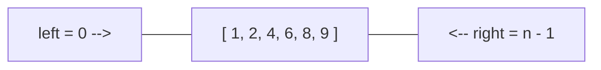

# 01. Two Pointers ⭐

## 1. Trigger Signals & Brute Force -> Optimal
* **Triggers:** Sorted array, pair/triplet sum, palindrome check, or in-place deduplication in $O(1)$ extra space.
* **Brute Force → Optimal:** Checking all `(i, j)` pairs takes $O(n^2)$ time. Because the array is sorted (or symmetric), moving `left` or `right` based on the comparison eliminates an entire row/column of pairs in **one step**, cutting time to **$O(n)$** and space to **$O(1)$**.

---

## 2. Mental Model & Dry-Run Trace



**Dry-Run (`nums = [1, 2, 4, 6, 8], target = 10`):**
1. `left=0 (1), right=4 (8)` → sum `9 < 10` → need larger sum → `left += 1`
2. `left=1 (2), right=4 (8)` → sum `10 == 10` → return `(1, 4)`

---

## 3. Reusable Python Template

```python
def two_sum_sorted(nums: list[int], target: int) -> tuple[int, int] | None:
    """Return indices of two numbers in a sorted list that sum to `target`."""
    left, right = 0, len(nums) - 1
    while left < right:
        cur = nums[left] + nums[right]
        if cur == target:
            return (left, right)
        if cur < target:
            left += 1   # Sum too small: advance left to increase value
        else:
            right -= 1  # Sum too large: retreat right to decrease value
    return None
```

---

## 4. Must-Know Classic Problems

### Problem A: Valid Palindrome (Opposite Ends)
* **Time:** $O(n)$ | **Space:** $O(1)$

```python
def is_palindrome(s: str) -> bool:
    """Check if `s` reads the same forwards and backwards, ignoring non-alphanumerics."""
    left, right = 0, len(s) - 1
    while left < right:
        while left < right and not s[left].isalnum():
            left += 1
        while left < right and not s[right].isalnum():
            right -= 1
        if s[left].lower() != s[right].lower():
            return False
        left += 1
        right -= 1
    return True

# Example: is_palindrome("A man, a plan, a canal: Panama") -> True
```

### Problem B: 3Sum — Unique Triplets Summing to 0
* **Time:** $O(n^2)$ | **Space:** $O(1)$ (excluding output)

```python
def three_sum(nums: list[int]) -> list[list[int]]:
    """Find all unique triplets [a, b, c] in `nums` such that a + b + c == 0."""
    nums.sort()
    res: list[list[int]] = []

    for i in range(len(nums) - 2):
        if i > 0 and nums[i] == nums[i - 1]:
            continue  # Skip duplicate anchor values

        left, right = i + 1, len(nums) - 1
        while left < right:
            total = nums[i] + nums[left] + nums[right]
            if total < 0:
                left += 1
            elif total > 0:
                right -= 1
            else:
                res.append([nums[i], nums[left], nums[right]])
                left += 1
                right -= 1
                # Skip duplicate second elements only AFTER recording a valid triplet
                while left < right and nums[left] == nums[left - 1]:
                    left += 1
    return res

# Example: three_sum([-1, 0, 1, 2, -1, -4]) -> [[-1, -1, 2], [-1, 0, 1]]
```

### Problem C: Remove Duplicates from Sorted Array (Same Direction)
* **Time:** $O(n)$ | **Space:** $O(1)$

```python
def remove_duplicates(nums: list[int]) -> int:
    """Compact unique elements to the front of sorted `nums` and return new length."""
    if not nums:
        return 0
    write = 1  # Next index to write a newly discovered unique value
    for read in range(1, len(nums)):
        if nums[read] != nums[read - 1]:
            nums[write] = nums[read]
            write += 1
    return write

# Example: remove_duplicates([1, 1, 2]) -> 2 (nums[:2] == [1, 2])
```

---

## 5. Edge Cases & Pattern vs. Pattern
* **Edge Cases:** Empty/1-element arrays (`left < right` exits cleanly), all duplicates (`[0, 0, 0]` in 3Sum).

| Pattern | When to Choose |
| :--- | :--- |
| **Two Pointers** | Sorted array / comparing two ends / $O(1)$ space in-place writes. |
| **[Sliding Window](03-sliding-window.md)** | **Contiguous** subarray or substring optimization. |
| **Hash Map (`dict`)** | **Unsorted** array where original indices are required (`Two Sum`). |

---

## 6. Rapid Follow-Up Q&As
* **Q: When do you choose Hash Map vs. Two Pointers for Two Sum?**  
  **A:** Unsorted + need original indices → Hash Map ($O(n)$ space). Sorted or need $O(1)$ space → Two Pointers.
* **Q: How do you extend 3Sum to kSum?**  
  **A:** Sort once, recursively fix $k - 2$ elements, and finish with the $O(n)$ Two Pointers base case ($O(n^{k-1})$ total).
