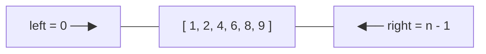

# 01. Two Pointers

## 1. Trigger Signals (When to Use)
* Input is a **sorted array** (or can be sorted first).
* You need to find a **pair, triplet, or subarray** matching a target sum/condition.
* You need to **compare from both ends** (palindromes, container with most water).
* You need **in-place filtering/deduplication** in $O(1)$ extra space (slow/write pointer + fast/read pointer).

---

## 2. Mental Model


* **Opposite ends:** If `sum < target`, move `left += 1` (increase sum); if `sum > target`, move `right -= 1` (decrease sum).
* **Same direction:** `slow` marks the write boundary; `fast` scans ahead.

---

## 3. Reusable Python Template

```python
def two_pointers_opposite(nums: list[int], target: int) -> tuple[int, int] | None:
    left, right = 0, len(nums) - 1
    while left < right:
        cur = nums[left] + nums[right]
        if cur == target:
            return (left, right)
        if cur < target:
            left += 1
        else:
            right -= 1
    return None
```

---

## 4. Must-Know Classic Problems

### Problem A: Valid Palindrome (Opposite Ends)
Ignore non-alphanumeric characters and case.
* **Time:** $O(n)$ | **Space:** $O(1)$

```python
def is_palindrome(s: str) -> bool:
    left, right = 0, len(s) - 1
    while left < right:
        while left < right and not s[left].isalnum():
            left += 1
        while left < right and not s[right].isalnum():
            right -= 1
        if s[left].lower() != s[right].lower():
            return False
        left += 1
        right -= 1
    return True
```

### Problem B: 3Sum — Unique Triplets Summing to 0
Sort first, fix `nums[i]`, then run Two Pointers on `[i+1 .. n-1]` while skipping duplicates.
* **Time:** $O(n^2)$ | **Space:** $O(1)$ (excluding output)

```python
def three_sum(nums: list[int]) -> list[list[int]]:
    nums.sort()
    res: list[list[int]] = []
    for i in range(len(nums) - 2):
        if i > 0 and nums[i] == nums[i - 1]:
            continue  # Skip duplicate anchor
        left, right = i + 1, len(nums) - 1
        while left < right:
            total = nums[i] + nums[left] + nums[right]
            if total < 0:
                left += 1
            elif total > 0:
                right -= 1
            else:
                res.append([nums[i], nums[left], nums[right]])
                left += 1
                right -= 1
                while left < right and nums[left] == nums[left - 1]:
                    left += 1
    return res
```

### Problem C: Remove Duplicates from Sorted Array (Same Direction)
* **Time:** $O(n)$ | **Space:** $O(1)$

```python
def remove_duplicates(nums: list[int]) -> int:
    if not nums:
        return 0
    write = 1
    for read in range(1, len(nums)):
        if nums[read] != nums[read - 1]:
            nums[write] = nums[read]
            write += 1
    return write
```

---

## 5. Edge Cases & Common Traps
* **Duplicate skipping in 3Sum:** Always skip duplicates on **both** the outer anchor `i` and inner `left` pointer (only *after* recording a match).
* **Empty or 1-element arrays:** `left < right` handles them safely without index errors.
* **Unsorted input:** Opposite-ends sum requires sorting first ($O(n \log n)$); if original indices are required, use a Hash Map instead.

---

## 6. Rapid Follow-Up Q&As
- **Q: When do you choose Hash Map vs. Two Pointers for Two Sum?**  
  **A:** If the array is **unsorted** and you need **original indices**, use a Hash Map ($O(n)$ time, $O(n)$ space). If it's **already sorted** or you need **$O(1)$ space**, use Two Pointers.
- **Q: How do you extend 3Sum to 4Sum / kSum?**  
  **A:** Sort the array, recursively fix $k - 2$ elements, and finish with the $O(n)$ Two Pointers base case ($O(n^{k-1})$ total).
