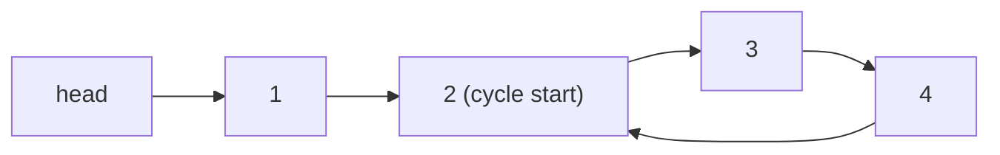

# 02. Fast & Slow Pointers ⭐

## 1. Trigger Signals & Brute Force -> Optimal
* **Triggers:** Cycle detection in a linked list or sequence, finding the **middle node**, or finding the **cycle entrance** in $O(1)$ space.
* **Brute Force → Optimal:** Storing visited nodes in a `set` takes $O(n)$ space. Moving `slow` by 1 step and `fast` by 2 steps guarantees they meet inside any cycle in **$O(n)$ time and $O(1)$ space**.

---

## 2. Mental Model & Dry-Run Trace



**Dry-Run (Cycle `1 -> 2 -> 3 -> 4 -> 2`):**
1. Start: `slow = 1, fast = 1`
2. Step 1: `slow = 2, fast = 3`
3. Step 2: `slow = 3, fast = 2`
4. Step 3: `slow = 4, fast = 4` → `slow is fast` → **Cycle detected!**

---

## 3. Reusable Python Template

```python
class ListNode:
    def __init__(self, val: int = 0, next: "ListNode | None" = None) -> None:
        self.val = val
        self.next = next


def has_cycle(head: ListNode | None) -> bool:
    """Return True if the linked list contains a cycle using O(1) extra space."""
    slow = fast = head
    while fast and fast.next:
        slow = slow.next
        fast = fast.next.next
        if slow is fast:  # Compare node identity, not value
            return True
    return False
```

---

## 4. Must-Know Classic Problems

### Problem A: Middle of the Linked List
* **Time:** $O(n)$ | **Space:** $O(1)$

```python
def middle_node(head: ListNode | None) -> ListNode | None:
    """Return the middle node (second middle if length is even)."""
    slow = fast = head
    while fast and fast.next:
        slow = slow.next
        fast = fast.next.next
    return slow

# Example: [1, 2, 3, 4, 5] -> node(3); [1, 2, 3, 4] -> node(3)
```

### Problem B: Linked List Cycle II (Find Cycle Start)
* **Time:** $O(n)$ | **Space:** $O(1)$

```python
def detect_cycle_start(head: ListNode | None) -> ListNode | None:
    """Return the node where the cycle begins, or None if acyclic."""
    slow = fast = head
    while fast and fast.next:
        slow = slow.next
        fast = fast.next.next
        if slow is fast:
            # Reset one pointer to head; advancing both by 1 meets at cycle start
            ptr = head
            while ptr is not slow:
                ptr = ptr.next
                slow = slow.next
            return ptr
    return None
```

### Problem C: Happy Number
* **Time:** $O(\log n)$ | **Space:** $O(1)$

```python
def is_happy(n: int) -> bool:
    """Detect whether summing squared digits reaches 1 or enters an endless cycle."""
    def next_num(x: int) -> int:
        total = 0
        while x:
            x, d = divmod(x, 10)
            total += d * d
        return total

    slow, fast = n, next_num(n)
    while fast != 1 and slow != fast:
        slow = next_num(slow)
        fast = next_num(next_num(fast))
    return fast == 1

# Example: is_happy(19) -> True; is_happy(2) -> False
```

---

## 5. Edge Cases & Pattern vs. Pattern
* **Loop guard:** Always check `while fast and fast.next:`—checking only `fast.next` crashes on `head = None`.

| Pattern | When to Choose |
| :--- | :--- |
| **Fast & Slow Pointers** | Linked list cycle/midpoint in $O(1)$ space. |
| **Hash Set (`visited`)** | Graph traversal where nodes have multiple neighbors (not a singly linked list). |

---

## 6. Rapid Follow-Up Q&As
* **Q: Why does resetting one pointer to `head` after meeting find the cycle entrance?**  
  **A:** With distance $F$ to cycle start, meeting offset $a$, and cycle length $C$: $2(F + a) = F + a + kC \implies F = kC - a$. Walking $F$ steps from `head` and $F$ steps from the meeting point lands both at the entrance.
