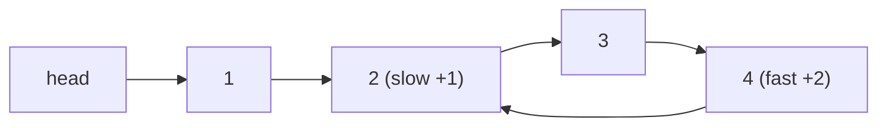

# 02. Fast & Slow Pointers

## 1. Trigger Signals (When to Use)
* **Cycle detection** in a linked list or sequence (e.g., Happy Number).
* Finding the **middle node** of a linked list in a single pass.
* Finding the **start of a cycle** or **palindrome linked list** in $O(1)$ space.

---

## 2. Mental Model


* If there is a cycle, `fast` (2 steps) will eventually lap and meet `slow` (1 step).
* If `fast` reaches `None`, there is no cycle.

---

## 3. Reusable Python Template

```python
class ListNode:
    def __init__(self, val: int = 0, next: "ListNode | None" = None) -> None:
        self.val = val
        self.next = next


def has_cycle(head: ListNode | None) -> bool:
    slow = fast = head
    while fast and fast.next:
        slow = slow.next
        fast = fast.next.next
        if slow is fast:
            return True
    return False
```

---

## 4. Must-Know Classic Problems

### Problem A: Find the Middle of a Linked List
When `fast` reaches the end, `slow` is at the middle (second middle for even length).
* **Time:** $O(n)$ | **Space:** $O(1)$

```python
def middle_node(head: ListNode | None) -> ListNode | None:
    slow = fast = head
    while fast and fast.next:
        slow = slow.next
        fast = fast.next.next
    return slow
```

### Problem B: Linked List Cycle II (Find Cycle Start)
After `slow` and `fast` meet, reset one pointer to `head` and advance both by 1 step—they meet at the cycle entrance.
* **Time:** $O(n)$ | **Space:** $O(1)$

```python
def detect_cycle_start(head: ListNode | None) -> ListNode | None:
    slow = fast = head
    while fast and fast.next:
        slow = slow.next
        fast = fast.next.next
        if slow is fast:
            ptr = head
            while ptr is not slow:
                ptr = ptr.next
                slow = slow.next
            return ptr
    return None
```

### Problem C: Happy Number
Repeatedly sum squares of digits; if `1` is reached return `True`, if a cycle forms return `False`.
* **Time:** $O(\log n)$ | **Space:** $O(1)$

```python
def is_happy(n: int) -> bool:
    def next_num(x: int) -> int:
        total = 0
        while x:
            x, d = divmod(x, 10)
            total += d * d
        return total

    slow, fast = n, next_num(n)
    while fast != 1 and slow != fast:
        slow = next_num(slow)
        fast = next_num(next_num(fast))
    return fast == 1
```

---

## 5. Edge Cases & Common Traps
* **Loop condition:** Always check `while fast and fast.next:` (not `while fast.next:`), otherwise `fast.next.next` raises `AttributeError` when `fast` is `None`.
* **Identity vs. Value:** Compare nodes with `slow is fast`, not `slow.val == fast.val`.

---

## 6. Rapid Follow-Up Q&As
- **Q: Why does resetting one pointer to `head` after meeting find the cycle start?**  
  **A:** If distance to cycle start is $F$ and meeting point is $a$ steps into a cycle of length $C$, then $2(F + a) = F + a + kC \implies F = kC - a$. Moving $F$ steps from `head` and $F$ steps from the meeting point lands both at the cycle start.
