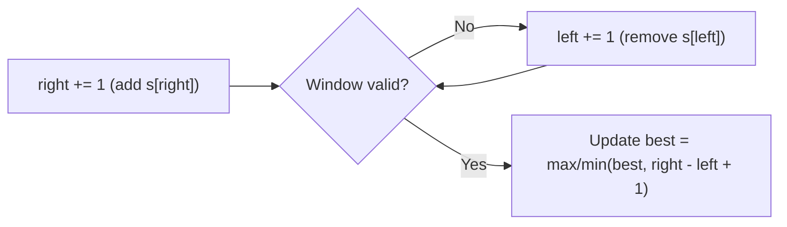

# 03. Sliding Window ⭐

## 1. Trigger Signals & Brute Force -> Optimal
* **Triggers:** Linear array/string asking for a **contiguous subarray or substring** (*longest*, *shortest*, *max sum*, *at most K distinct*).
* **Brute Force → Optimal:** Enumerating all `[i..j]` subarrays takes $O(n^2)$ (or $O(n^3)$). Sliding Window maintains running window state while `right` expands and `left` shrinks monotonically, cutting time to **$O(n)$**.

---

## 2. Mental Model & Dry-Run Trace



**Dry-Run (`nums = [2, 3, 1, 2, 4, 3], target = 7`, Min Size Subarray Sum):**
1. Expand to `right=3` (`[2, 3, 1, 2]`, sum `8 >= 7`) → `best = 4` → shrink `left=1` (`[3, 1, 2]`, sum `6 < 7`).
2. Expand to `right=4` (`[3, 1, 2, 4]`, sum `10 >= 7`) → shrink to `[2, 4]` (`6 < 7`), `best = 3`.
3. Expand to `right=5` (`[2, 4, 3]`, sum `9 >= 7`) → shrink to `[4, 3]` (`7 >= 7`) → **`best = 2`**.

---

## 3. Reusable Python Template

```python
from collections import defaultdict


def longest_k_distinct(s: str, k: int) -> int:
    """Return length of the longest substring with at most `k` distinct characters."""
    counts: dict[str, int] = defaultdict(int)
    left = best = 0

    for right, ch in enumerate(s):
        counts[ch] += 1

        while len(counts) > k:  # Shrink from left until window is valid again
            left_ch = s[left]
            counts[left_ch] -= 1
            if counts[left_ch] == 0:
                del counts[left_ch]  # Remove zero-count key so len(counts) stays accurate
            left += 1

        best = max(best, right - left + 1)
    return best
```

---

## 4. Must-Know Classic Problems

### Problem A: Longest Substring Without Repeating Characters
* **Time:** $O(n)$ | **Space:** $O(\min(n, \Sigma))$

```python
def length_of_longest_substring(s: str) -> int:
    """Return length of longest substring with all unique characters."""
    last_seen: dict[str, int] = {}
    left = best = 0

    for right, ch in enumerate(s):
        if ch in last_seen and last_seen[ch] >= left:
            left = last_seen[ch] + 1  # Jump left directly past the duplicate
        last_seen[ch] = right
        best = max(best, right - left + 1)
    return best

# Example: length_of_longest_substring("abcabcbb") -> 3 ("abc")
```

### Problem B: Minimum Size Subarray Sum (Positive Integers)
* **Time:** $O(n)$ | **Space:** $O(1)$

```python
def min_subarray_len(target: int, nums: list[int]) -> int:
    """Return minimal length of a contiguous subarray with sum >= `target`, else 0."""
    left = cur_sum = 0
    best = float("inf")

    for right, val in enumerate(nums):
        cur_sum += val
        while cur_sum >= target:
            best = min(best, right - left + 1)
            cur_sum -= nums[left]
            left += 1
    return 0 if best == float("inf") else int(best)

# Example: min_subarray_len(7, [2, 3, 1, 2, 4, 3]) -> 2 ([4, 3])
```

### Problem C: Maximum Sum Subarray of Fixed Size `k`
* **Time:** $O(n)$ | **Space:** $O(1)$

```python
def max_sum_subarray(nums: list[int], k: int) -> int:
    """Return maximum sum of any contiguous subarray of fixed size `k`."""
    window_sum = sum(nums[:k])
    best = window_sum
    for right in range(k, len(nums)):
        window_sum += nums[right] - nums[right - k]  # Slide: add entering, drop leaving
        best = max(best, window_sum)
    return best

# Example: max_sum_subarray([2, 1, 5, 1, 3, 2], 3) -> 9 ([5, 1, 3])
```

---

## 5. Edge Cases & Pattern vs. Pattern
* **Negative numbers:** Variable-size sum windows **break** when negative numbers exist (shrinking doesn't monotonically decrease the sum).

| Pattern | When to Choose |
| :--- | :--- |
| **Sliding Window** | Contiguous subarray/substring with **monotonic** window condition (e.g., positive numbers). |
| **Prefix Sum + Hash Map** | Contiguous subarray sum with **negative numbers** (`Subarray Sum Equals K`). |

---

## 6. Rapid Follow-Up Q&As
* **Q: Why is Sliding Window $O(n)$ despite the inner `while` loop?**  
  **A:** Both `left` and `right` only move forward, visiting at most $n$ elements each ($2n$ total pointer moves).
