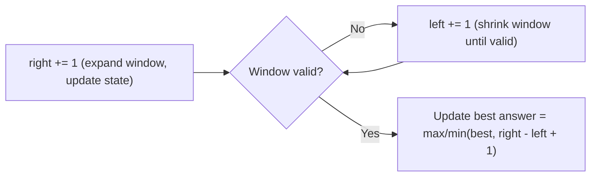

# 03. Sliding Window

## 1. Trigger Signals (When to Use)
* Input is a **linear structure** (array or string).
* Problem asks for a **contiguous subarray or substring** (e.g., *longest*, *shortest*, *maximum sum*, *at most K distinct*).
* Brute force would be $O(n^2)$ nested loops over all `(i, j)` pairs.

---

## 2. Mental Model



---

## 3. Reusable Python Template

```python
from collections import defaultdict


def sliding_window_variable(s: str, k: int) -> int:
    counts: dict[str, int] = defaultdict(int)
    left = 0
    best = 0

    for right, ch in enumerate(s):
        counts[ch] += 1

        while len(counts) > k:  # Shrink while window is invalid
            left_ch = s[left]
            counts[left_ch] -= 1
            if counts[left_ch] == 0:
                del counts[left_ch]
            left += 1

        best = max(best, right - left + 1)
    return best
```

---

## 4. Must-Know Classic Problems

### Problem A: Longest Substring Without Repeating Characters
Track last seen index of each char; jump `left` past duplicates in $O(1)$.
* **Time:** $O(n)$ | **Space:** $O(\min(n, \Sigma))$

```python
def length_of_longest_substring(s: str) -> int:
    last_seen: dict[str, int] = {}
    left = best = 0
    for right, ch in enumerate(s):
        if ch in last_seen and last_seen[ch] >= left:
            left = last_seen[ch] + 1
        last_seen[ch] = right
        best = max(best, right - left + 1)
    return best
```

### Problem B: Minimum Size Subarray Sum (Positive Integers)
Find minimal length of a contiguous subarray with `sum >= target`.
* **Time:** $O(n)$ | **Space:** $O(1)$

```python
def min_subarray_len(target: int, nums: list[int]) -> int:
    left = cur_sum = 0
    best = float("inf")
    for right, val in enumerate(nums):
        cur_sum += val
        while cur_sum >= target:
            best = min(best, right - left + 1)
            cur_sum -= nums[left]
            left += 1
    return 0 if best == float("inf") else int(best)
```

### Problem C: Maximum Sum Subarray of Fixed Size `k`
* **Time:** $O(n)$ | **Space:** $O(1)$

```python
def max_sum_subarray(nums: list[int], k: int) -> int:
    window_sum = sum(nums[:k])
    best = window_sum
    for right in range(k, len(nums)):
        window_sum += nums[right] - nums[right - k]
        best = max(best, window_sum)
    return best
```

---

## 5. Edge Cases & Common Traps
* **Negative numbers:** Variable-size sum windows (like Problem B) **break** if the array has negative numbers because shrinking doesn't monotonically decrease the sum—use **Prefix Sum + Hash Map** instead.
* **Delete zero-count keys:** When tracking distinct characters with `dict`, always `del counts[ch]` when count hits `0`, or `len(counts)` will be wrong.

---

## 6. Rapid Follow-Up Q&As
- **Q: Why is Sliding Window $O(n)$ despite the inner `while` loop?**  
  **A:** Both `left` and `right` only move forward and each visits at most $n$ elements, so total pointer moves are at most $2n = O(n)$.
