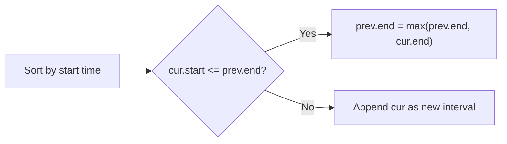

# 04. Merge Intervals

## 1. Trigger Signals (When to Use)
* Input is a list of **time ranges / intervals** `[start, end]`.
* Problem mentions **overlapping intervals, merging ranges, calendar conflicts, or meeting rooms**.

---

## 2. Mental Model



---

## 3. Reusable Python Template

```python
def merge_intervals(intervals: list[list[int]]) -> list[list[int]]:
    if not intervals:
        return []
    intervals.sort(key=lambda x: x[0])
    merged = [intervals[0][:]]

    for start, end in intervals[1:]:
        if start <= merged[-1][1]:
            merged[-1][1] = max(merged[-1][1], end)
        else:
            merged.append([start, end])
    return merged
```

---

## 4. Must-Know Classic Problems

### Problem A: Insert Interval (Already Sorted Input)
Insert `new_interval` into sorted non-overlapping intervals and merge.
* **Time:** $O(n)$ | **Space:** $O(n)$

```python
def insert_interval(intervals: list[list[int]], new_iv: list[int]) -> list[list[int]]:
    res: list[list[int]] = []
    i, n = 0, len(intervals)
    while i < n and intervals[i][1] < new_iv[0]:
        res.append(intervals[i])
        i += 1
    while i < n and intervals[i][0] <= new_iv[1]:
        new_iv[0] = min(new_iv[0], intervals[i][0])
        new_iv[1] = max(new_iv[1], intervals[i][1])
        i += 1
    res.append(new_iv)
    res.extend(intervals[i:])
    return res
```

### Problem B: Meeting Rooms II (Minimum Rooms Required)
Sort by start time and track active meeting end times in a **min-heap**.
* **Time:** $O(n \log n)$ | **Space:** $O(n)$

```python
import heapq


def min_meeting_rooms(intervals: list[list[int]]) -> int:
    if not intervals:
        return 0
    intervals.sort(key=lambda x: x[0])
    heap: list[int] = []  # Stores end times of active meetings

    for start, end in intervals:
        if heap and heap[0] <= start:
            heapq.heappop(heap)  # Reuse earliest-ending room
        heapq.heappush(heap, end)
    return len(heap)
```

---

## 5. Edge Cases & Common Traps
* **Touching endpoints:** Confirm whether `[1, 4]` and `[4, 5]` count as overlapping (`<=`) or non-overlapping (`<`). For Meeting Rooms, `heap[0] <= start` means a room freed at `4` *can* be reused at `4`.
* **Mutating input:** Copy `[start, end]` (`intervals[0][:]`) so you don't unexpectedly mutate the caller's list.

---

## 6. Rapid Follow-Up Q&As
- **Q: How do you find the intersection of two sorted interval lists?**  
  **A:** Use Two Pointers (`i, j`): overlap is `[max(a.start, b.start), min(a.end, b.end)]` if `start <= end`, then advance whichever interval ends first.
