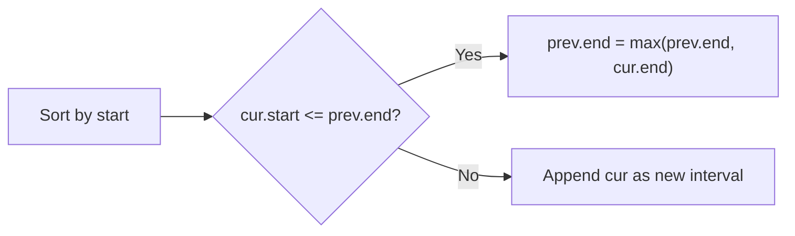

# 04. Merge Intervals ⭐

## 1. Trigger Signals & Brute Force -> Optimal
* **Triggers:** Input is a list of `[start, end]` ranges asking to **merge overlaps**, **insert an interval**, or find **minimum meeting rooms**.
* **Brute Force → Optimal:** Checking every interval pair for overlap takes $O(n^2)$. Sorting by `start` puts all overlapping intervals adjacent to each other, reducing the merge pass to **$O(n \log n)$**.

---

## 2. Mental Model & Dry-Run Trace



**Dry-Run (`[[1, 3], [2, 6], [8, 10]]`):**
1. Start with `merged = [[1, 3]]`.
2. `[2, 6]`: `2 <= 3` (overlap!) → `merged[-1][1] = max(3, 6) = 6` → `[[1, 6]]`.
3. `[8, 10]`: `8 > 6` (disjoint) → append → `[[1, 6], [8, 10]]`.

---

## 3. Reusable Python Template

```python
def merge_intervals(intervals: list[list[int]]) -> list[list[int]]:
    """Merge all overlapping [start, end] intervals and return sorted result."""
    if not intervals:
        return []
    intervals.sort(key=lambda x: x[0])
    merged = [intervals[0][:]]  # Copy first interval to avoid mutating caller input

    for start, end in intervals[1:]:
        if start <= merged[-1][1]:
            merged[-1][1] = max(merged[-1][1], end)
        else:
            merged.append([start, end])
    return merged

# Example: merge_intervals([[1, 3], [2, 6], [8, 10]]) -> [[1, 6], [8, 10]]
```

---

## 4. Must-Know Classic Problems

### Problem A: Insert Interval (Already Sorted Input)
* **Time:** $O(n)$ | **Space:** $O(n)$

```python
def insert_interval(intervals: list[list[int]], new_iv: list[int]) -> list[list[int]]:
    """Insert `new_iv` into sorted non-overlapping intervals and merge overlaps."""
    res: list[list[int]] = []
    i, n = 0, len(intervals)
    cur = new_iv[:]

    while i < n and intervals[i][1] < cur[0]:  # Strictly before new_iv
        res.append(intervals[i])
        i += 1
    while i < n and intervals[i][0] <= cur[1]:  # Overlapping with new_iv
        cur[0] = min(cur[0], intervals[i][0])
        cur[1] = max(cur[1], intervals[i][1])
        i += 1
    res.append(cur)
    res.extend(intervals[i:])  # Remaining intervals strictly after
    return res

# Example: insert_interval([[1, 3], [6, 9]], [2, 5]) -> [[1, 5], [6, 9]]
```

### Problem B: Meeting Rooms II (Minimum Rooms Required)
* **Time:** $O(n \log n)$ | **Space:** $O(n)$

```python
import heapq


def min_meeting_rooms(intervals: list[list[int]]) -> int:
    """Return minimum conference rooms needed using a min-heap of active end times."""
    if not intervals:
        return 0
    intervals.sort(key=lambda x: x[0])
    heap: list[int] = []

    for start, end in intervals:
        if heap and heap[0] <= start:
            heapq.heappop(heap)  # Reuse earliest-ending room
        heapq.heappush(heap, end)
    return len(heap)

# Example: min_meeting_rooms([[0, 30], [5, 10], [15, 20]]) -> 2
```

---

## 5. Edge Cases & Pattern vs. Pattern
* **Touching endpoints:** Clarify whether `[1, 4]` and `[4, 5]` overlap (`<=` vs `<`). In Meeting Rooms, `heap[0] <= start` means a room freed at `4` is available at `4`.

| Pattern | When to Choose |
| :--- | :--- |
| **Merge Intervals (sort by `start`)** | Merging overlaps, inserting ranges, counting concurrent rooms. |
| **[Greedy](11-greedy-techniques.md) (sort by `end`)** | Selecting the **maximum** number of non-overlapping intervals. |

---

## 6. Rapid Follow-Up Q&As
* **Q: How do you find the intersection of two sorted interval lists?**  
  **A:** Use Two Pointers (`i, j`): overlap is `[max(a.start, b.start), min(a.end, b.end)]` if `lo <= hi`, then advance whichever interval ends first.
