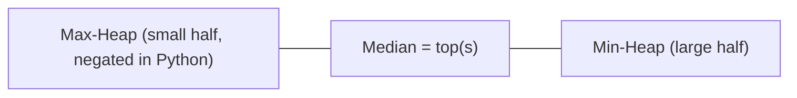

# 06. Two Heaps

## 1. Trigger Signals (When to Use)
* Data arrives as a **stream** and you need the **running median**.
* You need to partition numbers into a **smaller half** and a **larger half** to access the middle boundary in $O(1)$ time.

---

## 2. Mental Model


Keep `len(small)` equal to `len(large)` or `len(large) + 1`.

---

## 3. Reusable Python Template

```python
import heapq


class MedianFinder:
    def __init__(self) -> None:
        self.small: list[int] = []  # Max-heap (store -num)
        self.large: list[int] = []  # Min-heap

    def add_num(self, num: int) -> None:
        heapq.heappush(self.small, -num)
        # Ensure every element in small <= every element in large
        if self.small and self.large and -self.small[0] > self.large[0]:
            heapq.heappush(self.large, -heapq.heappop(self.small))

        # Rebalance sizes (small can have at most 1 extra)
        if len(self.small) > len(self.large) + 1:
            heapq.heappush(self.large, -heapq.heappop(self.small))
        elif len(self.large) > len(self.small):
            heapq.heappush(self.small, -heapq.heappop(self.large))

    def find_median(self) -> float:
        if len(self.small) > len(self.large):
            return float(-self.small[0])
        return (-self.small[0] + self.large[0]) / 2.0
```

---

## 4. Must-Know Classic Problems

### Problem A: Find Median from Data Stream
Handled directly by `MedianFinder` above.
* **Time:** $O(\log n)$ per `add_num`, $O(1)$ per `find_median` | **Space:** $O(n)$

### Problem B: IPO (Maximize Capital with `k` Projects)
Sort projects by `capital`; push affordable projects' profits into a **max-heap**, pick the highest profit `k` times.
* **Time:** $O(n \log n)$ | **Space:** $O(n)$

```python
import heapq


def find_maximized_capital(k: int, w: int, profits: list[int], capital: list[int]) -> int:
    projects = sorted(zip(capital, profits))
    max_profit: list[int] = []
    i, n = 0, len(projects)

    for _ in range(k):
        while i < n and projects[i][0] <= w:
            heapq.heappush(max_profit, -projects[i][1])
            i += 1
        if not max_profit:
            break
        w += -heapq.heappop(max_profit)
    return w
```

---

## 5. Edge Cases & Common Traps
* **Python `heapq` is Min-Heap only:** Always negate values (`-num`) when pushing to `self.small`, and negate again when reading/popping.
* **Float division:** Return `(-self.small[0] + self.large[0]) / 2.0` (not `//`).

---

## 6. Rapid Follow-Up Q&As
- **Q: How would you extend MedianFinder to support a Sliding Window Median?**  
  **A:** Use **lazy deletion** (mark removed elements in a `deleted` hash map and pop them only when they reach the top of either heap).
