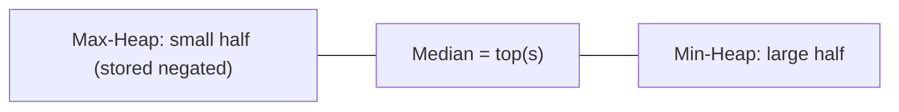

# 06. Two Heaps

## 1. Trigger Signals & Brute Force -> Optimal
* **Triggers:** Streaming numbers requiring a **running median**, or partitioning elements into **smaller half vs. larger half**.
* **Brute Force → Optimal:** Re-sorting on every insertion takes $O(n \log n)$ per query. Balancing a **Max-Heap** (lower half) and **Min-Heap** (upper half) gives **$O(\log n)$ insert and $O(1)$ median**.

---

## 2. Mental Model & Dry-Run Trace



**Dry-Run (`add(1), add(5), add(2)`):**
1. `add(1)` → `small=[-1], large=[]` → median `1.0`.
2. `add(5)` → `small=[-1], large=[5]` → median `(1 + 5)/2 = 3.0`.
3. `add(2)` → `small=[-2, -1], large=[5]` → median `2.0`.

---

## 3. Reusable Python Template

```python
import heapq


class MedianFinder:
    """Maintains a balanced Max-Heap (small) and Min-Heap (large) for O(1) median."""

    def __init__(self) -> None:
        self.small: list[int] = []  # Max-heap via negated values
        self.large: list[int] = []  # Min-heap

    def add_num(self, num: int) -> None:
        """Insert `num` in O(log n) while preserving order and size balance."""
        heapq.heappush(self.small, -num)

        # Ordering invariant: max(small) <= min(large)
        if self.small and self.large and -self.small[0] > self.large[0]:
            heapq.heappush(self.large, -heapq.heappop(self.small))

        # Size invariant: len(small) is len(large) or len(large) + 1
        if len(self.small) > len(self.large) + 1:
            heapq.heappush(self.large, -heapq.heappop(self.small))
        elif len(self.large) > len(self.small):
            heapq.heappush(self.small, -heapq.heappop(self.large))

    def find_median(self) -> float:
        """Return current median in O(1)."""
        if len(self.small) > len(self.large):
            return float(-self.small[0])
        return (-self.small[0] + self.large[0]) / 2.0
```

---

## 4. Must-Know Classic Problems

### Problem A: IPO (Maximize Capital with `k` Projects)
* **Time:** $O(n \log n)$ | **Space:** $O(n)$

```python
import heapq


def find_maximized_capital(k: int, w: int, profits: list[int], capital: list[int]) -> int:
    """Greedily pick up to `k` affordable projects with maximum profit."""
    projects = sorted(zip(capital, profits))  # Min-capital order
    max_profit: list[int] = []
    i, n = 0, len(projects)

    for _ in range(k):
        while i < n and projects[i][0] <= w:
            heapq.heappush(max_profit, -projects[i][1])
            i += 1
        if not max_profit:
            break
        w += -heapq.heappop(max_profit)
    return w

# Example: k=2, w=0, profits=[1,2,3], capital=[0,1,1] -> 4
```

---

## 5. Edge Cases & Pattern vs. Pattern
* **Python `heapq` is Min-Heap only:** Always negate when pushing/popping `self.small`.

| Pattern | When to Choose |
| :--- | :--- |
| **Two Heaps** | Dynamic **median** / middle split over a stream. |
| **[Top 'K' Elements](08-top-k-elements.md)** | Tracking the **top/bottom $K$** items with a single heap. |

---

## 6. Rapid Follow-Up Q&As
* **Q: How do you handle Sliding Window Median (removals)?**  
  **A:** Use **lazy deletion**: track removed numbers in a `Counter` dict and pop them only when they surface at the top of `small` or `large`.
