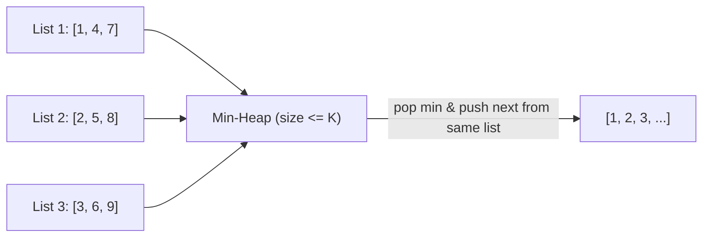

# 07. K-Way Merge

## 1. Trigger Signals (When to Use)
* Input gives **$K$ sorted arrays, linked lists, or matrix rows**.
* Problem asks to **merge them**, find the **$K$-th smallest element**, or find the **smallest range covering all $K$ lists**.

---

## 2. Mental Model



---

## 3. Reusable Python Template

```python
import heapq


def merge_k_sorted_arrays(lists: list[list[int]]) -> list[int]:
    heap: list[tuple[int, int, int]] = []  # (val, list_idx, elem_idx)
    for r, arr in enumerate(lists):
        if arr:
            heapq.heappush(heap, (arr[0], r, 0))

    res: list[int] = []
    while heap:
        val, r, c = heapq.heappop(heap)
        res.append(val)
        if c + 1 < len(lists[r]):
            heapq.heappush(heap, (lists[r][c + 1], r, c + 1))
    return res
```

---

## 4. Must-Know Classic Problems

### Problem A: Merge K Sorted Linked Lists
Use `(node.val, idx, node)` in the heap (`idx` breaks ties so Python never compares `ListNode` objects!).
* **Time:** $O(N \log K)$ | **Space:** $O(K)$

```python
import heapq


class ListNode:
    def __init__(self, val: int = 0, next: "ListNode | None" = None) -> None:
        self.val = val
        self.next = next


def merge_k_lists(lists: list[ListNode | None]) -> ListNode | None:
    heap: list[tuple[int, int, ListNode]] = []
    for i, node in enumerate(lists):
        if node:
            heapq.heappush(heap, (node.val, i, node))

    dummy = tail = ListNode()
    while heap:
        _, i, node = heapq.heappop(heap)
        tail.next = node
        tail = tail.next
        if node.next:
            heapq.heappush(heap, (node.next.val, i, node.next))
    return dummy.next
```

### Problem B: Kth Smallest Element in a Sorted Matrix
Push the first element of each row (up to `min(k, n)` rows) and pop `k` times.
* **Time:** $O(K \log(\min(K, N)))$ | **Space:** $O(\min(K, N))$

```python
import heapq


def kth_smallest_matrix(matrix: list[list[int]], k: int) -> int:
    n = len(matrix)
    heap = [(matrix[r][0], r, 0) for r in range(min(n, k))]
    heapq.heapify(heap)
    val = 0
    for _ in range(k):
        val, r, c = heapq.heappop(heap)
        if c + 1 < len(matrix[r]):
            heapq.heappush(heap, (matrix[r][c + 1], r, c + 1))
    return val
```

---

## 5. Edge Cases & Common Traps
* **`TypeError: '<' not supported between instances of 'ListNode'`:** Always include a unique tie-breaker index `(node.val, i, node)` in Python tuples pushed to `heapq`.
* **Empty sub-lists:** Guard `if arr:` / `if node:` before pushing to the heap.

---

## 6. Rapid Follow-Up Q&As
- **Q: Heap vs. Divide-and-Conquer pair merging for K lists?**  
  **A:** Both are $O(N \log K)$ time; Divide-and-Conquer uses $O(1)$ extra space (iterative), while Heap is ideal for **streaming** or stopping early at the $K$-th element.
