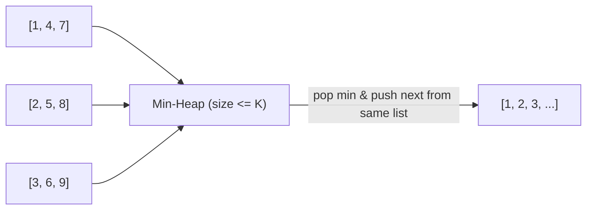

# 07. K-Way Merge

## 1. Trigger Signals & Brute Force -> Optimal
* **Triggers:** Input provides **$K$ sorted arrays, linked lists, or matrix rows** and asks to merge or find the **$K$-th smallest**.
* **Brute Force → Optimal:** Concatenating all $N$ elements and sorting takes $O(N \log N)$. Keeping only the current head of each of the $K$ lists in a Min-Heap reduces work to **$O(N \log K)$ time and $O(K)$ space**.

---

## 2. Mental Model & Dry-Run Trace



---

## 3. Reusable Python Template

```python
import heapq


def merge_k_sorted_arrays(lists: list[list[int]]) -> list[int]:
    """Merge `k` sorted lists into a single sorted list in O(N log K)."""
    heap: list[tuple[int, int, int]] = []  # (value, list_index, elem_index)
    for r, arr in enumerate(lists):
        if arr:
            heapq.heappush(heap, (arr[0], r, 0))

    res: list[int] = []
    while heap:
        val, r, c = heapq.heappop(heap)
        res.append(val)
        if c + 1 < len(lists[r]):
            heapq.heappush(heap, (lists[r][c + 1], r, c + 1))
    return res

# Example: merge_k_sorted_arrays([[1, 4], [2, 5], [3]]) -> [1, 2, 3, 4, 5]
```

---

## 4. Must-Know Classic Problems

### Problem A: Merge K Sorted Linked Lists
* **Time:** $O(N \log K)$ | **Space:** $O(K)$

```python
import heapq


class ListNode:
    def __init__(self, val: int = 0, next: "ListNode | None" = None) -> None:
        self.val = val
        self.next = next


def merge_k_lists(lists: list[ListNode | None]) -> ListNode | None:
    """Merge K sorted linked lists using a Min-Heap with tie-breaker index `i`."""
    heap: list[tuple[int, int, ListNode]] = []
    for i, node in enumerate(lists):
        if node:
            heapq.heappush(heap, (node.val, i, node))  # `i` prevents ListNode comparison

    dummy = tail = ListNode()
    while heap:
        _, i, node = heapq.heappop(heap)
        tail.next = node
        tail = tail.next
        if node.next:
            heapq.heappush(heap, (node.next.val, i, node.next))
    return dummy.next
```

### Problem B: Kth Smallest Element in a Sorted Matrix
* **Time:** $O(K \log(\min(K, N)))$ | **Space:** $O(\min(K, N))$

```python
import heapq


def kth_smallest_matrix(matrix: list[list[int]], k: int) -> int:
    """Find the k-th smallest value in a row-and-column-sorted matrix."""
    n = len(matrix)
    heap = [(matrix[r][0], r, 0) for r in range(min(n, k))]
    heapq.heapify(heap)
    val = 0
    for _ in range(k):
        val, r, c = heapq.heappop(heap)
        if c + 1 < len(matrix[r]):
            heapq.heappush(heap, (matrix[r][c + 1], r, c + 1))
    return val

# Example: kth_smallest_matrix([[1, 5], [2, 6]], 3) -> 5
```

---

## 5. Edge Cases & Pattern vs. Pattern
* **Tuple tie-breaker:** Always include `i` in `(node.val, i, node)` so Python never tries `ListNode < ListNode` (`TypeError`).

| Pattern | When to Choose |
| :--- | :--- |
| **K-Way Merge** | Inputs are **already sorted** streams/lists. |
| **[Top 'K' Elements](08-top-k-elements.md)** | Input is **unsorted** and you only need the top $K$. |

---

## 6. Rapid Follow-Up Q&As
* **Q: Heap vs. Divide-and-Conquer pair merging?**  
  **A:** Both are $O(N \log K)$ time; Divide-and-Conquer uses $O(1)$ extra space iteratively, while a Heap works on **infinite streams** and can stop early at the $K$-th element.
