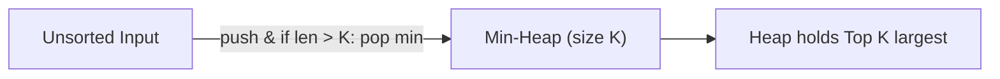

# 08. Top 'K' Elements ⭐

## 1. Trigger Signals & Brute Force -> Optimal
* **Triggers:** **Top `K`**, **`K` largest / smallest**, **`K` most frequent**, or **`K` closest** items.
* **Brute Force → Optimal:** Sorting all $n$ items takes $O(n \log n)$. Keeping a bounded heap of size $K$ reduces time to **$O(n \log K)$** and space to **$O(K)$**.

---

## 2. Mental Model & Dry-Run Trace


* **Top K Largest** → **Min-Heap** of size `K` (evict smallest).
* **Top K Smallest** → **Max-Heap** of size `K` (evict largest, using `-val`).

---

## 3. Reusable Python Template

```python
import heapq


def top_k_largest(nums: list[int], k: int) -> list[int]:
    """Return the `k` largest elements from `nums` in O(n log k) time."""
    heap: list[int] = []
    for num in nums:
        heapq.heappush(heap, num)
        if len(heap) > k:
            heapq.heappop(heap)  # Evict smallest so only top K remain
    return heap

# Example: sorted(top_k_largest([3, 1, 5, 12, 2, 11], 3)) -> [5, 11, 12]
```

---

## 4. Must-Know Classic Problems

### Problem A: Top K Frequent Elements
* **Time:** $O(n \log k)$ | **Space:** $O(n)$

```python
import heapq
from collections import Counter


def top_k_frequent(nums: list[int], k: int) -> list[int]:
    """Return the `k` most frequent elements in `nums`."""
    counts = Counter(nums)
    return heapq.nlargest(k, counts.keys(), key=counts.get)  # type: ignore[arg-type]

# Example: top_k_frequent([1, 1, 1, 2, 2, 3], 2) -> [1, 2]
```

### Problem B: K Closest Points to Origin
* **Time:** $O(n \log k)$ | **Space:** $O(k)$

```python
import heapq


def k_closest(points: list[list[int]], k: int) -> list[list[int]]:
    """Return `k` points closest to (0, 0) using a size-k Max-Heap."""
    heap: list[tuple[int, int, int]] = []
    for x, y in points:
        neg_dist = -(x * x + y * y)  # Squared distance avoids float sqrt
        if len(heap) < k:
            heapq.heappush(heap, (neg_dist, x, y))
        elif neg_dist > heap[0][0]:
            heapq.heapreplace(heap, (neg_dist, x, y))
    return [[x, y] for _, x, y in heap]

# Example: k_closest([[1, 3], [-2, 2]], 1) -> [[-2, 2]]
```

---

## 5. Edge Cases & Pattern vs. Pattern
* **`k <= 0` or `k >= len(nums)`:** Guard `if k <= 0: return []`.

| Pattern | When to Choose |
| :--- | :--- |
| **Bounded Heap (`O(n log K)`)** | Streaming data or guaranteed $O(n \log K)$ worst case. |
| **Quickselect (`O(n)` avg)** | Offline $K$-th element in $O(1)$ space (worst-case $O(n^2)$). |
| **Bucket Sort (`O(n)`)** | Top $K$ Frequent when frequencies are bounded in `1..n`. |

---

## 6. Rapid Follow-Up Q&As
* **Q: Why use `heapq.heapreplace(heap, item)` instead of `heappop` + `heappush`?**  
  **A:** `heapreplace` pops and pushes in a single sift operation instead of two.
