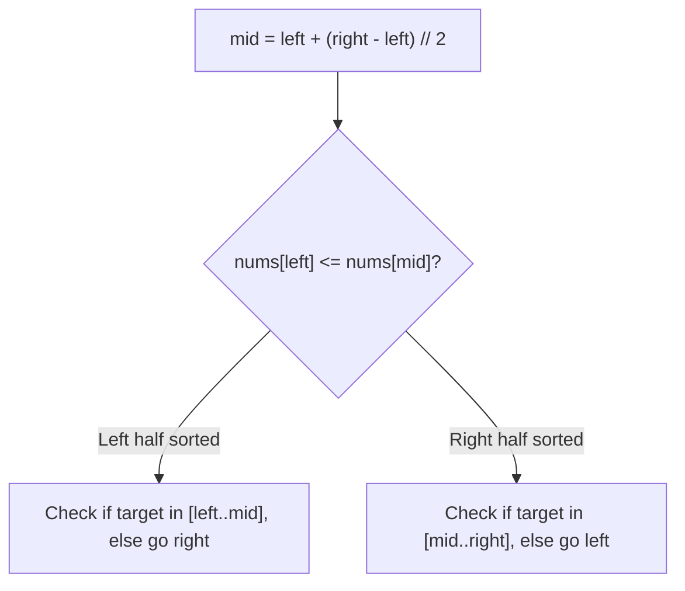

# 09. Modified Binary Search

## 1. Trigger Signals (When to Use)
* Input is **sorted** or **rotated sorted** (or bitonic/mountain).
* Requirement says **$O(\log n)$ time**.
* Optimization problem with a **monotonic condition** ("minimum capacity / speed to finish within `H` hours" → Binary Search on Answer).

---

## 2. Mental Model



---

## 3. Reusable Python Template (Lower Bound / First True)

```python
def binary_search_first_true(lo: int, hi: int, is_valid) -> int:
    while lo < hi:
        mid = lo + (hi - lo) // 2
        if is_valid(mid):
            hi = mid      # Keep mid as candidate
        else:
            lo = mid + 1  # Discard mid
    return lo
```

---

## 4. Must-Know Classic Problems

### Problem A: Search in Rotated Sorted Array
At least one half `[left..mid]` or `[mid..right]` is always sorted.
* **Time:** $O(\log n)$ | **Space:** $O(1)$

```python
def search_rotated(nums: list[int], target: int) -> int:
    left, right = 0, len(nums) - 1
    while left <= right:
        mid = left + (right - left) // 2
        if nums[mid] == target:
            return mid
        if nums[left] <= nums[mid]:  # Left half is sorted
            if nums[left] <= target < nums[mid]:
                right = mid - 1
            else:
                left = mid + 1
        else:  # Right half is sorted
            if nums[mid] < target <= nums[right]:
                left = mid + 1
            else:
                right = mid - 1
    return -1
```

### Problem B: Find Minimum in Rotated Sorted Array
* **Time:** $O(\log n)$ | **Space:** $O(1)$

```python
def find_min(nums: list[int]) -> int:
    left, right = 0, len(nums) - 1
    while left < right:
        mid = left + (right - left) // 2
        if nums[mid] > nums[right]:
            left = mid + 1
        else:
            right = mid
    return nums[left]
```

### Problem C: Koko Eating Bananas (Binary Search on Answer)
* **Time:** $O(n \log(\max(piles)))$ | **Space:** $O(1)$

```python
def min_eating_speed(piles: list[int], h: int) -> int:
    lo, hi = 1, max(piles)
    while lo < hi:
        mid = (lo + hi) // 2
        hours = sum((p + mid - 1) // mid for p in piles)
        if hours <= h:
            hi = mid
        else:
            lo = mid + 1
    return lo
```

---

## 5. Edge Cases & Common Traps
* **Infinite loop when `lo < hi`:** If `lo = mid`, you must compute `mid = (lo + hi + 1) // 2` (upper mid); if `hi = mid`, use `(lo + hi) // 2` (lower mid).
* **Python `bisect`:** `bisect.bisect_left` and `bisect_right` handle standard lower/upper bound in C speed.

---

## 6. Rapid Follow-Up Q&As
- **Q: What happens in Search in Rotated Sorted Array if duplicates exist?**  
  **A:** When `nums[left] == nums[mid] == nums[right]`, you can't tell which half is sorted—shrink `left += 1; right -= 1`, degrading worst-case to $O(n)$.
