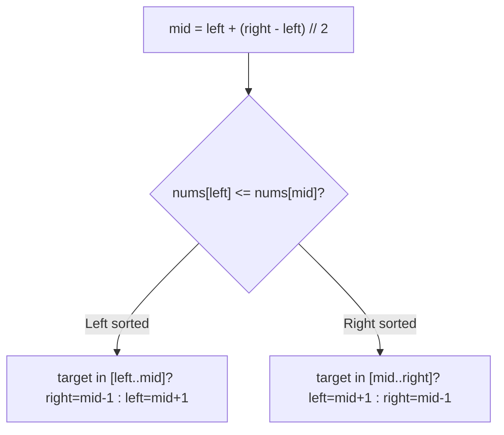

# 09. Modified Binary Search ⭐

## 1. Trigger Signals & Brute Force -> Optimal
* **Triggers:** **Sorted** or **rotated sorted** array, **$O(\log n)$ requirement**, or monotonic optimization (*"minimum speed/capacity to finish in H hours"*).
* **Brute Force → Optimal:** Linear scan takes $O(n)$. Halving the search space each step cuts time to **$O(\log n)$**.

---

## 2. Mental Model & Dry-Run Trace



**Dry-Run (`nums = [4, 5, 6, 7, 0, 1, 2], target = 0`):**
1. `left=0, right=6, mid=3 (7)`: `nums[0] <= nums[3]` (left sorted `[4..7]`), `0` not in `[4..7]` → `left = 4`.
2. `left=4, right=6, mid=5 (1)`: `nums[4] <= nums[5]` (`[0, 1]`), `0` in `[0..1]` → `right = 4`.
3. `left=4, right=4, mid=4 (0)` → found at index **`4`**!

---

## 3. Reusable Python Template (First True / Lower Bound)

```python
from typing import Callable


def binary_search_first_true(lo: int, hi: int, is_valid: Callable[[int], bool]) -> int:
    """Find the smallest integer in [lo, hi] where `is_valid(mid)` is True."""
    while lo < hi:
        mid = lo + (hi - lo) // 2
        if is_valid(mid):
            hi = mid      # mid might be the answer; keep it
        else:
            lo = mid + 1  # mid is invalid; discard it
    return lo
```

---

## 4. Must-Know Classic Problems

### Problem A: Search in Rotated Sorted Array
* **Time:** $O(\log n)$ | **Space:** $O(1)$

```python
def search_rotated(nums: list[int], target: int) -> int:
    """Return index of `target` in a rotated sorted array with unique values, or -1."""
    left, right = 0, len(nums) - 1
    while left <= right:
        mid = left + (right - left) // 2
        if nums[mid] == target:
            return mid
        if nums[left] <= nums[mid]:  # Left half is sorted
            if nums[left] <= target < nums[mid]:
                right = mid - 1
            else:
                left = mid + 1
        else:  # Right half is sorted
            if nums[mid] < target <= nums[right]:
                left = mid + 1
            else:
                right = mid - 1
    return -1

# Example: search_rotated([4, 5, 6, 7, 0, 1, 2], 0) -> 4
```

### Problem B: Koko Eating Bananas (Binary Search on Answer)
* **Time:** $O(n \log(\max(\text{piles})))$ | **Space:** $O(1)$

```python
def min_eating_speed(piles: list[int], h: int) -> int:
    """Find minimum integer eating speed `k` to finish all piles within `h` hours."""
    lo, hi = 1, max(piles)
    while lo < hi:
        mid = (lo + hi) // 2
        hours = sum((p + mid - 1) // mid for p in piles)  # Ceiling division
        if hours <= h:
            hi = mid
        else:
            lo = mid + 1
    return lo

# Example: min_eating_speed([3, 6, 7, 11], 8) -> 4
```

---

## 5. Edge Cases & Pattern vs. Pattern
* **Infinite loop trap:** With `while lo < hi:`, `hi = mid` pairs with lower `mid = (lo + hi) // 2`; `lo = mid` must pair with upper `mid = (lo + hi + 1) // 2`.

| Pattern | When to Choose |
| :--- | :--- |
| **Modified Binary Search** | Sorted/rotated/monotonic search space ($O(\log n)$). |
| **`bisect` (`bisect_left` / `bisect_right`)** | Standard lower/upper bound in a plain sorted Python list. |

---

## 6. Rapid Follow-Up Q&As
* **Q: What changes in Search in Rotated Sorted Array if duplicates exist?**  
  **A:** When `nums[left] == nums[mid] == nums[right]`, shrink `left += 1; right -= 1` (worst-case degrades to $O(n)$).
