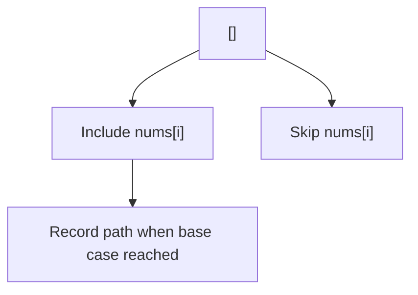

# 10. Subsets & Backtracking

## 1. Trigger Signals (When to Use)
* Problem asks for **all subsets**, **all combinations**, **all permutations**, or **all valid ways** (N-Queens, Word Search).
* Input size is small ($n \le 20$ for subsets, $n \le 10$ for permutations).

---

## 2. Mental Model



---

## 3. Reusable Python Template

```python
def backtrack_subsets(nums: list[int]) -> list[list[int]]:
    res: list[list[int]] = []
    path: list[int] = []

    def dfs(start: int) -> None:
        res.append(path[:])  # Copy current path
        for i in range(start, len(nums)):
            path.append(nums[i])
            dfs(i + 1)
            path.pop()

    dfs(0)
    return res
```

---

## 4. Must-Know Classic Problems

### Problem A: Subsets II (With Duplicates)
Sort first, then skip `nums[i] == nums[i - 1]` when `i > start`.
* **Time:** $O(n \cdot 2^n)$ | **Space:** $O(n)$

```python
def subsets_with_dup(nums: list[int]) -> list[list[int]]:
    nums.sort()
    res: list[list[int]] = []
    path: list[int] = []

    def dfs(start: int) -> None:
        res.append(path[:])
        for i in range(start, len(nums)):
            if i > start and nums[i] == nums[i - 1]:
                continue
            path.append(nums[i])
            dfs(i + 1)
            path.pop()

    dfs(0)
    return res
```

### Problem B: Permutations
* **Time:** $O(n \cdot n!)$ | **Space:** $O(n)$

```python
def permute(nums: list[int]) -> list[list[int]]:
    res: list[list[int]] = []
    used = [False] * len(nums)
    path: list[int] = []

    def dfs() -> None:
        if len(path) == len(nums):
            res.append(path[:])
            return
        for i, val in enumerate(nums):
            if used[i]:
                continue
            used[i] = True
            path.append(val)
            dfs()
            path.pop()
            used[i] = False

    dfs()
    return res
```

---

## 5. Edge Cases & Common Traps
* **Forgetting `path[:]`:** Appending `path` directly stores a reference to the mutated list—resulting in `[[]]` at the end! Always append `path[:]` or `list(path)`.
* **Subsets vs. Permutations:** Subsets/Combinations use `start` index (`dfs(i + 1)` or `dfs(i)` if reuse allowed); Permutations loop from `0` with a `used` array.

---

## 6. Rapid Follow-Up Q&As
- **Q: How do you generate combinations where elements can be reused unlimited times (Combination Sum)?**  
  **A:** Recurse with `dfs(i)` instead of `dfs(i + 1)` and prune when `remaining < 0`.
