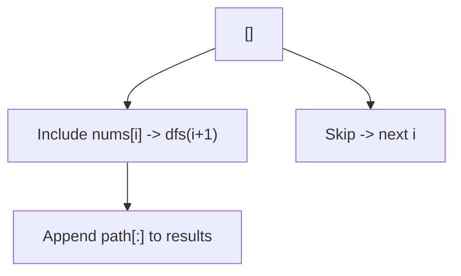

# 10. Subsets & Backtracking ⭐

## 1. Trigger Signals & Brute Force -> Optimal
* **Triggers:** Problem asks for **all subsets**, **all combinations**, **all permutations**, or **all valid configurations** (N-Queens, Word Search), typically with small $n \le 20$.
* **Decision Tree:** At each step, choose → recurse → undo choice (`path.pop()`).

---

## 2. Mental Model & Dry-Run Trace



---

## 3. Reusable Python Template

```python
def subsets(nums: list[int]) -> list[list[int]]:
    """Return all 2^n subsets of distinct integers `nums`."""
    res: list[list[int]] = []
    path: list[int] = []

    def dfs(start: int) -> None:
        res.append(path[:])  # Copy snapshot; `path` is mutated in-place
        for i in range(start, len(nums)):
            path.append(nums[i])
            dfs(i + 1)
            path.pop()

    dfs(0)
    return res

# Example: subsets([1, 2]) -> [[], [1], [1, 2], [2]]
```

---

## 4. Must-Know Classic Problems

### Problem A: Subsets II (Input Contains Duplicates)
* **Time:** $O(n \cdot 2^n)$ | **Space:** $O(n)$

```python
def subsets_with_dup(nums: list[int]) -> list[list[int]]:
    """Return all unique subsets when `nums` may contain duplicates."""
    nums.sort()  # Group duplicates adjacent
    res: list[list[int]] = []
    path: list[int] = []

    def dfs(start: int) -> None:
        res.append(path[:])
        for i in range(start, len(nums)):
            if i > start and nums[i] == nums[i - 1]:
                continue  # Skip duplicate at the same tree depth
            path.append(nums[i])
            dfs(i + 1)
            path.pop()

    dfs(0)
    return res

# Example: subsets_with_dup([1, 2, 2]) -> [[], [1], [1, 2], [1, 2, 2], [2], [2, 2]]
```

### Problem B: Permutations
* **Time:** $O(n \cdot n!)$ | **Space:** $O(n)$

```python
def permute(nums: list[int]) -> list[list[int]]:
    """Return all n! permutations of distinct integers `nums`."""
    res: list[list[int]] = []
    used = [False] * len(nums)
    path: list[int] = []

    def dfs() -> None:
        if len(path) == len(nums):
            res.append(path[:])
            return
        for i, val in enumerate(nums):
            if used[i]:
                continue
            used[i] = True
            path.append(val)
            dfs()
            path.pop()
            used[i] = False

    dfs()
    return res

# Example: permute([1, 2]) -> [[1, 2], [2, 1]]
```

---

## 5. Edge Cases & Pattern vs. Pattern
* **Forgetting `path[:]`:** `res.append(path)` stores references to the same list, producing `[[]]` at the end.

| Pattern | When to Choose |
| :--- | :--- |
| **Backtracking** | Must **enumerate all** valid combinations/subsets/permutations. |
| **[Dynamic Programming](17-dynamic-programming.md)** | Only need **count** or **min/max** (not all paths). |

---

## 6. Rapid Follow-Up Q&As
* **Q: How do you adapt this for Combination Sum (unlimited reuse of elements)?**  
  **A:** Sort `nums`, recurse with `dfs(i)` instead of `dfs(i + 1)`, and prune (`break`) when `nums[i] > remaining`.
