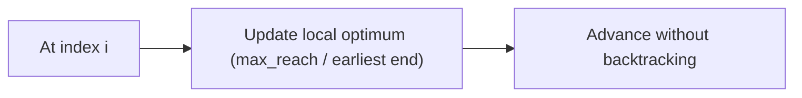

# 11. Greedy Techniques

## 1. Trigger Signals & Brute Force -> Optimal
* **Triggers:** Optimization (min jumps, max non-overlapping intervals, circular tour) where **one local best choice** never invalidates the global optimum.
* **Brute Force → Optimal:** Backtracking or $O(n^2)$ DP checks all choices; Greedy commits to the single best local step in **$O(n)$ or $O(n \log n)$**.

---

## 2. Mental Model & Dry-Run Trace



---

## 3. Must-Know Classic Problems

### Problem A: Jump Game (Can Reach Last Index?)
* **Time:** $O(n)$ | **Space:** $O(1)$

```python
def can_jump(nums: list[int]) -> bool:
    """Return True if you can reach the last index starting from index 0."""
    max_reach = 0
    for i, jump in enumerate(nums):
        if i > max_reach:
            return False  # Index `i` is unreachable from any prior index
        max_reach = max(max_reach, i + jump)
    return True

# Example: can_jump([2, 3, 1, 1, 4]) -> True; can_jump([3, 2, 1, 0, 4]) -> False
```

### Problem B: Jump Game II (Minimum Jumps)
* **Time:** $O(n)$ | **Space:** $O(1)$

```python
def min_jumps(nums: list[int]) -> int:
    """Return minimum jumps to reach the last index (greedy BFS window)."""
    jumps = cur_end = farthest = 0
    for i in range(len(nums) - 1):
        farthest = max(farthest, i + nums[i])
        if i == cur_end:  # Finished current jump range; commit next jump
            jumps += 1
            cur_end = farthest
    return jumps

# Example: min_jumps([2, 3, 1, 1, 4]) -> 2
```

### Problem C: Gas Station (Circular Tour)
* **Time:** $O(n)$ | **Space:** $O(1)$

```python
def can_complete_circuit(gas: list[int], cost: list[int]) -> int:
    """Return starting station index for a full loop, or -1 if impossible."""
    if sum(gas) < sum(cost):
        return -1
    tank = start = 0
    for i, (g, c) in enumerate(zip(gas, cost)):
        tank += g - c
        if tank < 0:  # Cannot start anywhere in [start..i]; reset to i + 1
            tank = 0
            start = i + 1
    return start

# Example: can_complete_circuit([1,2,3,4,5], [3,4,5,1,2]) -> 3
```

---

## 4. Edge Cases & Pattern vs. Pattern
* **Counterexample check:** Always test a small counterexample before assuming Greedy works (e.g., Coin Change `[1, 3, 4]`, target `6` fails Greedy).

| Pattern | When to Choose |
| :--- | :--- |
| **Greedy** | Local choice is provably optimal without revisiting earlier choices. |
| **[Dynamic Programming](17-dynamic-programming.md)** | Local choice can trap you in a suboptimal path (overlapping subproblems). |

---

## 5. Rapid Follow-Up Q&As
* **Q: For max non-overlapping intervals, do you sort by start or end time?**  
  **A:** Sort by **earliest end time**—it leaves the maximum remaining timeline for subsequent intervals.
