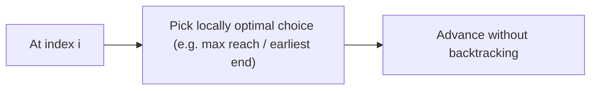

# 11. Greedy Techniques

## 1. Trigger Signals (When to Use)
* Problem asks for **minimum/maximum** count (jumps, coins, intervals) where a **local best choice** never hurts future options.
* Often paired with **sorting** (by end time, ratio, or deadline).

---

## 2. Mental Model



---

## 3. Must-Know Classic Problems

### Problem A: Jump Game (Can Reach Last Index?)
Track the farthest reachable index `max_reach`.
* **Time:** $O(n)$ | **Space:** $O(1)$

```python
def can_jump(nums: list[int]) -> bool:
    max_reach = 0
    for i, jump in enumerate(nums):
        if i > max_reach:
            return False
        max_reach = max(max_reach, i + jump)
    return True
```

### Problem B: Jump Game II (Minimum Jumps)
BFS-like greedy window: when `i == cur_end`, increment `jumps` and set `cur_end = farthest`.
* **Time:** $O(n)$ | **Space:** $O(1)$

```python
def min_jumps(nums: list[int]) -> int:
    jumps = cur_end = farthest = 0
    for i in range(len(nums) - 1):
        farthest = max(farthest, i + nums[i])
        if i == cur_end:
            jumps += 1
            cur_end = farthest
    return jumps
```

### Problem C: Gas Station (Circular Tour)
If `sum(gas) >= sum(cost)`, a unique solution exists; reset `start = i + 1` whenever `tank < 0`.
* **Time:** $O(n)$ | **Space:** $O(1)$

```python
def can_complete_circuit(gas: list[int], cost: list[int]) -> int:
    if sum(gas) < sum(cost):
        return -1
    tank = start = 0
    for i, (g, c) in enumerate(zip(gas, cost)):
        tank += g - c
        if tank < 0:
            tank = 0
            start = i + 1
    return start
```

---

## 4. Edge Cases & Common Traps
* **Greedy vs. Dynamic Programming:** Greedy fails on problems like general Coin Change (e.g., coins `[1, 3, 4]`, target `6` → Greedy picks `4+1+1 = 3` coins, DP picks `3+3 = 2` coins). Always test a counterexample before committing to Greedy!

---

## 5. Rapid Follow-Up Q&As
- **Q: For interval scheduling (max non-overlapping intervals), do you sort by start time or end time?**  
  **A:** Sort by **earliest end time**—it leaves the maximum remaining room for future intervals.
