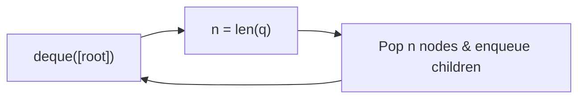

# 13. Tree Breadth-First Search (BFS) ⭐

## 1. Trigger Signals & Brute Force -> Optimal
* **Triggers:** **Level-order traversal**, **zigzag order**, **right-side view**, or **minimum depth** of a tree.
* **Key Technique:** Snapshot `len(q)` at the start of each level using `collections.deque` (`popleft()` is $O(1)$).

---

## 2. Mental Model & Dry-Run Trace



---

## 3. Reusable Python Template

```python
from collections import deque


class TreeNode:
    def __init__(self, val: int = 0, left: "TreeNode | None" = None, right: "TreeNode | None" = None) -> None:
        self.val = val
        self.left = left
        self.right = right


def level_order(root: TreeNode | None) -> list[list[int]]:
    """Return node values grouped by tree level from top to bottom."""
    if not root:
        return []
    res: list[list[int]] = []
    q = deque([root])

    while q:
        level: list[int] = []
        for _ in range(len(q)):  # Process exactly the nodes belonging to this level
            node = q.popleft()
            level.append(node.val)
            if node.left:
                q.append(node.left)
            if node.right:
                q.append(node.right)
        res.append(level)
    return res
```

---

## 4. Must-Know Classic Problems

### Problem A: Binary Tree Right Side View
* **Time:** $O(n)$ | **Space:** $O(W)$ (max width)

```python
def right_side_view(root: TreeNode | None) -> list[int]:
    """Return the rightmost node value at each level."""
    if not root:
        return []
    res: list[int] = []
    q = deque([root])
    while q:
        n = len(q)
        for i in range(n):
            node = q.popleft()
            if i == n - 1:  # Last node popped in this level
                res.append(node.val)
            if node.left:
                q.append(node.left)
            if node.right:
                q.append(node.right)
    return res
```

### Problem B: Minimum Depth of Binary Tree
* **Time:** $O(n)$ | **Space:** $O(W)$

```python
def min_depth(root: TreeNode | None) -> int:
    """Return depth of the nearest leaf; BFS exits as soon as the first leaf is found."""
    if not root:
        return 0
    q = deque([(root, 1)])
    while q:
        node, depth = q.popleft()
        if not node.left and not node.right:
            return depth
        if node.left:
            q.append((node.left, depth + 1))
        if node.right:
            q.append((node.right, depth + 1))
    return 0
```

---

## 5. Edge Cases & Pattern vs. Pattern
* **Never use `list.pop(0)`:** `list.pop(0)` is $O(n)$, degrading BFS to $O(n^2)$; always use `collections.deque.popleft()`.

| Pattern | When to Choose |
| :--- | :--- |
| **Tree BFS** | Level-by-level processing or **minimum depth / shortest unweighted path**. |
| **[Tree DFS](14-tree-dfs.md)** | Root-to-leaf paths, diameter, LCA, or lower memory on balanced trees ($O(H)$). |

---

## 6. Rapid Follow-Up Q&As
* **Q: What is the worst-case space complexity of Tree BFS?**  
  **A:** $O(W)$ where $W$ is the tree's maximum width—up to $n / 2 = O(n)$ for a complete binary tree.
