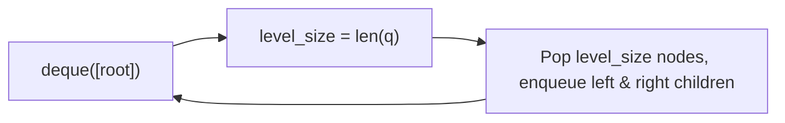

# 13. Tree Breadth-First Search (BFS)

## 1. Trigger Signals (When to Use)
* Problem asks for **level-order traversal**, **zigzag level order**, **right-side view**, or **minimum depth** of a tree.
* Shortest path in an **unweighted** tree/graph.

---

## 2. Mental Model



---

## 3. Reusable Python Template

```python
from collections import deque


class TreeNode:
    def __init__(self, val: int = 0, left: "TreeNode | None" = None, right: "TreeNode | None" = None) -> None:
        self.val = val
        self.left = left
        self.right = right


def level_order(root: TreeNode | None) -> list[list[int]]:
    if not root:
        return []
    res: list[list[int]] = []
    q = deque([root])

    while q:
        level: list[int] = []
        for _ in range(len(q)):  # Snapshot current level size
            node = q.popleft()
            level.append(node.val)
            if node.left:
                q.append(node.left)
            if node.right:
                q.append(node.right)
        res.append(level)
    return res
```

---

## 4. Must-Know Classic Problems

### Problem A: Binary Tree Right Side View
Record the **last node** (`i == level_size - 1`) of each level.
* **Time:** $O(n)$ | **Space:** $O(w)$ (max width)

```python
def right_side_view(root: TreeNode | None) -> list[int]:
    if not root:
        return []
    res: list[int] = []
    q = deque([root])
    while q:
        n = len(q)
        for i in range(n):
            node = q.popleft()
            if i == n - 1:
                res.append(node.val)
            if node.left:
                q.append(node.left)
            if node.right:
                q.append(node.right)
    return res
```

### Problem B: Minimum Depth of Binary Tree
Return immediately at the **first leaf** (`not node.left and not node.right`).
* **Time:** $O(n)$ | **Space:** $O(w)$

```python
def min_depth(root: TreeNode | None) -> int:
    if not root:
        return 0
    q = deque([(root, 1)])
    while q:
        node, depth = q.popleft()
        if not node.left and not node.right:
            return depth
        if node.left:
            q.append((node.left, depth + 1))
        if node.right:
            q.append((node.right, depth + 1))
    return 0
```

---

## 5. Edge Cases & Common Traps
* **Use `collections.deque` (`popleft()` is $O(1)$):** Never use `list.pop(0)`, which is $O(n)$ per pop and degrades BFS to $O(n^2)$.
* **Empty root:** Always check `if not root: return []` before pushing `root` into `deque`.

---

## 6. Rapid Follow-Up Q&As
- **Q: What is the space complexity of Tree BFS?**  
  **A:** $O(W)$, where $W$ is the maximum width of the tree (up to $n/2 = O(n)$ for a full binary tree).
