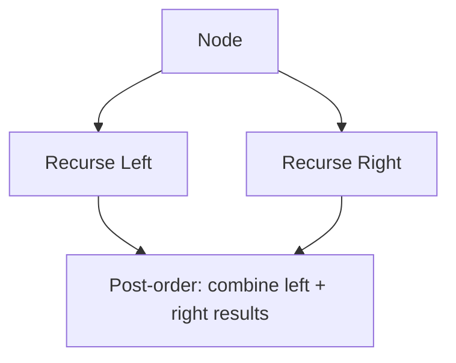

# 14. Tree Depth-First Search (DFS)

## 1. Trigger Signals (When to Use)
* Problem involves **root-to-leaf paths**, **tree height/diameter**, **Lowest Common Ancestor (LCA)**, or **validating BSTs**.
* **Pre-order** (top-down state), **In-order** (sorted BST order), **Post-order** (bottom-up aggregation from children).

---

## 2. Mental Model



---

## 3. Must-Know Classic Problems

### Problem A: Path Sum (Top-Down Pre-Order)
Check if any root-to-leaf path sums to `target_sum`.
* **Time:** $O(n)$ | **Space:** $O(h)$

```python
class TreeNode:
    def __init__(self, val: int = 0, left: "TreeNode | None" = None, right: "TreeNode | None" = None) -> None:
        self.val = val
        self.left = left
        self.right = right


def has_path_sum(root: TreeNode | None, target_sum: int) -> bool:
    if not root:
        return False
    if not root.left and not root.right:
        return root.val == target_sum
    rem = target_sum - root.val
    return has_path_sum(root.left, rem) or has_path_sum(root.right, rem)
```

### Problem B: Diameter of Binary Tree (Bottom-Up Post-Order)
Return height to parent while updating global `best = max(best, left_h + right_h)`.
* **Time:** $O(n)$ | **Space:** $O(h)$

```python
def diameter_of_binary_tree(root: TreeNode | None) -> int:
    best = 0

    def height(node: TreeNode | None) -> int:
        nonlocal best
        if not node:
            return 0
        lh, rh = height(node.left), height(node.right)
        best = max(best, lh + rh)
        return 1 + max(lh, rh)

    height(root)
    return best
```

### Problem C: Lowest Common Ancestor (LCA)
* **Time:** $O(n)$ | **Space:** $O(h)$

```python
def lowest_common_ancestor(root: TreeNode | None, p: TreeNode, q: TreeNode) -> TreeNode | None:
    if not root or root is p or root is q:
        return root
    left = lowest_common_ancestor(root.left, p, q)
    right = lowest_common_ancestor(root.right, p, q)
    if left and right:
        return root
    return left or right
```

---

## 4. Edge Cases & Common Traps
* **Leaf check:** A leaf requires **both** `not node.left and not node.right` (a node with 1 child is NOT a leaf).
* **Recursion depth:** Python's default limit is `1000`; for skewed trees in production, use an explicit stack.

---

## 5. Rapid Follow-Up Q&As
- **Q: Tree DFS vs. Tree BFS space complexity?**  
  **A:** DFS uses $O(H)$ stack space (height: $O(\log n)$ balanced, $O(n)$ skewed); BFS uses $O(W)$ queue space (width: $O(n)$ for a balanced full tree).
