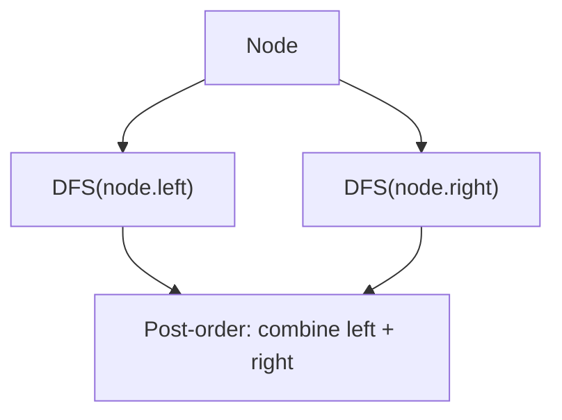

# 14. Tree Depth-First Search (DFS) ⭐

## 1. Trigger Signals & Brute Force -> Optimal
* **Triggers:** **Root-to-leaf paths**, **tree height/diameter**, **Lowest Common Ancestor (LCA)**, or **BST validation**.
* **Traversal Choice:** **Pre-order** (pass state down), **In-order** (sorted BST values), **Post-order** (aggregate child results up).

---

## 2. Mental Model



---

## 3. Must-Know Classic Problems

### Problem A: Path Sum (Top-Down Pre-Order)
* **Time:** $O(n)$ | **Space:** $O(H)$

```python
class TreeNode:
    def __init__(self, val: int = 0, left: "TreeNode | None" = None, right: "TreeNode | None" = None) -> None:
        self.val = val
        self.left = left
        self.right = right


def has_path_sum(root: TreeNode | None, target_sum: int) -> bool:
    """Return True if any root-to-leaf path sums to `target_sum`."""
    if not root:
        return False
    if not root.left and not root.right:  # Must be a true leaf
        return root.val == target_sum
    rem = target_sum - root.val
    return has_path_sum(root.left, rem) or has_path_sum(root.right, rem)
```

### Problem B: Diameter of Binary Tree (Bottom-Up Post-Order)
* **Time:** $O(n)$ | **Space:** $O(H)$

```python
def diameter_of_binary_tree(root: TreeNode | None) -> int:
    """Return longest path (in edges) between any two nodes in the tree."""
    best = 0

    def height(node: TreeNode | None) -> int:
        nonlocal best
        if not node:
            return 0
        lh, rh = height(node.left), height(node.right)
        best = max(best, lh + rh)  # Path passing through `node`
        return 1 + max(lh, rh)     # Height returned to parent

    height(root)
    return best
```

### Problem C: Lowest Common Ancestor (LCA)
* **Time:** $O(n)$ | **Space:** $O(H)$

```python
def lowest_common_ancestor(root: TreeNode | None, p: TreeNode, q: TreeNode) -> TreeNode | None:
    """Return the lowest node in `root` that has both `p` and `q` as descendants."""
    if not root or root is p or root is q:
        return root
    left = lowest_common_ancestor(root.left, p, q)
    right = lowest_common_ancestor(root.right, p, q)
    if left and right:
        return root  # p and q split across left and right subtrees
    return left or right
```

---

## 4. Edge Cases & Pattern vs. Pattern
* **Leaf check:** Check `not node.left and not node.right` (a node with 1 child is NOT a leaf).

| Pattern | When to Choose |
| :--- | :--- |
| **Tree DFS** | Paths, subtree aggregations, LCA, $O(H)$ space on balanced trees. |
| **[Tree BFS](13-tree-bfs.md)** | Level-by-level queries or nearest leaf. |

---

## 5. Rapid Follow-Up Q&As
* **Q: What is the space complexity of DFS on a skewed vs. balanced tree?**  
  **A:** $O(H)$ call-stack space: $O(\log n)$ balanced, $O(n)$ skewed (can hit Python's 1000 recursion limit).
