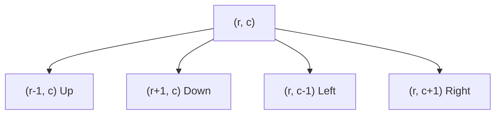

# 15. Matrix Traversal

## 1. Trigger Signals (When to Use)
* Input is a **2D grid (`list[list[int]]` or `list[list[str]]`)**.
* Problem asks for **number of islands**, **flood fill**, **rotting oranges** (multi-source BFS), or **shortest path in a grid**.

---

## 2. Mental Model



---

## 3. Reusable Python Template (4-Directional Grid DFS)

```python
DIRS = ((1, 0), (-1, 0), (0, 1), (0, -1))


def grid_dfs(grid: list[list[str]], r: int, c: int) -> None:
    rows, cols = len(grid), len(grid[0])
    if not (0 <= r < rows and 0 <= c < cols) or grid[r][c] != "1":
        return
    grid[r][c] = "0"  # Mark visited in-place (or use a visited set)
    for dr, dc in DIRS:
        grid_dfs(grid, r + dr, c + dc)
```

---

## 4. Must-Know Classic Problems

### Problem A: Number of Islands (DFS)
* **Time:** $O(R \cdot C)$ | **Space:** $O(R \cdot C)$ worst-case recursion

```python
def num_islands(grid: list[list[str]]) -> int:
    if not grid:
        return 0
    rows, cols = len(grid), len(grid[0])
    islands = 0

    def dfs(r: int, c: int) -> None:
        if not (0 <= r < rows and 0 <= c < cols) or grid[r][c] != "1":
            return
        grid[r][c] = "0"
        for dr, dc in ((1, 0), (-1, 0), (0, 1), (0, -1)):
            dfs(r + dr, c + dc)

    for r in range(rows):
        for c in range(cols):
            if grid[r][c] == "1":
                islands += 1
                dfs(r, c)
    return islands
```

### Problem B: Rotting Oranges (Multi-Source BFS)
Enqueue **all** initially rotten oranges at `t = 0` and spread level-by-level.
* **Time:** $O(R \cdot C)$ | **Space:** $O(R \cdot C)$

```python
from collections import deque


def oranges_rotting(grid: list[list[int]]) -> int:
    rows, cols = len(grid), len(grid[0])
    q: deque[tuple[int, int]] = deque()
    fresh = 0

    for r in range(rows):
        for c in range(cols):
            if grid[r][c] == 2:
                q.append((r, c))
            elif grid[r][c] == 1:
                fresh += 1

    minutes = 0
    while q and fresh > 0:
        minutes += 1
        for _ in range(len(q)):
            r, c = q.popleft()
            for dr, dc in ((1, 0), (-1, 0), (0, 1), (0, -1)):
                nr, nc = r + dr, c + dc
                if 0 <= nr < rows and 0 <= nc < cols and grid[nr][nc] == 1:
                    grid[nr][nc] = 2
                    fresh -= 1
                    q.append((nr, nc))
    return minutes if fresh == 0 else -1
```

---

## 5. Edge Cases & Common Traps
* **Mark visited *when enqueuing* in BFS**, not when popping—otherwise the same cell gets pushed multiple times, causing TLE/MLE.
* **Check bounds before indexing:** Always verify `0 <= nr < rows and 0 <= nc < cols`.

---

## 6. Rapid Follow-Up Q&As
- **Q: What if mutating the input `grid` is not allowed?**  
  **A:** Maintain a `visited: set[tuple[int, int]]` instead of overwriting `grid[r][c]`.
