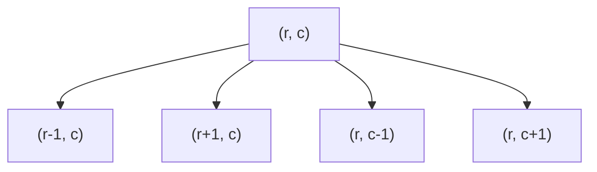

# 15. Matrix Traversal ⭐

## 1. Trigger Signals & Brute Force -> Optimal
* **Triggers:** **2D grid** (`list[list[str]]` / `list[list[int]]`) asking for **connected components (islands)**, **flood fill**, or **minimum steps / multi-source spread**.
* **DFS vs. BFS:** Use **DFS** for connected components/flood fill; use **BFS** for shortest path / minimum minutes.

---

## 2. Mental Model



---

## 3. Reusable Python Template (4-Directional Grid DFS)

```python
DIRS = ((1, 0), (-1, 0), (0, 1), (0, -1))


def flood_dfs(grid: list[list[str]], r: int, c: int) -> None:
    """Mark all connected '1' cells starting at (r, c) as visited ('0')."""
    rows, cols = len(grid), len(grid[0])
    if not (0 <= r < rows and 0 <= c < cols) or grid[r][c] != "1":
        return
    grid[r][c] = "0"  # Mark visited immediately before recursing
    for dr, dc in DIRS:
        flood_dfs(grid, r + dr, c + dc)
```

---

## 4. Must-Know Classic Problems

### Problem A: Number of Islands (DFS)
* **Time:** $O(R \cdot C)$ | **Space:** $O(R \cdot C)$

```python
def num_islands(grid: list[list[str]]) -> int:
    """Count distinct islands of '1's in a 2D binary grid."""
    if not grid:
        return 0
    rows, cols = len(grid), len(grid[0])
    islands = 0

    def dfs(r: int, c: int) -> None:
        if not (0 <= r < rows and 0 <= c < cols) or grid[r][c] != "1":
            return
        grid[r][c] = "0"
        for dr, dc in ((1, 0), (-1, 0), (0, 1), (0, -1)):
            dfs(r + dr, c + dc)

    for r in range(rows):
        for c in range(cols):
            if grid[r][c] == "1":
                islands += 1
                dfs(r, c)
    return islands
```

### Problem B: Rotting Oranges (Multi-Source BFS)
* **Time:** $O(R \cdot C)$ | **Space:** $O(R \cdot C)$

```python
from collections import deque


def oranges_rotting(grid: list[list[int]]) -> int:
    """Return minimum minutes until no fresh orange (1) remains, or -1 if impossible."""
    rows, cols = len(grid), len(grid[0])
    q: deque[tuple[int, int]] = deque()
    fresh = 0

    for r in range(rows):
        for c in range(cols):
            if grid[r][c] == 2:
                q.append((r, c))  # Seed BFS with all rotten sources at t = 0
            elif grid[r][c] == 1:
                fresh += 1

    minutes = 0
    while q and fresh > 0:
        minutes += 1
        for _ in range(len(q)):
            r, c = q.popleft()
            for dr, dc in ((1, 0), (-1, 0), (0, 1), (0, -1)):
                nr, nc = r + dr, c + dc
                if 0 <= nr < rows and 0 <= nc < cols and grid[nr][nc] == 1:
                    grid[nr][nc] = 2  # Mark visited WHEN enqueuing
                    fresh -= 1
                    q.append((nr, nc))
    return minutes if fresh == 0 else -1

# Example: oranges_rotting([[2,1,1],[1,1,0],[0,1,1]]) -> 4
```

---

## 5. Edge Cases & Pattern vs. Pattern
* **Mark visited on enqueue (BFS):** Marking on pop causes duplicate queue entries and TLE/MLE.

| Pattern | When to Choose |
| :--- | :--- |
| **Grid DFS** | Flood fill, island counting, existence checks. |
| **Grid BFS** | Shortest unweighted grid path or multi-source spread. |

---

## 6. Rapid Follow-Up Q&As
* **Q: What if mutating the input `grid` is forbidden?**  
  **A:** Track visited coordinates in `visited: set[tuple[int, int]]` instead of overwriting `grid[r][c]`.
