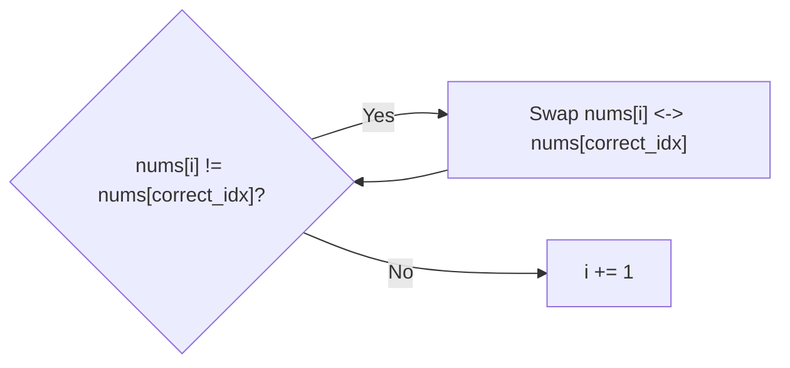

# 16. Cyclic Sort

## 1. Trigger Signals (When to Use)
* Array contains integers in a **continuous range `1..n` or `0..n`**.
* Problem asks to find **missing**, **duplicate**, or **first missing positive** number in **$O(n)$ time and $O(1)$ space**.

---

## 2. Mental Model


For `1..n`, value `v` belongs at `correct_idx = v - 1`.

---

## 3. Reusable Python Template

```python
def cyclic_sort(nums: list[int]) -> list[int]:
    i = 0
    while i < len(nums):
        correct = nums[i] - 1
        if nums[i] != nums[correct]:
            nums[i], nums[correct] = nums[correct], nums[i]
        else:
            i += 1
    return nums
```

---

## 4. Must-Know Classic Problems

### Problem A: Find All Duplicates in an Array (`1..n`)
* **Time:** $O(n)$ | **Space:** $O(1)$ (excluding output)

```python
def find_duplicates(nums: list[int]) -> list[int]:
    i = 0
    while i < len(nums):
        correct = nums[i] - 1
        if nums[i] != nums[correct]:
            nums[i], nums[correct] = nums[correct], nums[i]
        else:
            i += 1
    return [val for idx, val in enumerate(nums) if val != idx + 1]
```

### Problem B: First Missing Positive (Unsorted, Any Integers)
Ignore values `<= 0` or `> n`; place each `1 <= nums[i] <= n` at `nums[i] - 1`.
* **Time:** $O(n)$ | **Space:** $O(1)$

```python
def first_missing_positive(nums: list[int]) -> int:
    n = len(nums)
    i = 0
    while i < n:
        correct = nums[i] - 1
        if 1 <= nums[i] <= n and nums[i] != nums[correct]:
            nums[i], nums[correct] = nums[correct], nums[i]
        else:
            i += 1

    for i, val in enumerate(nums):
        if val != i + 1:
            return i + 1
    return n + 1
```

---

## 5. Edge Cases & Common Traps
* **Infinite swap loop:** Always check `nums[i] != nums[correct]` (NOT `nums[i] != i + 1`) when duplicates exist—otherwise two identical numbers will swap forever!
* **Python tuple swap gotcha:** Write `nums[i], nums[correct] = nums[correct], nums[i]` carefully—never `nums[nums[i] - 1], nums[i] = ...` in reversed order because Python evaluates LHS targets left-to-right!

---

## 6. Rapid Follow-Up Q&As
- **Q: Why is Cyclic Sort $O(n)$ even though there is a `while` loop?**  
  **A:** Each swap places at least one number into its final position; at most $n$ swaps occur across the entire run, so total work is $O(n)$.
