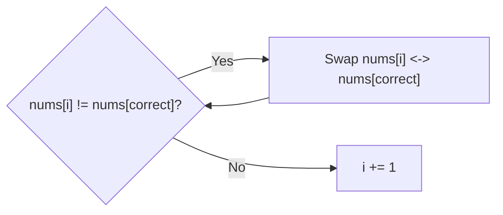

# 16. Cyclic Sort

## 1. Trigger Signals & Brute Force -> Optimal
* **Triggers:** Array contains integers in a **continuous range `1..n` or `0..n`**, asking for **missing**, **duplicate**, or **first missing positive** in **$O(n)$ time and $O(1)$ space**.
* **Brute Force → Optimal:** Sorting takes $O(n \log n)$ and a `set` takes $O(n)$ space. Swapping each value `v` directly to index `v - 1` achieves **$O(n)$ time and $O(1)$ space**.

---

## 2. Mental Model & Dry-Run Trace



**Dry-Run (`[3, 1, 2]`):**
1. `i=0 (3)`: `correct=2` → swap `3` and `2` → `[2, 1, 3]`
2. `i=0 (2)`: `correct=1` → swap `2` and `1` → `[1, 2, 3]`
3. `i=0 (1)`: `nums[0] == nums[0]` → `i += 1` → already sorted!

---

## 3. Reusable Python Template

```python
def cyclic_sort(nums: list[int]) -> list[int]:
    """Sort an array of `1..n` integers in-place in O(n) time and O(1) space."""
    i = 0
    while i < len(nums):
        correct = nums[i] - 1
        if nums[i] != nums[correct]:  # Avoid infinite loop on duplicates
            nums[i], nums[correct] = nums[correct], nums[i]
        else:
            i += 1
    return nums
```

---

## 4. Must-Know Classic Problems

### Problem A: Find All Duplicates in an Array (`1..n`)
* **Time:** $O(n)$ | **Space:** $O(1)$ (excluding output)

```python
def find_duplicates(nums: list[int]) -> list[int]:
    """Return all elements appearing twice in a `1..n` array."""
    i = 0
    while i < len(nums):
        correct = nums[i] - 1
        if nums[i] != nums[correct]:
            nums[i], nums[correct] = nums[correct], nums[i]
        else:
            i += 1
    return [val for idx, val in enumerate(nums) if val != idx + 1]

# Example: find_duplicates([4, 3, 2, 7, 8, 2, 3, 1]) -> [3, 2]
```

### Problem B: First Missing Positive (Unsorted, Any Integers)
* **Time:** $O(n)$ | **Space:** $O(1)$

```python
def first_missing_positive(nums: list[int]) -> int:
    """Return the smallest missing positive integer in O(n) time and O(1) space."""
    n = len(nums)
    i = 0
    while i < n:
        correct = nums[i] - 1
        if 1 <= nums[i] <= n and nums[i] != nums[correct]:
            nums[i], nums[correct] = nums[correct], nums[i]
        else:
            i += 1

    for i, val in enumerate(nums):
        if val != i + 1:
            return i + 1
    return n + 1

# Example: first_missing_positive([3, 4, -1, 1]) -> 2
```

---

## 5. Edge Cases & Pattern vs. Pattern
* **Python tuple swap trap:** Compute `correct = nums[i] - 1` first; never write `nums[i], nums[nums[i]-1] = ...` in wrong order.

| Pattern | When to Choose |
| :--- | :--- |
| **Cyclic Sort** | Values lie in `1..n` / `0..n` and in-place mutation is allowed. |
| **[Bitwise XOR](12-bitwise-xor.md)** | Read-only array with exactly 1 missing or 1 unique value. |

---

## 6. Rapid Follow-Up Q&As
* **Q: Why is Cyclic Sort $O(n)$ despite the `while` loop?**  
  **A:** Every swap puts at least one number in its permanent home; at most $n$ swaps happen total.
