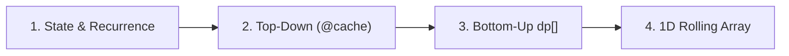

# 17. Dynamic Programming (DP) ⭐

## 1. Trigger Signals & Brute Force -> Optimal
* **Triggers:** **Min/max value**, **number of ways**, or **boolean feasibility** (`can_partition`) where choices overlap (**overlapping subproblems** + **optimal substructure**).
* **Brute Force → Optimal:** Naive recursion recomputes the same sub-states exponentially ($O(2^n)$). Caching (`@functools.cache`) or bottom-up `dp[]` reduces time to polynomial (**$O(n \cdot W)$** or **$O(n^2)$**).

---

## 2. Mental Model & Dry-Run Trace



**Dry-Run (0/1 Knapsack `nums = [1, 5, 11, 5]`, `target = 11`):**
* Initialize `dp = [True, False, ..., False]` (size 12).
* Process `num = 1` backwards (`11..1`): `dp[1] = True`.
* Process `num = 5` backwards (`11..5`): `dp[6] = True, dp[5] = True`.
* Process `num = 11`: `dp[11] = dp[11] or dp[0] = True` → **Return `True`!**

---

## 3. Must-Know Classic Problems

### Problem A: Partition Equal Subset Sum (0/1 Knapsack — Backwards Loop)
* **Time:** $O(n \cdot \text{target})$ | **Space:** $O(\text{target})$

```python
def can_partition(nums: list[int]) -> bool:
    """Return True if `nums` can be split into two subsets with equal sum."""
    total = sum(nums)
    if total % 2:
        return False
    target = total // 2
    dp = [False] * (target + 1)
    dp[0] = True

    for num in nums:
        # Loop backwards so each `num` is used at most ONCE (0/1 Knapsack)
        for s in range(target, num - 1, -1):
            dp[s] = dp[s] or dp[s - num]
    return dp[target]

# Example: can_partition([1, 5, 11, 5]) -> True ([1, 5, 5] and [11])
```

### Problem B: Coin Change (Unbounded Knapsack — Forward Loop)
* **Time:** $O(n \cdot \text{amount})$ | **Space:** $O(\text{amount})$

```python
def coin_change(coins: list[int], amount: int) -> int:
    """Return fewest coins needed to make `amount`, or -1 if impossible."""
    dp = [float("inf")] * (amount + 1)
    dp[0] = 0

    for c in coins:
        # Loop forwards so coin `c` can be reused unlimited times
        for a in range(c, amount + 1):
            dp[a] = min(dp[a], dp[a - c] + 1)
    return -1 if dp[amount] == float("inf") else int(dp[amount])

# Example: coin_change([1, 2, 5], 11) -> 3 (5 + 5 + 1)
```

### Problem C: Longest Common Subsequence (2-String DP)
* **Time:** $O(m \cdot n)$ | **Space:** $O(m \cdot n)$

```python
def longest_common_subsequence(text1: str, text2: str) -> int:
    """Return length of the longest common subsequence between two strings."""
    m, n = len(text1), len(text2)
    dp = [[0] * (n + 1) for _ in range(m + 1)]
    for i in range(1, m + 1):
        for j in range(1, n + 1):
            if text1[i - 1] == text2[j - 1]:
                dp[i][j] = 1 + dp[i - 1][j - 1]
            else:
                dp[i][j] = max(dp[i - 1][j], dp[i][j - 1])
    return dp[m][n]

# Example: longest_common_subsequence("abcde", "ace") -> 3 ("ace")
```

---

## 4. Edge Cases & Pattern vs. Pattern
* **Loop direction bug:** 0/1 Knapsack **must** loop capacity backwards; Unbounded Knapsack **must** loop forwards.

| Pattern | When to Choose |
| :--- | :--- |
| **Dynamic Programming** | Need optimal count/value over overlapping subproblems. |
| **[Greedy](11-greedy-techniques.md)** | Local best choice never needs revisiting. |
| **[Backtracking](10-subsets-and-backtracking.md)** | Must **list all** valid solutions, not just count/optimize. |

---

## 5. Rapid Follow-Up Q&As
* **Q: Top-Down (`@functools.cache`) vs. Bottom-Up (`dp[]`)?**  
  **A:** Top-down is faster to write in interviews and only visits reachable states; bottom-up avoids recursion limits and allows $O(W)$ 1D space optimization.
