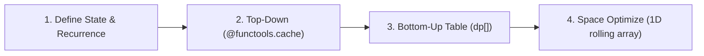

# 17. Dynamic Programming (DP)

## 1. Trigger Signals (When to Use)
* Problem asks for **min/max value**, **number of ways**, or **boolean feasibility** (`can_partition`).
* Choices at step `i` affect future steps (**overlapping subproblems** + **optimal substructure**).
* Families: **1D (House Robber, Coin Change)**, **0/1 Knapsack**, **Unbounded Knapsack**, **2-String (LCS, Edit Distance)**.

---

## 2. Mental Model



---

## 3. Must-Know Classic Problems

### Problem A: 0/1 Knapsack / Partition Equal Subset Sum (1D Backwards Loop)
Iterate capacity **backwards** (`range(target, num - 1, -1)`) so each item is used at most once.
* **Time:** $O(n \cdot \text{target})$ | **Space:** $O(\text{target})$

```python
def can_partition(nums: list[int]) -> bool:
    total = sum(nums)
    if total % 2:
        return False
    target = total // 2
    dp = [False] * (target + 1)
    dp[0] = True

    for num in nums:
        for s in range(target, num - 1, -1):
            dp[s] = dp[s] or dp[s - num]
    return dp[target]
```

### Problem B: Coin Change (Unbounded Knapsack — Forward Loop)
Iterate amount **forwards** so coins can be reused unlimited times.
* **Time:** $O(n \cdot \text{amount})$ | **Space:** $O(\text{amount})$

```python
def coin_change(coins: list[int], amount: int) -> int:
    dp = [float("inf")] * (amount + 1)
    dp[0] = 0
    for c in coins:
        for a in range(c, amount + 1):
            dp[a] = min(dp[a], dp[a - c] + 1)
    return -1 if dp[amount] == float("inf") else int(dp[amount])
```

### Problem C: Longest Common Subsequence (2-String DP)
* **Time:** $O(m \cdot n)$ | **Space:** $O(\min(m, n))$ (or $O(m \cdot n)$ 2D)

```python
def longest_common_subsequence(text1: str, text2: str) -> int:
    m, n = len(text1), len(text2)
    dp = [[0] * (n + 1) for _ in range(m + 1)]
    for i in range(1, m + 1):
        for j in range(1, n + 1):
            if text1[i - 1] == text2[j - 1]:
                dp[i][j] = 1 + dp[i - 1][j - 1]
            else:
                dp[i][j] = max(dp[i - 1][j], dp[i][j - 1])
    return dp[m][n]
```

---

## 4. Edge Cases & Common Traps
* **0/1 vs. Unbounded loop direction:** 0/1 Knapsack loops capacity **backwards**; Unbounded Knapsack loops **forwards**.
* **Top-down `@functools.cache`:** Great for interviews—just watch out for large recursion depth (`sys.setrecursionlimit` or convert to bottom-up).

---

## 5. Rapid Follow-Up Q&As
- **Q: How do you reconstruct the actual chosen items, not just the optimal value?**  
  **A:** Keep the 2D `dp` table and walk backwards from `(n, W)` checking whether `dp[i][w] != dp[i-1][w]`.
