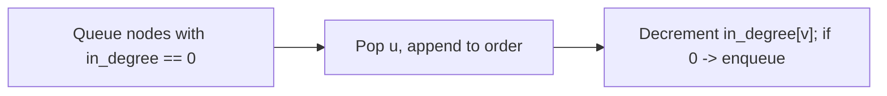

# 18. Topological Sort (Graph)

## 1. Trigger Signals & Brute Force -> Optimal
* **Triggers:** Tasks/courses have **prerequisites (`u -> v`)**, **build order**, **Alien Dictionary**, or **cycle detection in a directed graph**.
* **Kahn's Algorithm:** Repeatedly peel off nodes with `in_degree == 0` in **$O(V + E)$ time**.

---

## 2. Mental Model & Dry-Run Trace



**Dry-Run (`0 -> 1, 0 -> 2, 1 -> 3, 2 -> 3`):**
1. `in_degree = [0, 1, 1, 2]` → `q = [0]`
2. Pop `0` → `order=[0]`, `in_degree[1]=0, in_degree[2]=0` → `q = [1, 2]`
3. Pop `1`, `2` → `in_degree[3]=0` → Pop `3` → `order = [0, 1, 2, 3]`

---

## 3. Reusable Python Template

```python
from collections import defaultdict, deque


def topological_sort(num_nodes: int, edges: list[tuple[int, int]]) -> list[int]:
    """Return a topological ordering of a DAG, or [] if a cycle exists."""
    graph: dict[int, list[int]] = defaultdict(list)
    in_degree = [0] * num_nodes

    for u, v in edges:  # Directed edge: u must come before v
        graph[u].append(v)
        in_degree[v] += 1

    q = deque(i for i in range(num_nodes) if in_degree[i] == 0)
    order: list[int] = []

    while q:
        u = q.popleft()
        order.append(u)
        for v in graph[u]:
            in_degree[v] -= 1
            if in_degree[v] == 0:
                q.append(v)

    return order if len(order) == num_nodes else []  # Cycle if not all nodes visited
```

---

## 4. Must-Know Classic Problems

### Problem A: Course Schedule II
* **Time:** $O(V + E)$ | **Space:** $O(V + E)$

```python
def find_order(num_courses: int, prerequisites: list[list[int]]) -> list[int]:
    """Return a valid course order given [course, prereq] pairs, or [] if impossible."""
    return topological_sort(num_courses, [(pre, crs) for crs, pre in prerequisites])

# Example: find_order(4, [[1,0],[2,0],[3,1],[3,2]]) -> [0, 1, 2, 3]
```

---

## 5. Edge Cases & Pattern vs. Pattern
* **Edge direction:** `[course, prereq]` means `prereq -> course`.

| Pattern | When to Choose |
| :--- | :--- |
| **Topological Sort** | **Directed** dependencies (DAG) and directed cycle detection. |
| **[Union-Find](21-union-find.md)** | **Undirected** connectivity and undirected cycle detection. |

---

## 6. Rapid Follow-Up Q&As
* **Q: Kahn's BFS vs. DFS Topological Sort?**  
  **A:** Kahn's BFS is iterative (no recursion limit) and detects cycles directly via `len(order) < V`.
